# 04 美术与声音风格

更新日期：2026-10-12

> **状态（10-13 晚）**：风格、媒介滤镜、影像档案、空间 UI 部分仍然有效。凡涉及旧剧情的内容（罗伊德庄园、签收人、访客簿、事务所、电报、N1—N7 镜号、第 11 节“侦探没有脸”、第 12 节怪谈物证）已过时，以 [02-剧情设计](02-剧情设计.md) 为准：怪谈改为灵魂照片，侦探从不出现在画面与镜中，直到叠印与终局。

状态：时代、渗漏视觉、博尔赫斯信号来自剧情【已确定】；色彩、灯光、参考作品为【提案】。

## 1. 一句话风格

**1926 年雨夜的英式庄园，被拍成一部克制的黑色电影；随着调查推进，这座房子从材质开始一格一格地“露底”。**

关键词：雨夜、煤气灯与台灯的暖光、纸张与墨迹、黄铜与胡桃木、对称构图、慢推镜头；后期是白模、网格、均匀的键声。

## 2. 视觉的两极与过渡

| | 1926（L0） | 渗漏（L1—L4） |
| --- | --- | --- |
| 材质 | 胡桃木、黄铜、丝绒、纸张纤维、墨迹洇开 | 木纹过分均匀 → 材质褪成白模 → 地面出现网格 |
| 光 | 暖色点光源（台灯、壁炉、煤气灯），大面积暗部 | 光源方向消失（影子没有方向）→ 均匀冷白 |
| 声音 | 雨、电车铃、壁炉噼啪、钟摆、打字机 | 脚步声循环、回声延迟、键声变成均匀节拍、通信握手式短音 |
| 文字 | 打字稿、手写、报纸铅字 | 日志格式、ACK、“数据库”页眉 |

过渡必须**渐进且不解释**。每个节点只能出现对应等级的渗漏（见《02》第 4 节）。

## 3. 色彩与光【提案】

| 用途 | 建议 |
| --- | --- |
| 主色 | 深胡桃棕、墨绿、暗酒红；纸张米黄 |
| 光 | 暖琥珀色点光源；窗外冷蓝的街灯与雨 |
| 强调色 | 证据板的红线（全游戏唯一高饱和色），用于引导注意 |
| 渗漏色 | 无色温的白、网格的浅灰线 |

- 指引规则：关键物件处放房间里唯一的暖光或唯一的黄铜反光（见《03》各关卡的指引）。
- 镜头：开场与演出使用 2.39:1 宽银幕黑边、浅景深、胶片颗粒、慢推；行走模式去掉黑边。

## 4. 开场的写法（N1-01 — N1-05）

用户要求开场含蓄、文雅，可借鉴赋比兴，同时有电影质感。分镜中的镜头可以这样对应：

| 手法 | 镜头 | 作用 |
| --- | --- | --- |
| 兴 | N1-01 雨夜事务所，街灯的光在玻璃上流动，打字机空打一声 | 先写景，定下情绪，不说事 |
| 比 | N1-03 打字机特写，e 比旁边的字母高出半行；N1-05 庄园的窗一格一格亮起，“像表格” | 以物喻事：偏高的 e 与表格般的窗，都在暗示后来的真相 |
| 赋 | N1-02 委托信：“请即刻来罗伊德庄园。家主昨夜在书房里不见了。”；N1-04 电报纸打出目标 | 直陈其事，给出唯一的目标文字 |

## 5. 空间 UI

所有界面都是场景里的实物：纸、卡片、图钉、红线、打字稿、电报纸。参考 *Ghost in the SQL Data* 的证据板：剪报、便签、胶带、图钉、红线、马克笔批注。

| 元素 | 视觉 |
| --- | --- |
| 证据板 | 软木板，证据以照片、纸片钉上，红线连接；连错时红线抖动弹回 |
| 文件阅读 | 镜头俯向纸面，纸有纤维与折痕；可交互区域在悬停时以铅笔圈出 |
| 手记 | 打字机滚筒上的纸，逐字打出 |
| 电报纸 | 七张叠放，用掉一张就撕下；渗漏后纸边出现“已读 21:40” |
| 选择 | 预设批注以打字稿的三行呈现，玩家选择后打字机打出 |

## 6. 参考作品

| 参考 | 借鉴什么 |
| --- | --- |
| *P.T.* | 空间感受准则：有限空间、重访即变化、写实中的不合逻辑 |
| *Ghost in the SQL Data* | 证据板界面、单一动作 + 干净判定 + 温和反馈 |
| *Return of the Obra Dinn* | 凝固的现场、以三个为一组确认推理 |
| *The Case of the Golden Idol* | 用填空还原案情的判定方式 |
| 1920 年代黑色电影与英式庄园推理剧 | 构图、布光、服装、器物 |

用户收集的参考图建议放在 `docs/参考图/`，按房间分文件夹。

## 7. 声音清单（MVP）

| 类别 | 内容 |
| --- | --- |
| 环境 | 雨（室内 / 窗边 / 外景）、远处电车铃、雷、壁炉、钟摆、座钟报时 |
| 器物 | 打字机按键、回车、空打；纸张摩擦、翻页；钢笔沙沙声；图钉；红线绷紧；抽屉；钥匙碰撞；留声机唱针 |
| 人 | 脚步（木地板、地毯、楼梯）；三位嫌疑人的少量台词（如需配音） |
| 渗漏 | 灯丝嗡鸣、循环脚步、回声延迟、均匀键声、通信握手式短音、方格闪烁的细响 |

## 8. 素材来源【提案】

- 3D：优先使用 CC0 素材库（如 Poly Haven）中的家具与材质，再由美术统一风格；自制模型集中在标志性物件（打字机、访客簿、证据板、座钟）。所有第三方素材记录来源与授权。
- 2D：文件、报纸、回执等纸质素材可由用户用本机 Codex 的图像工具生成初稿，再人工修正文字（生成图中的文字往往不可用，正文文字应由游戏实时渲染）。
- 声音：CC0 音效库 + 自录（打字机、纸张、脚步都容易自录）。

## 9. 媒介滤镜：录像带、旧纪录片与“媒介的渗漏”（10-13）

**用户提出的参考**：一部荒诞感很强的伪纪录片 PV（B 站 BV1Bpo9BxEwi），有做旧、故障、录像带质感，以及荒诞的、像人手绘的插画。用户的思路是：代入主角所处的年代，想一桩怪谈会以什么样的媒介传达出来；开场的剧情讲解就用这种纪录片形式。恐怖元素减弱，保留荒诞与手绘感，重点是用风格形式带来沉浸感。

> 助手无法打开 B 站页面（访问被拦截），以下方案依据用户的文字描述。请把视频里几张关键画面截图放进 `docs/参考图/录像带/`，以便校准。

### 9.1 核心想法：媒介跟着世界观一起渗漏【提案】

渗漏原本规定“世界观一格一格露底”（《02》第 4 节）。滤镜让**画面的媒介**也随之变化：玩家先以为在看一部 1926 年的胶片，后来发现它其实被录在录像带上，最后连录像带也开始像数据一样碎裂。媒介本身就是伏笔。

| 渗漏等级 | 节点 | 画面像什么 | 主要效果 |
| --- | --- | --- | --- |
| 开场 | N1-01 — N1-05 | 一盘录像带里放着一部 1926 年的旧纪录片 | 泛黄、划痕、灰尘 + 扫描线、跟踪条纹 |
| L0 | N1 | 默片胶片 | 泛黄、颗粒、闪烁、竖向划痕、灰尘、画面轻微抖动、暗角 |
| L1 | N2—N3 | 胶片，红蓝开始极轻微错开 | 同上，几乎察觉不到的色彩错位 |
| L2 | N4 | 胶片里混进录像带 | 扫描线、行抖动、颜色拖影出现 |
| L3 | N5 | 录像带 | 跟踪条纹滚过画面、红蓝错位明显、去掉胶片划痕 |
| L4 | N6—N7 | 数字故障 | 方块错位、强烈红蓝分离 |

渗漏等级变化时，滤镜在 1.5 秒内渐变过去，不会突然跳变。

### 9.2 已实现（第一版）

- 一个全屏滤镜，盖在 3D 画面之上、纸质界面之下，所以文字始终清晰。
- 所有参数都在**滤镜表** `godot/content/visual/fx.csv` 里，美术成员不改程序就能调；L0—L4 五行跟随渗漏等级自动切换，另有“纪录片片头”“关闭”两个预设。
- 镜头表可以用动作 `fx(预设名)` 指定滤镜，`fx(自动)` 回到跟随渗漏。目前 N1-01 切到“纪录片片头”，N1-06 回到自动。
- 调试面板（F1）可切换滤镜、重载滤镜表，方便边调边看。

### 9.3 第一版效果截图（灰盒画面）

| 开场（纪录片片头） | L0 胶片 | L3 录像带 | L4 数字故障 |
| --- | --- | --- | --- |
| 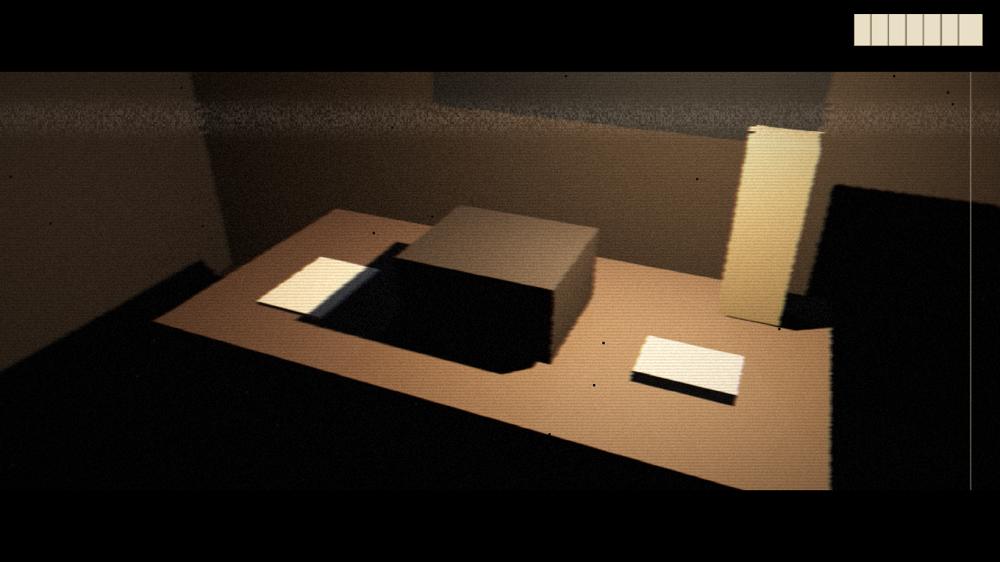 | 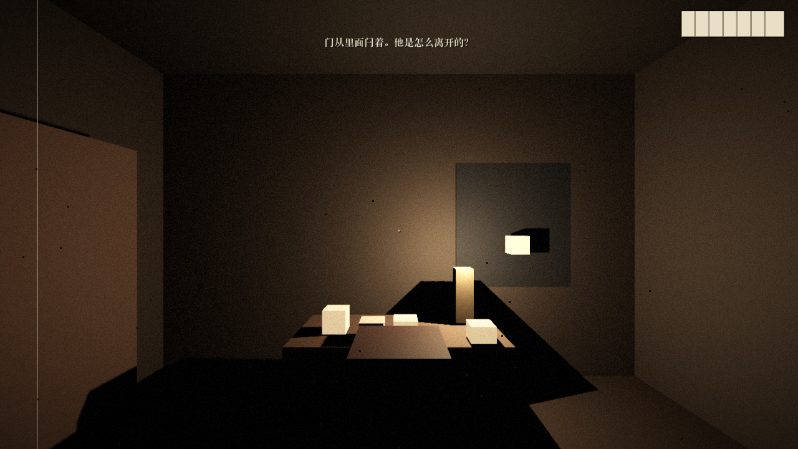 | 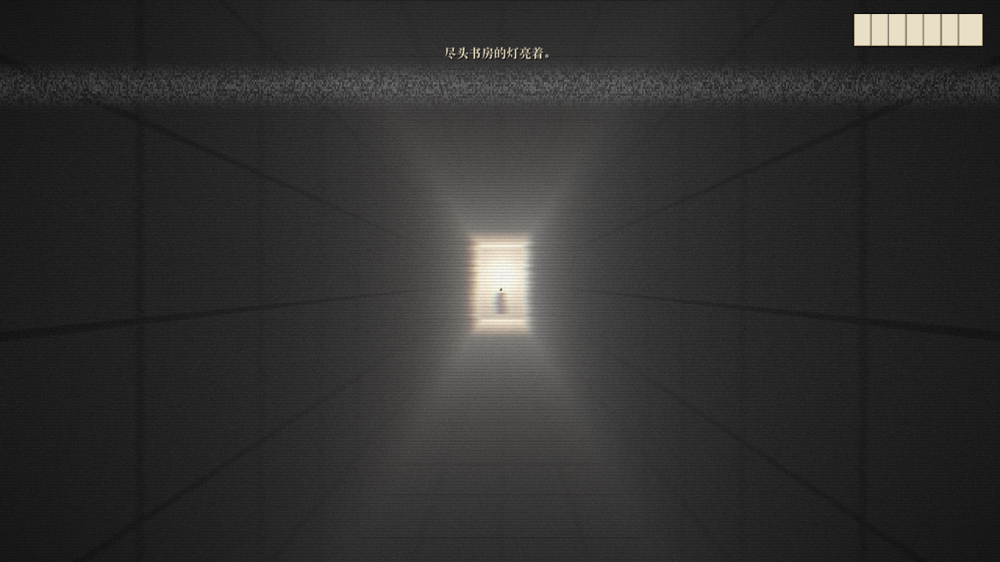 | 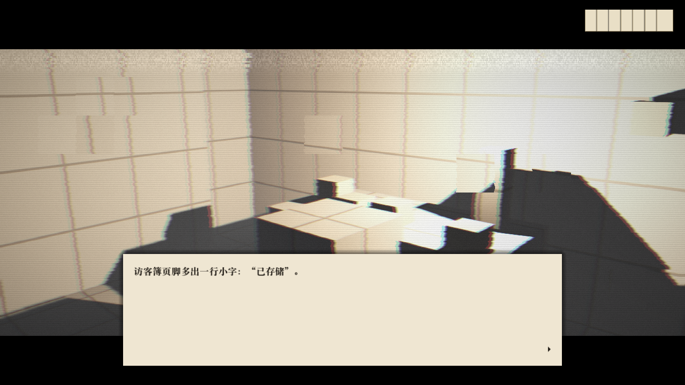 |

### 9.4 下一步（需要美术成员参与）

- **纪录片式开场**：在滤镜之外，开场需要纪录片的“语言”：手绘风格的标题卡与插图、旁白字幕、档案照片的推拉镜头。建议由 2D 美术负责一组手绘插画（荒诞、不恐怖），程序负责把它们排进开场镜头。
- **录像带的界面元素**：例如开场角落的播放标记、磁带计数器。它们本身就是“不属于 1926 年”的穿帮，适合只放在开场。
- **调参**：现在的数值是助手的初版，美术成员对照参考视频在滤镜表里调整。

## 10. 影像档案：开场动画与线索检视（10-13）

用户提供了参考视频（伪纪录片 PV，约 3 分钟），希望开场剧情动画和线索检视都采用这种风格：报纸、荒诞的录像带、奇怪的照片，都要有怪谈的质感；恐怖减弱，保留荒诞与手绘感，重点是风格形式带来的沉浸感。

### 10.1 参考视频的视觉语法（助手逐帧分析）

| 元素 | 参考视频里的样子 | 参考帧 |
| --- | --- | --- |
| 片头警告卡 | 黑底，先中文“警告”，再红色大字 WARNING；机密档案口吻；中英双语 | — |
| 摄像机取景器 | REC 红点、磁带图标、AF-C、ENC、电池与剩余时间、中心对焦框、AUTO/AWB、SENS/SHUTTER/IRIS、右下日期时间（虚构纪年 1101 年） | 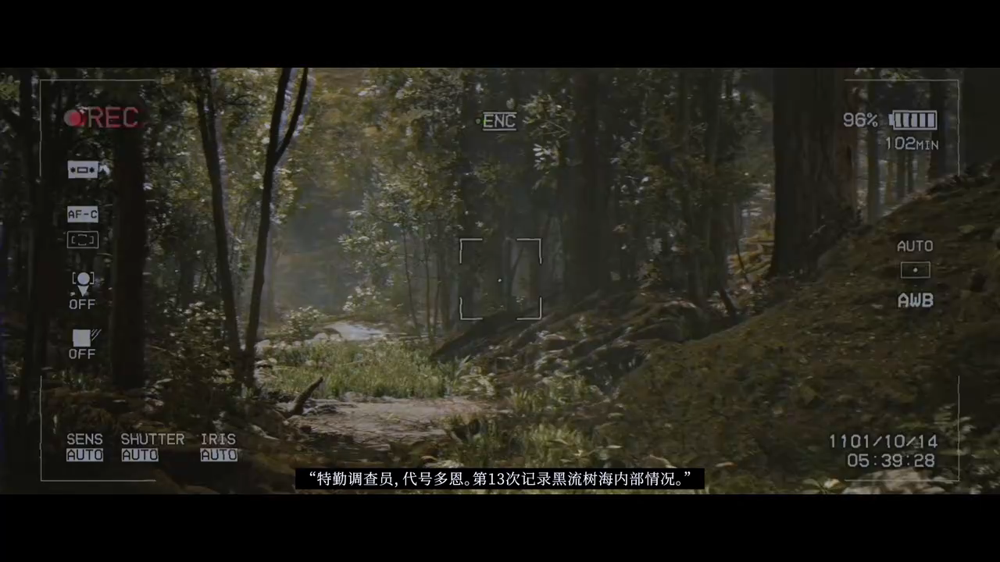 |
| 档案文件卡 | 黑白、4:3 小窗，左上时间码，右下大字文件名 + 编号 `[042/562]`，像“第几份被找回的录像” | 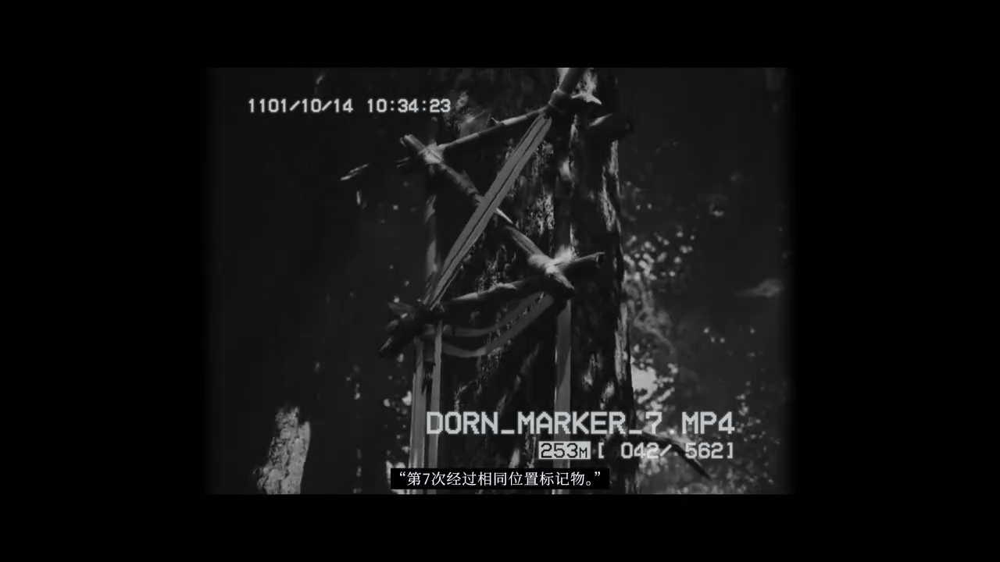 |
| 字幕 | 黑底白字，居中，带引号的第一人称口述 | 同上 |
| 荒诞手绘拼贴 | 手绘 / 剪纸质感的角色直接贴进写实场景，粗黑描边、平涂 | 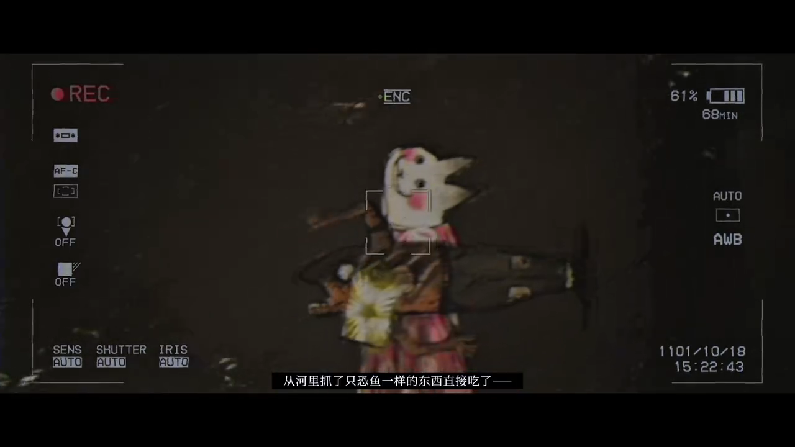 |
| 渐进崩坏 | 越往后，取景器文字被乱码替换（REC → HUS，日期 → 乱码），夜视绿、雪花屏 | 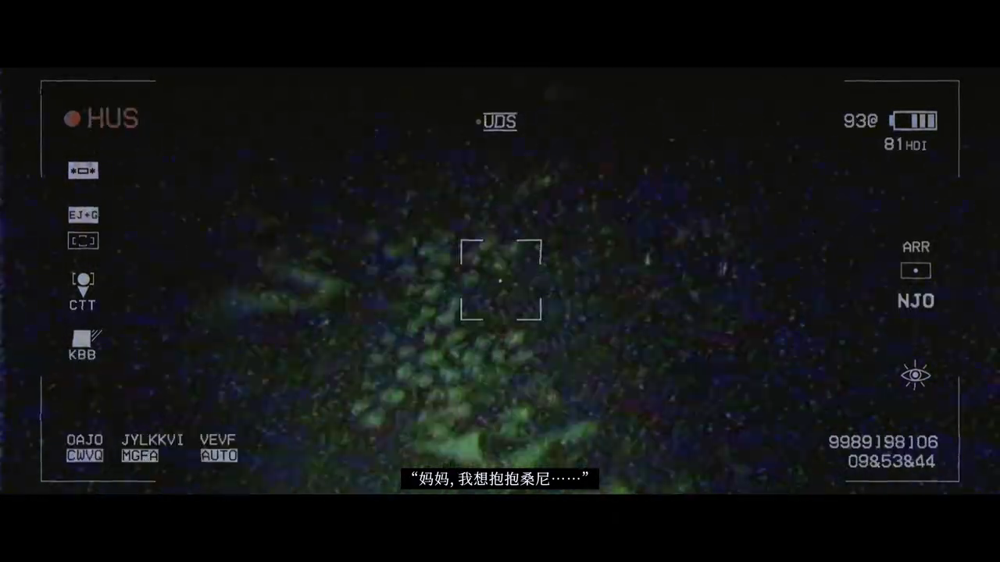 |
| 收尾 | 手绘图纸摊在桌上，被手拿起 | 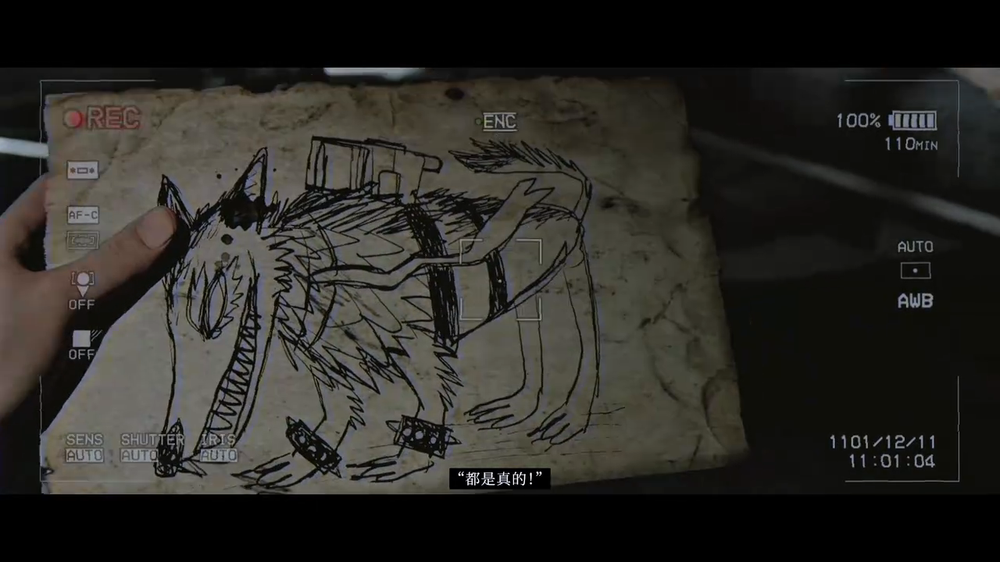 |

### 10.2 用到我们的游戏里

“渐进崩坏”和我们的渗漏几乎是同一种手法，所以采用时让它服从渗漏梯度：

| 场合 | 样式 | 说明 |
| --- | --- | --- |
| 开场 N1-00 | 警告卡 | 中英双语。文字为 1926 年卷宗口吻（草拟待确认），埋两处伏笔：“部分陈述有所省略”呼应“叙述者只省略”，“收讫后请回执”呼应 ACK |
| 开场 N1-01 — N1-05 | 档案卡（叠在实时 3D 上） | 黑白 4:3 胶片档案，文件名 `ROYD_REEL_01`、编号 `[001/007]`：七盘胶片对应七张电报纸。委托信、手记都以纪录片字幕出现 |
| 胶片 / 照片类线索 | 档案卡 | 任何时期都可用，属于 1926 年的媒介 |
| 录像带类线索 | 摄像机取景器 | 录像带出现在 1926 年的庄园里，本身就是穿帮。建议只在 L2（N4）之后出现 |
| L3 起的录像带 | 取景器文字开始乱码 | L3 偶尔，L4 大部分被乱码替换（已实现） |
| 报纸 | 纸质文件阅读（现有界面） | 之后可做成报纸版面 |

**荒诞手绘**交给 2D 美术：线索录像带和照片里出现的“东西”，用手绘或剪纸拼贴进写实（或灰盒）画面。荒诞，但不血腥、不惊吓。

### 10.3 已实现（影像档案播放器第一版）

- 四种样式：警告卡、档案卡、摄像机、雪花；样式之间用 0.2 秒雪花转场。
- **影像片段表** `godot/content/visual/footage.csv`：一行一个画面（图片、停留秒数、推拉镜头、字幕、文件名、编号、时间码），填表就能做出一段“录像”。
- 镜头表动作 `footage(片段)` 播放片段；`osd(样式,文件名,编号,时间)` 把档案卡或取景器直接叠在实时 3D 画面上，`osd()` 关闭。
- 可检查物件表新增“影像”一列：检查某个物件时先播放对应的片段。
- 取景器上的字始终清晰（盖在滤镜之上），画面本身经过滤镜做旧。
- 播放时隐藏电报纸、目标等界面；点击可跳到下一个画面。
- 两个示例片段（`示例_录像带`、`示例_档案照片`）用灰盒截图做素材，未接入剧情，可在 F1 调试面板播放。

| 警告卡 | 开场胶片档案 | 录像带线索 | 档案照片 | L4 乱码 |
| --- | --- | --- | --- | --- |
| 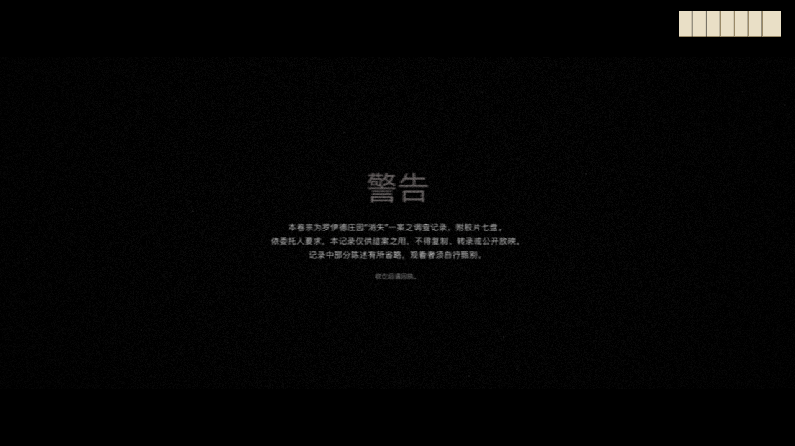 | 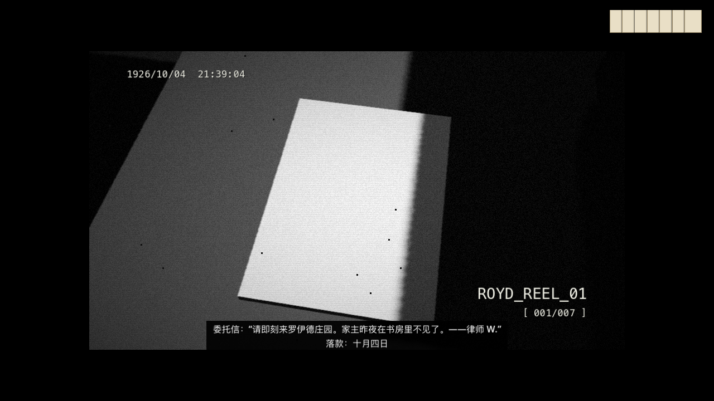 | 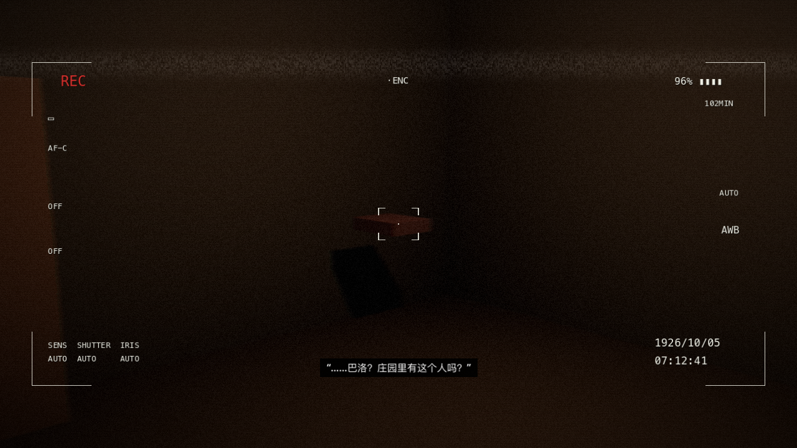 | 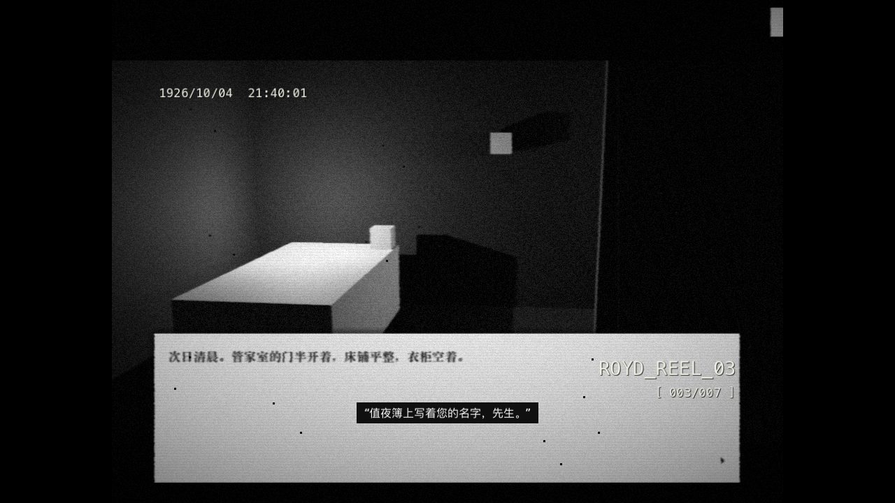 | 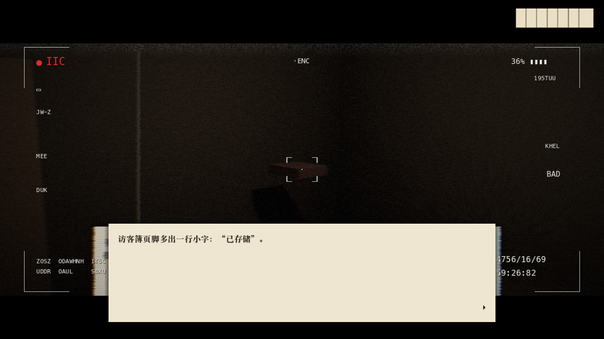 |

### 10.4 待做

- 剧情：决定哪些线索做成录像带 / 照片，写进可检查物件表的“影像”一列（目前没有改动分镜内容）。
- 2D 美术：手绘拼贴素材、照片素材（交到 `godot/art/footage/`，填影像片段表）。
- 开场：警告卡文字待确认；可以在第一、二盘胶片之间插入手绘插画画面。

## 11. 人物造型：只有侦探看得见（10-13）

用户确定：庄园里的每个人物都是同一个病人的一种人格（《11》第 3.2 节）。**除侦探以外，所有人的眼睛都被遮住**：他们看不见，所以不知道划名字的就是身边这个人；只有侦探能窥探事件。

**一句话：他们有脸没有眼，他有眼没有脸。**

| 人物 | 人格 | 眼部处理【提案：用 1920 年代的实物】 | 其他要点 |
| --- | --- | --- | --- |
| R. 艾克（侦探） | 好奇 | 不遮眼，但**永远不露出五官**：背影、帽檐、手、袖口；镜子与照片里没有他；终局镜中是没有脸的白色网格人形 | 一枚固定的袖扣，让玩家认出“这是我的手” |
| 罗伊德先生 | 自我 | 不出场；书房里的肖像，眼睛被涂成白色 | 空椅子、搭着的听筒 |
| 巴洛 | 记忆 | 黑色缎带（仆人戴孝用的那种） | 一圈钥匙；停在 21:40 的怀表 |
| 韦恩小姐 | 共情 | 打字员 / 电报员的绿色赛璐珞遮光帽，帽檐压到鼻梁 | 指尖的紫色色带墨；常把手放在耳边听 |
| 朗斯 | 欲望 | 客厅游戏“捉瞎子”（blind man's buff）用的丝巾 | 球杆、粉笔；脸总朝着窗外 |

- 眼部处理是**画面语言，不是剧情里的失明**：角色照常说“看见”，没有人评论它，和渗漏一样。
- 他们说话时脸朝着侦探的方向，但总偏一点点，像在对着声音说话。
- 也可以采用更绘画化的处理（眼睛位置是空白椭圆、被铅笔涂掉），由美术决定；三人须统一为同一种手法。
- 报纸广告里的人物画像（N4）、1901 年合影（N3）里的人物，同样没有眼睛。

## 12. 怪谈的物证（10-13）

怪谈“签收人”通过 1920 年代的媒介流传（《11》第 4.4 节），需要以下 2D 素材，均可用档案卡样式呈现：

| 素材 | 节点 | 内容 |
| --- | --- | --- |
| 开场老照片 3—4 张 | 开场 | 对称的庄园与一排眼睛被涂白的仆人；电话听筒没挂的书房；被划去一行的访客簿 |
| 童谣字幕卡 | 开场 | 五行童谣，默片字幕卡样式 |
| 事务所墙上的旧剪报 | N1 | “私家侦探 R. 艾克当众揭穿降灵会骗局”（交代他是现实主义者） |
| 1901 年合影 | N3（三条线各一版） | 同样的人、同样的年纪、没有眼睛；中间空出一块，地上一顶帽子；背面打字的说明，e 偏高 |
| 报纸广告 | N4（三条线各一则） | 管家 / 打字员 / 牌友的商品广告，画像没有眼睛 |
| 合同 | N7（欲望视角） | 名册背面：签名 R.，收件人 W. |
| 涂黑的文件 | N7 | “受试者：R. 艾克罗伊德　疗程：整合　人格：5 → □”，诊断一栏涂黑；它是全游戏唯一不属于 1926 年的纸 |
