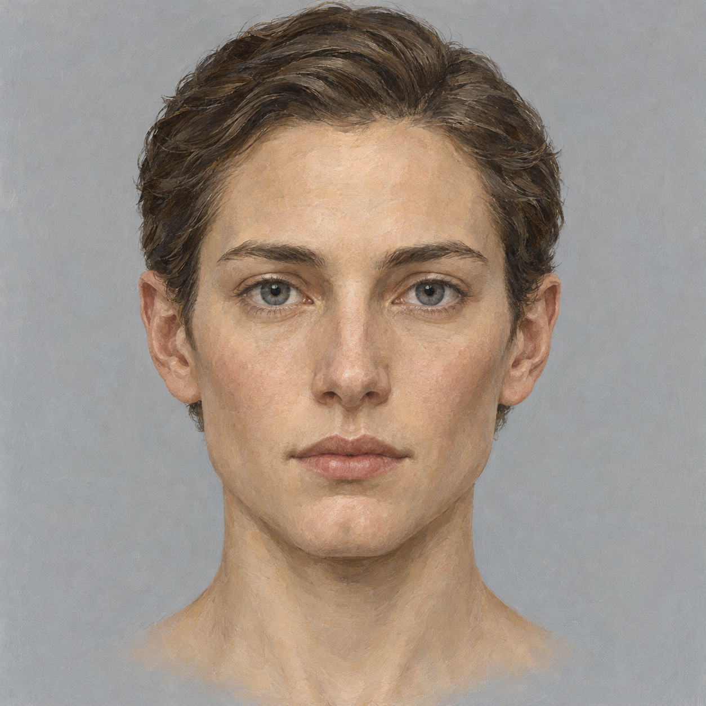
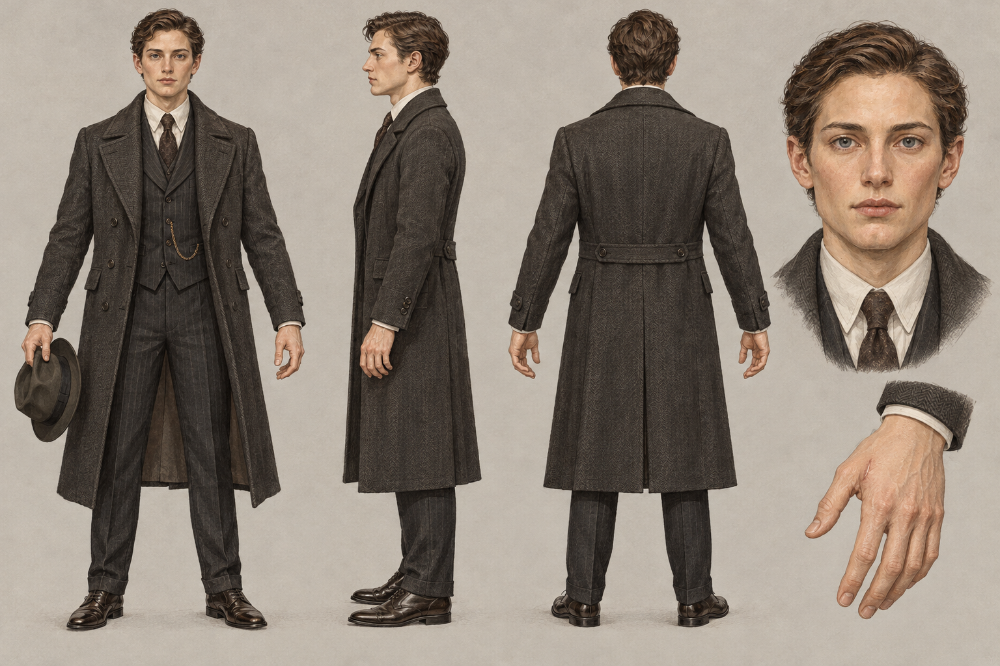
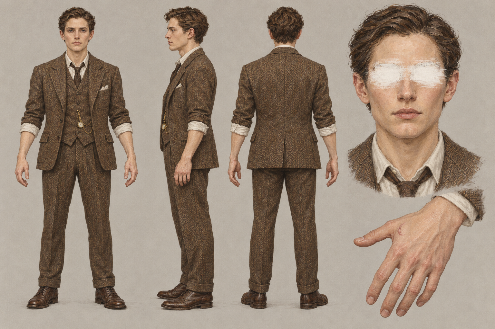
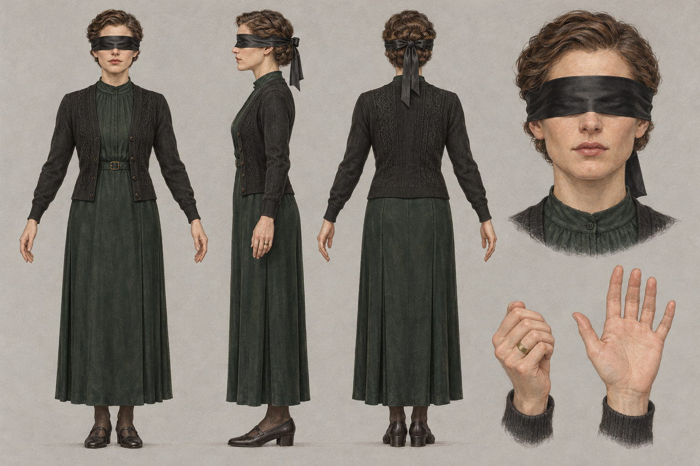
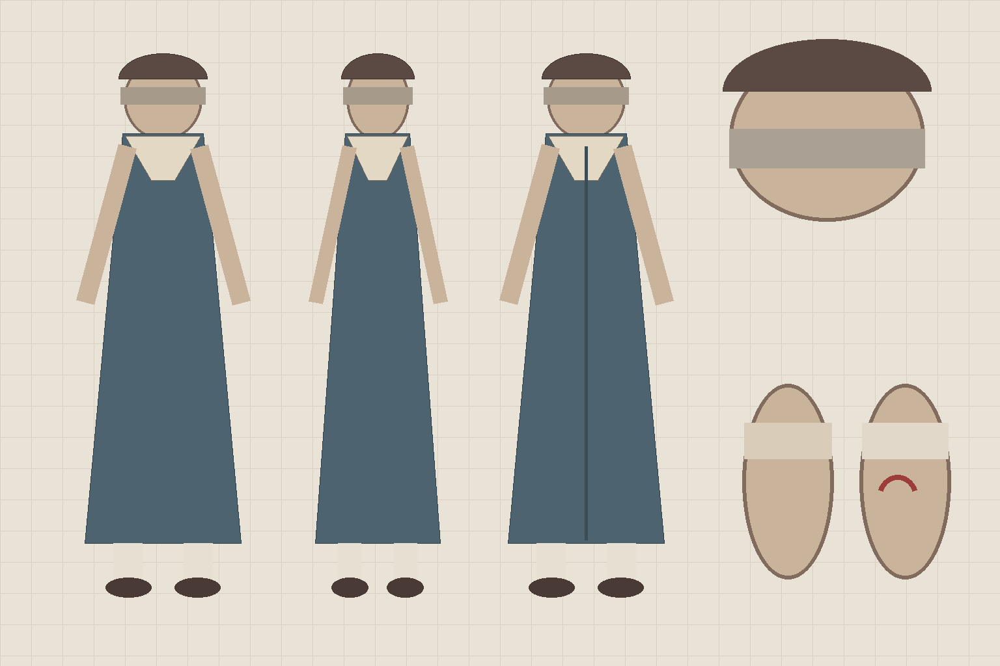
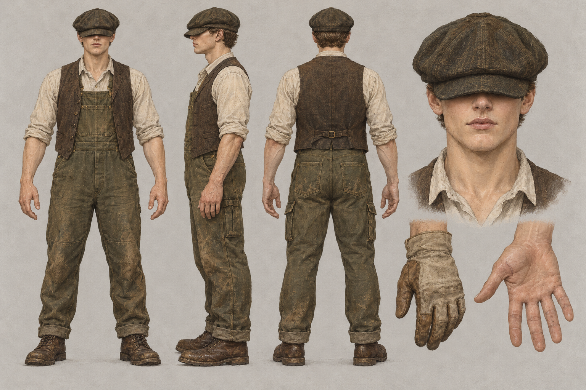
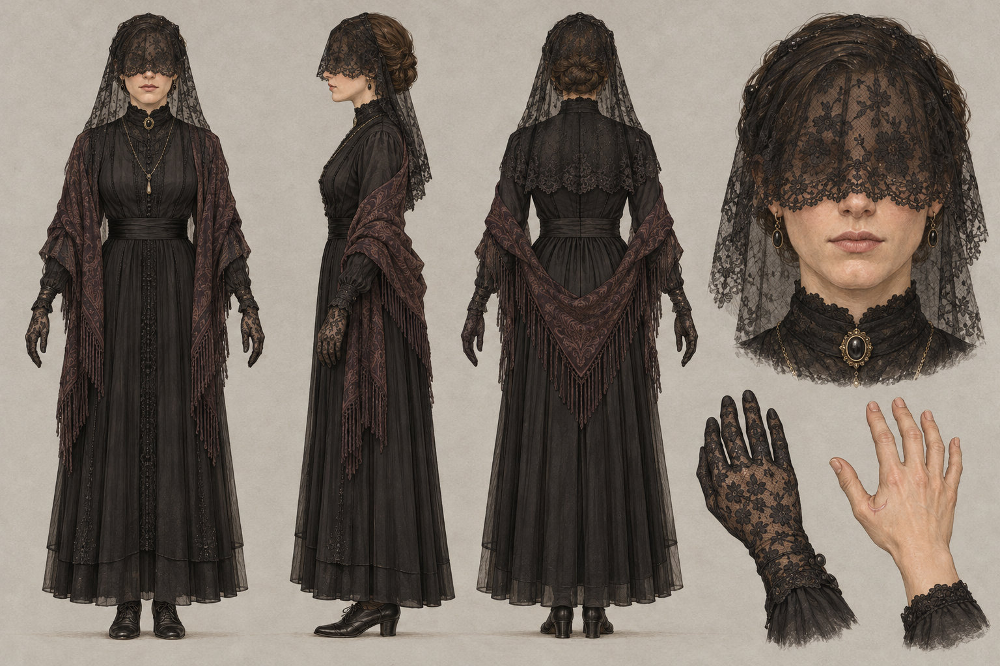

# 六个人物的设定意向

更新：2026-10-14。**六个人物现在“想做成什么样”，以这一篇为准。** 来源是《02》第 5、7 节和 T-024 任务卡；标【提案】的是助手补的，用户没确认，可以推翻；标【待决】的需要用户拍板。每人附现有的候选图（T-024 v1），并列出它和意向不一致的地方。

文件与管线见 [README](README.md)；怎么填人物表见 [填表说明 1.2](../填表说明/1.2-人物.md)。

## 0. 一眼看完

| | 格雷 | 安布罗斯 | 康斯坦斯 | 艾瑞斯 | 吉迪恩 | 拉坦特夫人 |
| --- | --- | --- | --- | --- | --- | --- |
| 身份 | 私家侦探（玩家） | 庄园主人，死者 | 女主人 | 女儿 | 园丁兼司机 | 灵媒 |
| 人格 | 解释者 | 记录者 | 照护者 | 儿童 | 保护者 | 新生 |
| 身高 | 1.80 | 1.78 | 1.65 | 1.20 | 1.85 | 1.65 |
| 年龄感【10-14 已确认】 | 30 出头 | 40 出头 | 35 左右 | 8 岁 | 40 多，风吹日晒 | 看不出（30—50） |
| 主色 | 炭灰 | 胡桃棕粗花呢 | 墨绿 + 黑 | 灰蓝 + 米白 | 橄榄绿 + 土棕 | 黑 + 暗酒红 |
| 眼部 | **不遮** | 照片里涂白 | 黑色缎带 | 捉瞎子的布条 | 压低的鸭舌帽檐 | 黑面纱垂到鼻尖 |
| 左手虎口的疤 | 不遮 | 尸体上露出 | 戒指 + 合拢拇指 | 创可贴 | 帆布工作手套 | 黑蕾丝手套 |
| 在哪见到 | 不出现，直到第 6、7 章 | 暗房的尸体、照片、遗物 | 餐厅；第 0 章门厅迎接 | 孩子的房间 | 温室 | 客厅·降灵会 |
| 候选图 | 可用，需改手 | 可用，需定眼睛 | 可用，需改手 | **占位，需重画** | 需改手套与裤子 | 最接近意向 |

## 1. 六个人共用的规则

- **他们是同一个病人的六种人格**。玩家后半段才看出来，所以单看一个人不能察觉，越往后越难“没看见”。
- **同一张底脸**（上图）：鼻形、颧骨、下颌、唇形六人一致，只靠年龄、性别、发型、体态、妆容区分。第 6 章六张肖像叠在一起，叠出的是格雷清晰的脸。
- **眼睛**：除格雷外都遮住，象征他们“看不见”，只有侦探能窥探事件。这是画面语言，不是剧情里的失明，角色照常说“看见”。一句话：**他们有脸没有眼，他有眼没有脸。**
- **左手**：虎口同一位置有一道新月形旧疤，每人用不同的东西遮。第 0—2 章偶尔露出一个，可以当巧合。
- **共同的小习惯**（演出与台词用）：思考时敲两下桌面；手写的 t 横画不碰竖画。
- **从不同时出现在同一画面里**，问话永远一对一。
- 1926 年英格兰乡间庄园，服装真实考究，不戏剧化；色调限于胡桃棕、墨绿、暗酒红、灰、米黄。画面里不出现血、文字和现代物品。

**对整批候选图的总意见**：六人现在都像二十多岁，格雷和安布罗斯几乎是同一个人，单看就会察觉，违反第一条。重画时按上表的年龄感拉开（发际线、皱纹、鬓角、体态），底脸的骨相不动。

## 2. 伊波利特·格雷 `grey`

- **一句话**：冷静的现实主义者，看得见一切，唯独看不见自己。
- **名字**：Hypo 是定影剂，让影像固定、只留一个；Grey 是照片的中间调，也是还没上色的灰模。
- **剧情位置**：玩家本人；解释者，把痛苦变成可以推理的谜题。凶手，也是记述者，隐瞒了“七点来过”。不信唯灵论。
- **出现方式**：全程不出现在画面与镜中，手直到最后才入画；第 6 章叠印出他的脸，第 7 章在镜中第一次露出全貌（“镜中的格雷”用同一个模型）。
- **造型**：深灰大衣、背心（口袋里放东西）、领带、皮鞋、礼帽。
- **眼部**：全游戏唯一露出眼睛的人。
- **左手**：不遮，疤要清楚可见。
- **口吻**：冷静、克制；只省略，不说谎。
- **候选图的问题**：手部特写的疤**很淡，几乎看不出**（要加清楚，第 7 章靠它）；`grey_左手.png` 是从原图裁切的，带进了身体和脸的边角，要重新出单独的手部图；显得太年轻；帽子拿在手里，建模时另做一顶可戴的。

## 3. 安布罗斯·塔尔博特 `ambrose`

- **一句话**：把所有人都拍下来、自己却留在暗房里的人。
- **名字**：Talbot 是负片的发明者；Ambrose 意为不朽。
- **剧情位置**：被害人；记录者，保存所有记忆，知道每个人格的存在。生前研究历年合影，做出了叠印。
- **出现方式**：只以尸体（暗房，倒地）、照片和遗物（摄影手册、底片簿、怀表）出现，不对话。
- **造型**：粗花呢外套、马甲、卷起的衬衫袖口，胸前挂怀表。业余摄影师的手：手指上可以有显影液的黄渍【提案】。
- **眼部【10-14 已确认】**：照片里眼睛被涂白；尸体在游戏中通过脸朝地或手臂遮脸隐藏眼睛，模型本体不涂白。建模三视图可以展示本体眼睛，不能把它直接当游戏中的可见状态。
- **左手**：不遮，尸体的手上露出疤。
- **另需**：倒地姿势版本（侧卧，无血无伤口）。
- **候选图的问题**：需要明显比格雷年长。已有 `ambrose_三视图-v2.png` 把白漆画到了模型本体上，按新决定退回；下一版三视图不涂白，照片肖像单独保存。

## 4. 康斯坦斯·塔尔博特 `constance`

- **一句话**：家里出了事也要把餐桌摆整齐的女主人。
- **名字**：Constance，恒常，让一切保持原样。
- **剧情位置**：照护者，对外维持日常；第一证人，晚饭时“听见计时铃”，无意中为侦探作证。隐瞒家里的异常；她仍会多摆一副餐具。
- **出现方式**：餐厅；第 0 章在门厅迎接。
- **造型**：1920 年代深色长裙、开衫，盘发，端庄。
- **眼部**：黑色缎带蒙眼。
- **左手**：保留无名指宽戒指；常态是拇指合向掌心，用手势遮住虎口疤（戒指不直接盖在疤上）。手部特写要两种状态：戴戒指合拇指 / 摘下戒指张开手露出疤。
- **口吻**：端庄、克制，坚持一切如常。
- **候选图的问题**：缎带、墨绿长裙、黑开衫、盘发都对；“张开”的那只手给的是**掌心**，看不到虎口的疤，要改成手背朝外、拇指张开。

## 5. 艾瑞斯·塔尔博特 `iris`

- **一句话**：唯一说真话的人，可惜只会用画和儿歌说。
- **名字**：Iris，虹膜，也是相机的光圈。
- **剧情位置**：儿童人格，最早出现，保有最初的恐惧；唯一说真话的证人，但只用画、儿歌和半句话表达。看到过“没有脸的叔叔”。她的画是线索（全家福里人人同一张脸、暗房外墙上的黑布、红光里戴帽子的人）。
- **出现方式**：孩子的房间。
- **造型**：八岁女孩，水手领连衣裙、长袜、短发。
- **眼部**：玩“捉瞎子”（blind man's buff）用的布条蒙眼。
- **左手**：虎口贴一块创可贴。
- **口吻**：说半句话，唱儿歌。
- **现状**：上图是**程序画的几何占位**，只定了配色（灰蓝连衣裙、米白领、灰布条）和疤的位置。图像模型连续拒绝生成儿童全身设定图。**【待决】重画方式**：队友手绘；或者只生成头肩与左手特写，全身用剪影建模。她在游戏里是一对一谈话，近景为主，后者够用。

## 6. 吉迪恩·沃登 `gideon`

- **一句话**：块头最大、脾气最坏、最像凶手的人。
- **名字**：Warden，看守。
- **剧情位置**：保护者，强壮、易怒，挡住外部的伤害。**主要误导**：替主人采购暗房药剂，有手段也有动机（主人要辞退他）。隐瞒替主人做过的事。
- **出现方式**：温室；第 5 章在井边摘下手套洗手，露出虎口的疤（C5-03）。
- **造型**：身材魁梧；工装背带裤、粗布衬衫、马甲、靴子。
- **眼部**：压得很低的鸭舌帽帽檐。
- **左手**：粗帆布工作手套，常态戴着。
- **口吻**：粗声、易怒、护短。
- **候选图的问题**：帽檐、背带裤、马甲都对；但全身图**没戴手套**（常态应戴着）；背面裤子有现代工装侧袋，1926 年不对；体型不够魁梧，应比格雷宽一圈；裸手特写给的是掌心，要改成能看到虎口。

## 7. 拉坦特夫人 `latente`

- **一句话**：两周前不知从哪来的灵媒，今年的合影里多出来的那张脸。
- **名字**：Latente，潜影，已经曝光、尚未显影。
- **剧情位置**：新生的人格，最近才出现，还没有固定位置；案发前两周到来的外来者，第一个被怀疑。隐瞒自己从哪里来（真名不明）。第 3 章降灵会上恍惚说出“有人在看着我们。稳定率已经很低了。”，醒来不记得。
- **出现方式**：客厅·降灵会。
- **造型**：黑色长裙、披肩、首饰，神秘但不浮夸。
- **眼部**：黑色面纱垂到鼻尖。
- **左手**：黑色蕾丝手套。
- **口吻**：轻声、恍惚，偶尔说出不属于这个年代的话。
- **候选图的问题**：六张里最接近意向；裸手特写的疤不明显，要加清楚。【提案】作为“还没固定”的人格，她的五官可以是六人里最接近底脸、最“没有特征”的一个。

## 8. 需要用户拍板

1. 年龄感已确认按第 0 节拉开，骨相不变。
2. 安布罗斯已确认：尸体用姿势遮眼，照片涂白。
3. 艾瑞斯用哪种方式重画（第 5 节）。
4. 定下来后，按每人“候选图的问题”重画 v2，再验收进入 T-025。
