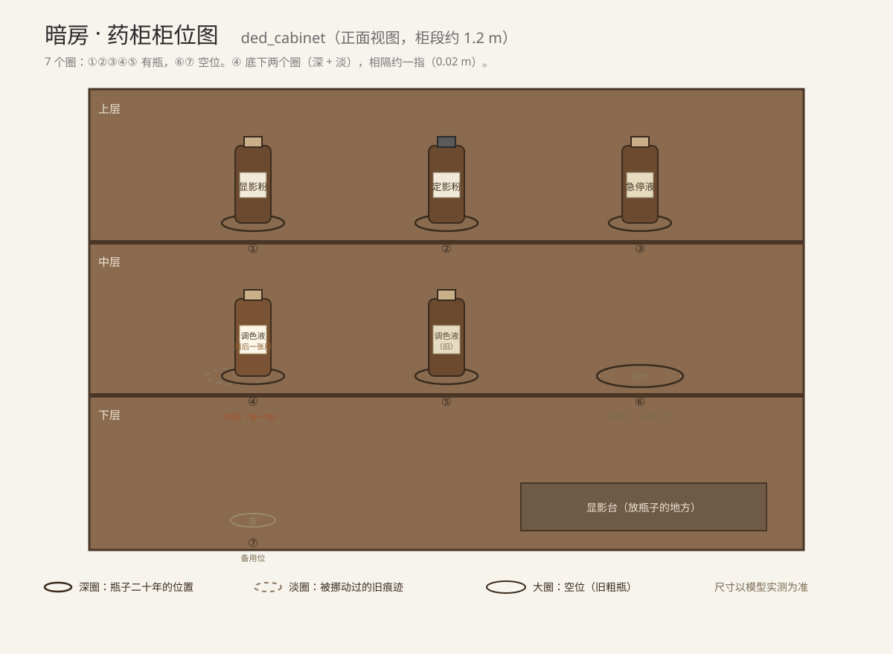

# 关卡：暗室犹存亡者墨 `ded_cabinet`

| 项目 | 内容 |
| --- | --- |
| 关卡文件 | `godot/levels/ded_cabinet.tscn`（薄叠层小场景，叠在 `darkroom.tscn` 上；房间模型、药柜、显影台、红灯开关一律复用，不新建、不重做） |
| 类型 | 演绎（现场复原；薄叠层场景，叠在暗房上） |
| 章节 | 第 1 章（**C1-05** 暗房；C1-02 是餐厅早饭，不在此列） |
| 入口 | 药柜上那只"调色液·最后一张用"的瓶子（瓶底灰圈） |
| 产出 | **复用 `ev_bottle_moved`**（S1-01①②），不新增线索 id；D1 已有三条连线都挂在它身上 |
| 热点 | **复用 `hs_bottles`**（`darkroom` / 药柜），不新增 `hs_cabinet` |
| 负责 | 第一章（死者） |
| 状态 | 文档已定稿（14 节）；场景、脚本、截图未开工，见第 13 节 |
| 参考 | 《02》第 9.5 节第 1 章、第 359 行"探索 · 暗房"；《03》第 2.2 节 L1-c；`docs/关卡/manor.md` 暗房；`assets/2d/T-027-暗房/` |

更新日期：2026-10-22

> 本文只写玩法设定。工程侧改动只有三样：药柜五只瓶、柜板灰圈贴图、一盏可调侧光；线索与热点全部沿用现有条目（见第 8.5 节）。工程形态照 `ded_table` 的做法——一个薄叠层场景 + 一个玩法脚本，房间模型一概不动。
>
> **与《03》的差异**：《03》L1-c 写"放大成房间的药柜，约 4×8 米"。本文主张**复用暗房西墙药柜段（约 1.2 米）**，理由是第一关不需要一个新空间，且灰圈必须在真实柜板上、与二十年使用痕迹同处一处才成立。《03》L1-c 与 `docs/关卡/README.md` 尚未同步，待你确认后一起改。
>
> **优先级未变**：仍为 P2。本文不主张提级；第一章唯一的 P0 是 `ded_locked`。

---

## 1. 一句话

### 1.1 为什么这一章只做三个关卡

第一章共 12 件可检查物。判定标准四条：**能动手**、**有成对物证**、**能产出新线索**、**空间可复用**。四条全中就做，缺一条就只做检视。

| 线索 | 媒介 | 判定 | 处理 |
| --- | --- | --- | --- |
| 药瓶底部的灰圈 | 痕迹 | 四条全中 | **本关卡**（`ded_cabinet`） |
| 瓶里液体发黄、与标签不符 | 实物 | 依附灰圈 | 并入本关卡第四圈 |
| 急停盘底的白色结晶（两种药水混过） | 痕迹 | 依附灰圈 | 不单独成关；已在 C1-05 的 `hs_tray`，本关不重复产出 |
| 正门与侧门门闩 | 痕迹 | 四条全中 | 已登记 `ded_locked`（P0，文档待写） |
| 蜡筒留声机 | 声音 | 能动手、有产出、空间可复用；无成对物证 | 已登记 `ded_carriage`（P2）／可另做「主人的声音」 |
| 配药记录（最后一栏空着） | 纸 | 只读，且不在暗房 | 属 S1-02②，在主卧床头（`hs_amb_notes`）；本关不搬过来 |
| 复写纸（第一页反字） | 纸 | 能动手、有产出 | 候选 P2「水面反读」，见 §12 |
| 笔记本最后一页 | 纸 | 只读 | 检视 |
| 墙上三个空钉位 | 照片 | 属第 2 章 | 留给 `ded_photo`，本章不碰 |
| 药柜内侧身高刻线 | 痕迹 | 信息太弱 | 只做检视（一次侧光特写） |
| 辞退信草稿 | 纸 | 属第 4 章 | 第 4 章再给 |
| 相机与"底片还在里面" | 实物 | 属第 6 章 | 本章只给一句台词，不开放 |

**结论**：第一章只需三个关卡——`ded_locked`（排除法，教程）、`ded_cabinet`（对位，本文）、`ded_carriage`（情绪，已登记）。三课教完，第 2 章起不再教新机制。三个关卡都**复用已有场景**，第一章不新建任何独立关卡。

---

### 1.2 玩家在做什么

玩家在暗房里，把五只棕色细颈瓶按柜板上的灰圈一一放回原位（柜板共七个圈，另两个是空位）。四只都能严丝合缝，只有那只贴着"调色液·最后一张用"的瓶子放不回去——它被取下来过，放回时偏了一指；而它的标签，是后贴上去的。

### 1.3 核心循环

拿起瓶子 → 对灰圈 → 放回 → 换侧光 → 揭标签角 → 得出"有人动过这只瓶子"

---

## 2. 玩家角色与叙事视角

### 2.1 玩家是谁

玩家始终是**伊波利特·格雷**——侦探、记述者、解释者人格。他没有变成安布罗斯。

第一章叫"死者"，是因为死者是这一章的核心与委托来源，不是因为玩家扮演他。玩家做的是**检查死者留下的现场**。

### 2.2 关卡是什么性质

这是**现场复原**，不是回忆，也不是时间旅行：

- 灰圈、瓶子、标签、结晶都是真实物证；
- 玩家做的动作是"把它放回去"，属于现场实验；
- 复原成功时不出现 1926 年以前的人影——**这一关没有记忆演出**，只有现场本身变得说得通；
- 线索来自瓶、圈、标签与液体，不来自"格雷看见了什么"。

> 与 `ded_locked` 的区别：密室是**排除法**（一扇一扇门关死），本关是**物证归位**（把东西放回去）。两关都在暗房里，但一个往外排除出口，一个往里对齐位置。第一章不让玩家看见过去，因为那时他还不知道有"过去"可以看。

### 2.3 为什么是格雷一个人

第 1 章是白天，但暗房没有透明外窗（`manor.md`），白天也是黑的；屋里只有门边那只电木开关控制的红灯，没有白灯（10-19 起；见 §2.4）。女主人把钥匙交给他时说的是"他不会介意您看看"；园丁在温室修井泵，灵媒在客厅，艾瑞斯在楼梯口。

**没人陪他进暗房**——这正是他之后能独自动手的原因，也是他七天里反复独自进出的开始（第 6 章回收）。

### 2.4 画面语言（10-19 灯光改动后重写）

暗房**没有白灯**：进门是黑的，门边墙上只有一只电木开关 `sw_红灯`，按下去只亮红灯。这一条不再是障碍，而是本关成立的理由：

1. **进门**：全黑。玩家先摸到门边开关，红灯亮，房间浮出轮廓。红光下药柜、瓶子、柜板都是同一层暗红，**灰圈看不见**——它们只是"更旧一点的木头"，明度差不到一个台阶。
2. **第一道障碍不是变暗，是看不清**：玩家会以为"五只瓶子都摆得挺整齐"。HUD 只提示"光太正"，不给答案。
3. **侧光的来路**（两条，任选或都给）：随身手电（斜掠柜板），或推开温室侧门留一道缝——白天门外是灰白日光，从东北斜进来。玩家自己调角度，不是过场。
4. **侧光下灰圈才显**：掠射光把木板上的凹陷与油垢的阴影拉长，圆痕变成一圈深色。这是全关唯一一次"变化"，不做滤镜、不做颗粒。
5. 画面不套演绎滤镜（颗粒、划痕一概不加）。这一关的"演绎感"来自**光的角度**，不来自红色本身；红色只是让玩家先看不见。
6. 瓶子与柜板的比例必须真实（瓶高约 15 cm），镜头近到能看见瓶底那一圈灰。

> 与第 6 章的分工：第 6 章是"红灯下冲洗"，红光是氛围；本关红光是**遮蔽**。同一盏灯，两种用法。

### 2.5 叙述约束

- 格雷不能写"有人来过暗房"——那是 D3 的结论，属第 3 章。
- 格雷能说的是："这只瓶子被取下来过""放回去的时候没有对准""标签是后贴的"。
- 不能出现指纹、粉笔圈、现代鉴识语言。
- 不能出现"我记得这只瓶子""我第一次进暗房"这类句子。

### 2.6 戏剧反讽

玩家此刻以为自己在追一个外来者的手。

但那只手是他的——第 6 章他会在同一个柜子前想起：**他没有耐心，灰圈没对准**。这一层在本关一句都不能提，只靠"偏一指"这个细节留下伏笔。

---

## 3. 核心谜题

### 3.1 灰圈为什么可信

安布罗斯在这只柜子前配了二十年药。每只瓶子都在同一块木板上坐出了印子：药液溅出的雾、手指的油、瓶底与木头的摩擦，层层积下来，成了一只只深色的圆。

- 圈的位置 = 瓶子二十年来的位置；
- 圈比瓶底略大一圈，因为拿放时总有半毫米的移动；
- 圈分深浅：越深，说明那只瓶子在这儿待得越久。

**这是全作唯一一种"不需要科学的科学证据"**：没有指纹、没有血型、没有化验，只有时间留下的印子。它和第 4 章的鞋印、第 5 章的长曝光是同一类东西——**物证靠"重复"成立**。

### 3.2 玩家不是在猜配方

配药记录本不在暗房（它在主卧床头，S1-02②）；本关的顺序感来自**标签**：五只瓶的标签都是主人手写，纸、墨、笔迹一致，只有 ④ 是后贴的。

玩家不做化学题。玩家做两件小事：

1. 把五只瓶子放回它们的圈里（操作）；
2. 发现 ④ 放不回去，并且它有两个圈、两层标签（推理）。

放回去只是让这张柜板"成立"；发现"它被挪过"，才是线索。

### 3.3 为什么"差一指"能成立

- 瓶子被取下时，人是用一只手拿的，放回时不会低头去看瓶底；
- 柜板是深色木头，白天不点灯时几乎看不清圈；
- 唯独"调色液"这只瓶，圈旁边还有一道**更淡的旧圈**——说明它被挪动过不止一次（十年间换标签、配新液）。

**一个做了二十年的人，会本能地对准。**没对准的那一次，是别人做的。

---

## 4. 空间与物件

### 4.1 空间

**叠在 C1-05 上，不新建房间。** 由镜头表的 `level(ded_cabinet,ev_bottle_moved)` 进入，走完回到暗房。取暗房西墙的高药柜那一段（约 1.2 m 宽、三层），显影台在画面右下作为"放瓶子的地方"。

- 药柜**照现状用**（西墙高柜、玻璃门，尺寸与层板一概不改），不重做柜体；
- 第一版让柜门开着（第 1 章勘验，女主人交代过"他不会介意您看看"），不做开锁交互；
- 若现模型的门是关的，只加一个"打开"的姿态，不重做门扇；
- 拾取范围收到柜板前方 0.4 m，避免玩家在暗房里乱走。

柜位与尺寸见第 5 节的 2D 图。

- 圈用贴图表现，不做几何凹槽（避免碰撞与摆放误差）；
- 只有**侧光**下圈才清晰；红灯下几乎不可见（见 §2.4）；
- 每只瓶子只能"拿起/放下"，不做自由旋转（第一版）。

### 4.2 五只瓶子与两个空位

柜板上一共 **7 个圈**：5 个圈上各坐一只瓶，2 个圈是空位。

| 位 | 标签 | 液体 | 圈 | 识别特征 |
| --- | --- | --- | --- | --- |
| ① | 显影粉 | 无色 | 深 | 瓶身有细粉痕，塞子是软木 |
| ② | 定影粉 | 无色 | 深 | 塞子是橡胶，瓶肩有一道旧裂 |
| ③ | 急停液 | 微浊 | 深 | 瓶身贴纸泛黄、边角卷起 |
| ④ | 调色液·最后一张用 | **发黄** | **深 + 淡（偏一指）** | 标签**新**、边缘翘起，下面露出一角旧标签 |
| ⑤ | 调色液（旧） | 淡褐 | 深 | 标签旧、字迹褪色 |
| ⑥ | 空位 | — | 深 | 圈比瓶底大很多：这里原本放过一只更粗的瓶（中层的旧配方位） |
| ⑦ | 备用空位 | — | 浅 | 下层的空瓶位，圈小，常年没有瓶 |

> ⑥ ⑦ 是"合法干扰"：玩家会先怀疑空位，但两个圈的直径都对不上手边任何一只瓶，说明那只粗瓶与备用瓶很多年前就不在了，**不指向谋杀**。

### 4.3 标签（本关的"图"）

- **不搬记录本进来**。配药记录本在主卧床头（S1-02②，`hs_amb_notes`），属于 C1-06；暗房里不该有第二份，否则线索重复。
- 本关的"图"就是瓶子本身：五只瓶的标签**都是主人的手写**（《02》第 359 行），纸、墨、笔迹一致，只有 ④ 是后贴的。
- 检视任一标签时进近景，字迹可读；不需要往返对照。
- 标签不解释"最后一张"是什么——那是第 6 章的事。

### 4.4 干扰与失败形态

| 情形 | 表现 | 是否阻断 |
| --- | --- | --- |
| 把 ④ 放到 ⑥ 的空位 | 圈太大，瓶子在里面"晃"，不吸附 | 否 |
| 把 ⑤ 当成 ④ | 液体颜色略深、标签旧，且圈对得上 | 否，但提示"这一只一直在原位" |
| 打翻瓶子 | 液体洒在柜板上，留下一片淡痕（**永久**，不可擦） | 否 |
| 用力揭标签 | 标签撕破，仍可读到"调色液" | 否，但失去"第二层标签完整"的展示 |
| 不开侧光直接看 | 圈只隐约可见，玩家会误判"都没问题" | 否，HUD 会提示"光太正" |

---

## 5. 2D 柜位图



三层柜板、7 个圈：①②③④⑤ 各坐一只瓶，⑥⑦ 空位。④ 底下两个圈（深 + 淡），相隔一指。

**画法约定**（沿用 `ded_table` 第 5 节的做法）：

- 圈画成细线圆、不填色；④ 的两个圈一实一虚，偏移量按 0.02 m 画；
- 瓶子只画轮廓与标签短线，标编号和短名（不做材质）；
- 显影台在右下角只画一条边，表示"瓶子可以临时放在这里"；
- 这张图只用于核对柜位，不作贴图来源；柜板材质另见第 4 节。

**尺寸**（以现状模型为准，搭的时候量了再回填）：柜段宽约 1.2 m、三层，层高约 0.30 m；瓶子高约 0.15 m、直径约 0.06 m；④ 的旧圈偏移约 0.02 m（一指）。

---

## 6. 玩法流程

### 6.1 进入

女主人把暗房钥匙交给格雷后离开。他推门——里面是黑的。

HUD：

> 暗房：门边墙上有一只开关。

玩家按 E 打开红灯（`sw_红灯`），红光浮起来，屋里只剩一层暗红。

> 暗房：药柜上的瓶子，好像有一只没摆正。

走近药柜：五只瓶、七个圈（两个空位）。**红灯下圈几乎看不见**——木板和灰圈是同一个色相，只差一点明度。

### 6.2 学会"灰圈"

拿起任意一只瓶（第一版固定从①开始），瓶底离开柜板，木板上留下一块颜色略深的地方，但在红光下仍看不清是什么。

HUD：

> 暗房：光太正。

放回去时瓶子自动吸附到原位（第一只作为教学，必然吸附）。玩家由此学到两件事：瓶子会自己找位置；而这间屋子的光不适合看柜板。

### 6.3 逐只归位

四只依次归位（① ② ③ ⑤），全部吸附成功，柜板看起来"整齐"了。

只剩 ④ 还拿在手里。

### 6.4 放不回去

玩家把 ④ 放回原位——**不吸附**，瓶子落在圈外，露出半圈空白。

第一次放回时给一句轻声提示：

> 暗房：……差一点。

玩家再试两次，仍不吸附（每次偏差方向不同，但都不对准）。

### 6.5 换侧光

HUD 出现"再斜一点"。玩家掏出手电斜掠柜板，或者推开温室侧门留一道缝（白天，门外是灰白日光）。

侧光扫过去，柜板上显出**两个圈**：一个深、一个淡，中间隔着一指宽。

### 6.6 揭标签

镜头自动推近 ④ 的标签，边缘翘起。玩家可交互"掀起一角"：

下面露出一角旧标签，字迹与现在这行不同，但能认出"调色液"三个字。

### 6.7 收束

三处证据凑齐，格雷自言自语（不是系统播报）：

> "这只瓶子被取下来过。放回去的时候，他没有对准。"
> "标签是新的。有人不愿意让谁知道，这只瓶里装的是什么。"

打字机（回房后）：`今天，我在药柜前站了很久。`

---

## 7. 判定、重置与提示

### 7.1 正确

三个条件都满足即通关：

1. 四只瓶归位（①②③⑤）；
2. ④ 被放回后判定偏移（`offset > 0`）；
3. 侧光已开，双圈已显；标签已掀。

### 7.2 错误

不重置。本关没有"失败"，只有"还没看见"：

- 放错位置 → 瓶子滑回显影台，圈保持露出（信息本身就是奖励）；
- 打翻 → 留淡痕，瓶子仍可用；
- 不开侧光 → 红灯下圈不显，双圈更不显，玩家会卡在"都摆得挺整齐"的错觉里，HUD 提示"光太正"。

### 7.3 提示（三次递进）

| 次序 | 提示 |
| --- | --- |
| 第一次放不回 | "……差一点。" |
| 第二次 | "他配了二十年药，不会放歪。" |
| 第三次 | "把灯压低一些。" |

不用箭头、不用高亮框。

### 7.4 不做的事

- 不做计时；
- 不做化学配比小游戏（本关不是配方题）；
- 不做随机瓶位；
- 不做像素级找物（五只瓶全部可见）；
- 不做需要精确对齐的物理摆放（吸附为主，只有 ④ 刻意不吸附）。

---

## 8. 演出与线索

### 8.1 演出（约 8 秒，无人物）

1. 侧光下双圈叠在一起，中间那道**淡圈**像一枚指纹一样浮出来；
2. 标签角掀起，旧标签的字露出来，两种墨水的新旧一眼可辨；
3. 镜头回到整块柜板：其余四只各就各位，只有 ④ 孤零零地偏在一指之外；
4. 静默两秒，只剩雨滴从檐口落下。

**不出现人影、不出现红光、不出现任何"回忆"**——第一章的恐怖来自"东西被摆错过了"。

### 8.2 线索卡（复用 `ev_bottle_moved`）

**`ev_bottle_moved`：被挪动过的调色液**（D1，S1-01①②）

现有文本（`godot/content/story/evidence.csv`，不改）：

> 药柜里，"调色液·最后一张用"那只瓶子，瓶底的灰圈和它现在站的位置对不上：它被人挪过。
> 瓶里的液体发黄，和标签上写的颜色不一样。

本关追加一句观察（接在同一张卡下方，**不新开卡、不换 id**）：

> 其余四只都能严丝合缝地放回圈里，只有这一只放不回：它底下有两个圈，一深一淡，隔着一指。标签是新的，边缘翘起，下面还压着一角旧标签。

### 8.3 连线与后续

**不新增连线。** 现有三条 D1 连线（`+ ev_never_wrong`、`+ ev_amb_notes`、`+ ev_tray_crystal`）照旧；本关只是让玩家亲自把"瓶底灰圈对不上"这件事做出来，而不是读一句话。

本关自己的收束独白（不写进 `links.csv`）：

> 他配了二十年药，闭着眼都能摸到每一只瓶子的位置。  
> 可这一只，放回去的时候偏了一指。  
> 拿走它的人，不熟悉这块柜板。

后续指向：

- 第 1 章 `ded_locked`：密室成立，所以"换瓶"必须发生在案发前；
- 第 1 章 S1-03②：急停盘底的白色结晶（两种药水混过）；
- 第 2 章 `ded_photo`：谁有机会在案发前来这个家；
- 第 3 章 `ded_blackcloth`：通风口从外面被堵；
- 第 4 章 `ded_footprint`：那条从温室过来的路；
- 第 6 章 `ded_thursday`：**同一条柜板，同一只瓶，同一只没有耐心的手**。

### 8.4 线索属于谁

这条线索**不属于任何活人**，它属于"被取下的那只瓶"。

- 安布罗斯是"位置的保存者"：二十年没让瓶子挪过位；
- 取瓶的人是"没有耐心的人"：他知道哪只瓶该换，但不知道瓶底有圈；
- 玩家拿到的是"这个现场被人动过"，而不是"谁动过"。

第 6 章回收时，这条线索会变成**对他自己性格的判决**：一个能把任何事解释清楚的人，做事却不留耐心。

### 8.5 与既有线索和热点的对接

本关**不新增线索 id、不新增连线、不新增热点**。第一章这条线索在内容表里已经做好，本关只是把它从"一句提示"变成"一次动手"。

| 项 | 现有条目 | 本关怎么用 |
| --- | --- | --- |
| 线索 | `ev_bottle_moved`（被挪动过的调色液，D1，S1-01①②） | 通关时触发；文本不改，只追加一句"放回去时偏了一指，标签是后贴的"观察 |
| 热点 | `hs_bottles`（`darkroom` / 药柜） | C1-05 的 `inspect()` 已含；本关在它内部展开，不新增 `hs_cabinet` |
| 旁证一 | `ev_never_wrong`（S1-02①，康斯坦斯） | C1-02 已收；现有 D1 连线回应用它 |
| 旁证二 | `ev_tray_crystal`（S1-03②，盘底结晶） | 已在 C1-05 的 `hs_tray`；本关只让玩家"看见"它作为第二处物证，不重复产出 |
| 配药记录 | `ev_amb_notes`（S1-02②，主卧床头） | **不在本关**，C1-06 再给 |
| D1 连线 | `links.csv` 现有三条，均以 `ev_bottle_moved` 起头 | 全部保留；本关不写第四条 |

**为什么不再加一条连线**：D1 的判定是"必需 1 + 其余任意 1"，`ev_bottle_moved` 已经是必需的那一条。再加一条会改变推理面的宽度，也会让第 2—6 章的连线表失去对照价值。

---

## 9. 逻辑自查

| 可能的问题 | 本文的回答 |
| --- | --- |
| 玩家为什么能独自进暗房？ | 第 1 章白天，女主人把钥匙交给他，说"他不会介意您看看"；园丁在温室，灵媒在客厅，艾瑞斯在楼梯口 |
| 暗房只有红灯，玩家怎么看清柜板？ | 靠侧光：手电斜掠，或推开温室侧门留一道缝。红光负责"先看不见"，侧光负责"显出来"——这就是本关的机制，也是它必须发生在暗房的理由 |
| 红灯会不会让红色线索抢先？ | 不会；本关的线索是位置与纸张，不靠颜色。第 6 章的红光是冲洗氛围，这里是遮蔽，用法不同 |
| 二十年的灰圈为什么还看得见？ | 柜板是深色木头，药液雾、指油与摩擦常年积累；只在侧光下明显 |
| 为什么没有指纹？ | 1926 年威尔特郡乡下没有鉴识手段；本作也刻意不使用现代刑侦语言 |
| 为什么四只都能吸附，只有 ④ 不能？ | 那四只从未离开原位；④ 被取下过，放回时没有对准。吸附与否是本关唯一的"判定" |
| 灰圈偏一指会不会太巧？ | 不是巧合：取瓶的人一只手拿瓶、另一只手扶着柜门，放回时不会低头看瓶底 |
| 标签为什么会被换？ | 旧标签写着"调色液"，新标签多写"最后一张用"——写清楚用途，才能保证主人一定用它 |
| 玩家能不能直接把 ④ 硬塞进去？ | 不能吸附，但可以"放在圈外"；这本身就是答案，不做惩罚 |
| 会不会提前泄露"谁"？ | 不会；本关只到"有人动过瓶子"，且不出现人影与记忆演出 |
| 和第 4 章通风口怎么分工？ | 第 1 章只讲"换药"；第 4 章才讲"堵风口"。两半合起来才是完整手法 |
| 和 T1—T5 冲突吗？ | 不冲突；不改死亡时间、凶手、叠印、身体特征，只补"瓶子被移动"的物证 |
| 格雷会不会知道他不该知道的事？ | 不会；他只知道柜板上有圈、圈偏了、标签是新的 |
| 打翻液体后还能通关吗？ | 能；淡痕是永久代价，但不阻断 |
| 会不会变成像素找物？ | 不会；五只瓶全部可见，圈在侧光下清晰，提示三次递进 |
| 一章塞三个关卡会不会太密？ | 不会；`ded_locked` 约 3 分钟、本关约 5 分钟、`ded_carriage` 可选，均不强制全做 |

---

## 10. 实现建议

### 10.0 建模约束（不动房间）

**这一关不重新建模。** 暗房已经在 `17_room_darkroom.py` 里建好、由 `manor.tscn` 实例化，本关只是在这间屋子里加物件。

不做的：

- 不改墙体、柜体尺寸、柜板层高、显影台、门窗、百叶、通风口；
- 不新建 `.blend`、不加新房间；只建一个薄叠层场景 `ded_cabinet.tscn`；
- 不重做玻璃门（沿用现有门扇）；
- 不为"放大成 4×8 米的药柜房间"做任何预留。

做的只有四样：

1. 五只瓶（同一套网格 + 实例，五套标签贴图）；
2. 柜板 7 处灰圈贴图 + 抽屉里那张旧圈；
3. 一盏可调侧光（手电或门缝）；
4. 四个状态变量（§10.3）。

**尺寸服从现有柜板**：瓶子按柜板层高做（约 15 cm）；如果现柜层高放不下，改瓶子的高度，不改柜子。

### 10.1 复用

- `darkroom.tscn` 整间（药柜、显影台、温室侧门、`sw_红灯`）；
- C1-05 已有的 walk 模式与 `hs_bottles`、`hs_tray` 热点；
- 现有的"检视/拿起"交互与记事本、证据板 UI；
- 现有的液体材质（不套颗粒滤镜）。

### 10.2 新增

- 五只棕色细颈瓶（④ 需要两套标签贴图：新标签 + 旧标签角）；
- 柜板灰圈贴图 7 处（含一个放大的空位圈）；
- 侧光：一盏可调角度的手电（玩家操作），或温室侧门缝光源；
- 打翻后的淡痕贴图（不复原）。
- **不做**：新场景、新房间、配药记录本。

### 10.3 程序接口

- 柜位：`slot_ring_1` … `slot_ring_6`；空位 `slot_ring_empty`；
- 瓶子：`prop_bottle_dev`、`prop_bottle_fix`、`prop_bottle_stop`、`prop_bottle_tone_new`、`prop_bottle_tone_old`；
- 灯光：`sw_红灯`（已有）、`light_raking`（侧光角度 0—1，新）；
- 状态：`state_bottles_placed`（计数）、`state_tone_offset`（bool）、`state_label_lifted`（bool）、`state_spill`（bool）；
- 热点：**复用 `hs_bottles`**，不新增；
- 演出：`reveal_double_ring` 状态层（无独立过场）。

### 10.4 判定

```text
通关条件：
  state_bottles_placed == 4
  and state_tone_offset == true
  and state_label_lifted == true
  and light_raking > 0.6
```

### 10.5 内容表改动

- `evidence.csv`：**不改**（复用 `ev_bottle_moved`）；
- `links.csv`：**不改**（D1 三条连线保留）；
- `hotspots.csv`：**不改**（复用 `hs_bottles`）；
- `shots.csv`：C1-05 的 `inspect()` 增加 `level(ded_cabinet,ev_bottle_moved)`，**不新增镜头**；
- `docs/关卡/README.md`：待补文档链接与状态，优先级仍是 **P2**（本次未改）；
- `docs/03-空间与关卡设计.md`：L1-c 的"4×8 米放大药柜"待改为"复用暗房药柜段"（本次未改）。

### 10.6 工作量

- 第一版：0.5 天（在现有暗房里加五只瓶 + 灰圈贴图 + 一盏侧光 + 一个状态演出），不含任何建模返工；
- 不做物理倾倒、不做自由旋转、不做化学配比。

---

## 11. 验收标准

- 玩家不看外部提示，能在药柜前发现"有一只瓶没摆正"；
- 玩家能自己把侧光压低，看见双圈；
- 玩家能掀起标签，看到旧标签；
- 玩家能用自己的话说清："这只瓶被取下来过，放回时没有对准，标签是后贴的"；
- 玩家能用 `ev_bottle_moved` 加任意一条旁证，在证据板上推出 D1；
- 关卡不违反 T1—T5，不出现格雷"看见过去"或"第一次进暗房"的说法；
- 打翻液体的玩家仍能通关，且能感到那点淡痕是代价。

---

## 12. 待定

- [ ] 侧光来源二选一：随身手电（玩家操作角度）还是温室侧门缝（固定光源 + 开合门）？建议前者为主、后者作为提示，因为"调光"本身就是侦探的动作。
- [ ] 液体"发黄"要不要做成可视对比（对着白纸看）？建议加，作为 ④ 的第二个识别特征。
- [ ] 打翻是否保留为永久淡痕？建议保留——本作需要一个"玩家也会留下痕迹"的先例。
- [ ] 药柜玻璃门：第一版常开，还是保留"拉开/合上"两态？
- [ ] 复写纸「水面反读」是否要做成 P2（见 §1.1 表）？建议留到第二版。

**已定（10-21）**：优先级仍为 P2；空间复用暗房、不新建房间、不重做柜体；灰圈用贴图不做凹槽；线索与热点全部复用现有条目。

---

## 13. 交付记录

### 2026-10-21：文档按 `ded_table` 的形式重排
- 章节从 0—12 改为 **1—14**，与第 2 章餐桌关（`ded_table`）同一套骨架：一句话 / 玩家角色与叙事视角 / 核心谜题 / 空间与物件 / **2D 柜位图** / 玩法流程 / 判定提示 / 演出与线索 / 逻辑自查 / 实现建议 / 验收 / 待定 / **交付记录** / **素材与登记**；
- 新增第 5 节 2D 柜位图（`docs/关卡/图/ded_cabinet-柜位图.svg`），把原来 4.1 里的 ASCII 图升级成可核对的矢量图；
- 原第 6 节「与既有线索和热点的对接」并入 8.5，不再单独占一节；
- 新增第 14 节素材与登记，预留 `ded_cabinet_*` 的 asset_id。

### 未开工（工程 PR 再做）

- `godot/levels/ded_cabinet.tscn`：薄叠层小场景，叠在 `darkroom.tscn` 上，自带药柜段与五只瓶（不新建房间模型）；
- `godot/levels/ded_cabinet.gd`（取放、侧光、判定）、`ded_cabinet_props.gd`（程序化瓶身与标签）；
- 镜头表 C1-05 的 `inspect(hs_bottles)` 增加 `level(ded_cabinet,ev_bottle_moved)`；
- `assets/3d/ded_cabinet/review/` 固定机位截图；`assets/登记表.csv` 登记；
- 自测：`--cabinet-test`（抽屉/柜板 → 取放 → 判定）、`--cabinet-light-test`（红灯 / 侧光切换 → 双圈）。

## 14. 素材与登记

**本关没有外部模型文件**：药柜、显影台、温室侧门、红灯开关全部复用 `manor` 的暗房模块；只按第 10.0 节的约束在柜板上加瓶子与灰圈贴图。素材的"源"是 `darkroom.tscn` + 本关脚本，不另开 `.blend`。

| 游戏 id | 内容 | 登记表 asset_id |
| --- | --- | --- |
| `bottle_dev` | ① 显影粉瓶（软木塞、瓶身细粉痕） | `ded_cabinet_bottle_dev` |
| `bottle_fix` | ② 定影粉瓶（橡胶塞、瓶肩旧裂） | `ded_cabinet_bottle_fix` |
| `bottle_stop` | ③ 急停液瓶（贴纸泛黄、边角卷起） | `ded_cabinet_bottle_stop` |
| `bottle_tone_new` | ④ 调色液·最后一张用（新标签 + 旧标签角） | `ded_cabinet_bottle_tone_new` |
| `bottle_tone_old` | ⑤ 调色液（旧，标签褪色） | `ded_cabinet_bottle_tone_old` |
| `ring_texture` | 柜板灰圈贴图（7 处 + ④ 的旧圈） | `ded_cabinet_ring_texture` |
| `raking_light` | 侧光（手电 / 温室门缝） | `ded_cabinet_raking_light` |
| `cabinet_layout` | 2D 柜位图 | `ded_cabinet_layout` |

- 检查截图：[`assets/3d/ded_cabinet/review/`](../../assets/3d/ded_cabinet/review/)（固定机位宽景、柜板近景、红灯、侧光、双圈、标签角、打翻淡痕）；
- 2D 图：[`图/ded_cabinet-柜位图.svg`](图/ded_cabinet-柜位图.svg)；
- 音效：沿用暗房现有环境声（雨、红灯嗡鸣），本关不新增音效。
