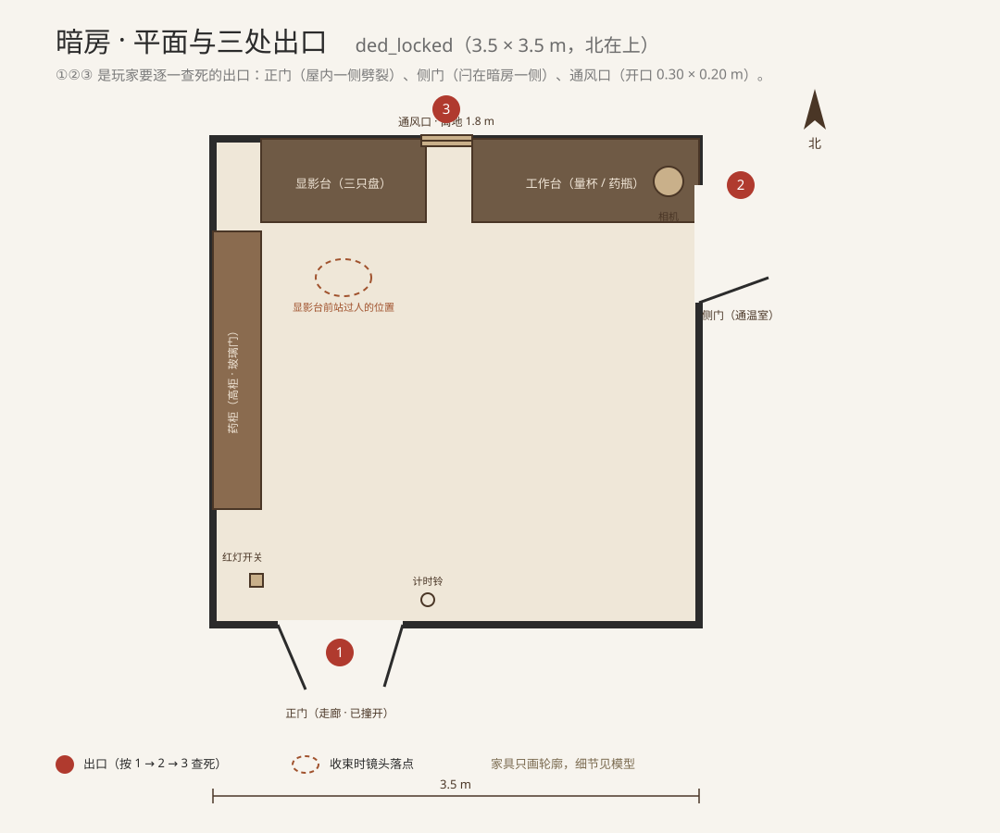

# 关卡：门自内闩人自囚 `ded_locked`

| 项目 | 内容 |
| --- | --- |
| 关卡文件 | `godot/levels/ded_locked.tscn`（薄叠层小场景，叠在 `darkroom.tscn` 上；暗房模型、门、百叶、工作台一律复用，不新建、不重做） |
| 类型 | 演绎（现场排查；第一课的"排除法"） |
| 章节 | 第 1 章（**C1-05** 暗房） |
| 入口 | 暗房里那个问题：他是怎么死的？三处出口都在屋内一侧被闩死，谁进得来、谁出得去 |
| 产出 | **不产出线索**（《03》L1-a 明确"不进推论"）；结论只服务 D1——换药只能发生在案发之前 |
| 负责 | 第一章（死者） |
| 状态 | 文档定稿（14 节）；场景、脚本、截图未开工，见第 13 节 |
| 参考 | 《02》第 9.5 节第 1 章、第 359 行"探索 · 暗房"；《03》第 2.2 节 L1-a；`docs/关卡/manor.md` 暗房；`docs/关卡/ded_cabinet.md` |

更新日期：2026-10-22

> 本文只写玩法设定。工程形态照 `ded_table`：一个薄叠层场景 + 一个玩法脚本，暗房模型一概不动。
>
> **固定事实（T1）**：安布罗斯 1926-10-16 约 22:00 死在暗房，正门与通温室的侧门**都是他自己从里面闩上的**，他用"最后一张"专用的调色液配药，放出了毒气。本关只让玩家自己把这件事查出来，不追加任何设定。

---

## 1. 一句话

玩家在暗房里把三处"出去的办法"一处一处查死：撞开的正门是从里面闩着的，侧门的闩插在暗房这一侧，通风口连一只手臂都伸不出去。三处都不通，屋里只剩他、那盘药，和显影台前一个站过人的位置。

### 1.1 为什么这一关是第一章的第一课

第一章三关各教一件事：**密室教排除法**（怎么证明"不可能"）、**药柜教对位**（怎么读位置）、**车厢教情绪**（怎么让玩家安静下来）。密室是 P0，因为它是玩家第一次意识到"这间屋子的话可以算"。

### 1.2 玩家在做什么

玩家不动手摆东西，只做三件事：看门的哪一侧被撞开、看侧门的闩插在哪一边、蹲下去量通风口的开口。每一处查死，房间就"封"一层。

### 1.3 核心循环

查正门（门框劈裂 + 闩扣板掉在屋内）→ 查侧门（闩插在暗房一侧，无撬痕）→ 查通风口（内百叶后开口太小）→ 三处封死 → 镜头回到显影台前那个位置 → 得出"没人进出"

---

## 2. 玩家角色与叙事视角

### 2.1 玩家是谁

玩家始终是**伊波利特·格雷**——侦探、记述者、解释者人格。他没有变成安布罗斯。

第一章叫"死者"，是因为死者是这一章的核心与委托来源，不是因为玩家扮演他。玩家做的是**检查死者留下的现场**。

### 2.2 关卡是什么性质

这是**现场排查**，不是回忆，也不是时间旅行：门、闩、百叶、扣板、门框劈裂都是真实物证，玩家做的是"去看、去量、去比"；排查成功时不出现 1926 年以前的人影，结论来自门与墙。

> 与 `ded_cabinet` 的区别：药柜关是把东西放回去，本关是把出口一个一个关掉；一个往里对齐，一个往外排除。

### 2.3 为什么是格雷一个人

第 1 章白天，暗房没有透明外窗，白天也是黑的；屋里只有门边那只电木开关控制的红灯，没有白灯（10-19 起）。女主人把钥匙交给他时说的是"他不会介意您看看"；园丁在温室修井泵，灵媒在客厅，艾瑞斯在楼梯口。

**没人陪他进暗房**——他才有机会一个人把三处出口都摸一遍。

### 2.4 画面语言

1. **进门**：全黑。玩家先摸到门边开关，红灯亮，房间浮出轮廓。
2. **每查死一处，房间暗一层**：正门查完，门缝那道光没了；侧门查完，东墙那条缝没了；通风口查完，最后一点微光没了。三次之后只剩红灯与手电。
3. **手电只照局部**：不给全景大亮，玩家必须把光打到门框、闩、百叶上才看得清。
4. **不套演绎滤镜**（不加颗粒、划痕）。压迫感来自空间一点点变小，不来自画面效果。

> 与第 6 章的分工：第 6 章的红灯是冲洗氛围，本关的红灯是**唯一的照明**——所以它会骗人，门缝、闩槽这些细节都得靠手电补。

### 2.5 叙述约束

- 格雷不能写"有人杀了他"——那是 D1 的结论，属本章稍后。
- 格雷能说的是："门是从里面闩上的""侧门的闩插在屋里这一侧""这个口子人过不去"。
- 不能说"这是一间密室"这种类型小说腔；用他自己的话："没人能从这里出去。"
- 不能出现指纹、粉笔圈、现代鉴识语言。
- 不能出现"我记得这扇门""我第一次进暗房"这类句子。
- 不能提"第二页""星期四夜里"——那是第 6 章。

### 2.6 戏剧反讽

玩家此刻以为自己在排除一个外来者。

但真正把门闩上的人是死者自己；而换掉药的人，已经在两天前走了。这一层在本关一句都不能提，只靠"门是从里面闩的"这个事实留下伏笔。

---

## 3. 核心谜题

### 3.1 "密室"在这个故事里怎么成立

不是靠"门窗都锁着"这种笼统说法，而是三处出口各有各的证据：

| 出口 | 证据 | 读法 |
| --- | --- | --- |
| 正门（走廊门） | 门框在**屋内一侧**劈裂；门闩扣板掉在屋内地上；闩杆弯了 | 门先被从里面闩上，再从外面撞开 |
| 侧门（通温室） | 闩杆插在暗房这一侧，闩槽无撬痕；门槛内侧灰尘完整 | 案发时这扇门是闩着的，没人从温室进来 |
| 通风口 | 内百叶后是一个 0.30 × 0.20 m 的开口，边缘有积尘，没有擦蹭 | 人过不去；外面为什么黑，第 3 章才回答 |

三处各自成立，合起来才是"没人进出"。

### 3.2 为什么必须按这个顺序

先正门，因为它最显眼、也最容易被"撞开"误导（玩家会以为凶手撞门而入）；再侧门，因为它是唯一通向屋外的路；最后通风口，因为它是唯一剩下的可能。**每排除一处，玩家的选择就少一个**——这就是《03》说的"每圈少一个出去的办法"。

### 3.3 为什么"通风口"是收尾

前两处都是门，玩家会自然想"那总还有个口子"。通风口必须由玩家**蹲下去量**，而不是看一眼就说"太小"：手电照进去，光斑落在 0.30 × 0.20 m 的开口上，边缘的积尘是完整的——没有人从这里爬过。

### 3.4 这一关不回答"谁"

本关只证明"没人能进出"，不证明"药被换过"。换药是 `ded_cabinet` 的事，两关合起来才指向 D1。

也不能让玩家得出"他是自杀"——1926 年的乡下，意外与自杀会被验尸官一句话了结（第 4 章才讲），本关只到"密室成立"。

---

## 4. 空间与物件

### 4.1 空间

**叠在 C1-05 上，不新建房间。** 由镜头表的 `level(ded_locked)` 进入，走完回到暗房。暗房 3.5 × 3.5 m，按 `manor.md` 已建的样子用：

- 西墙：高药品柜（玻璃门）；
- 北墙：工作台在百叶两侧分两段，左段三只显影 / 停显 / 定影盘，右段量杯、药瓶；
- 东墙：温室侧门（北段）、三脚架相机（门北侧）；
- 南墙：走廊门（正门），门内西侧墙上红灯开关，门边小搁板上一只计时铃；
- 天花：红色安全灯、晾片绳；墙上挂钟（建模时停在七点，不承载剧情）。

三条检视线：

```text
正门：南墙 → 门框劈裂面、闩扣板、闩杆
侧门：东墙北段 → 闩杆、闩槽、门槛灰尘
通风口：北墙中段高位 → 内百叶、开口、边缘积尘
```

### 4.2 物件清单

| 物件 | 大致尺寸（米） | 说明 |
| --- | --- | --- |
| 走廊门（正门） | 0.90 × 2.10 | 门扇在状态层；调查日是"门撞坏"：歪着开、锁侧门框劈裂、闩扣板掉在地上 |
| 门闩扣板 | 0.12 × 0.05 | 铁，掉在门内地上，离门框约 0.4 m |
| 闩杆（正门） | 0.30 × 0.03 | 弯了，还挂在门扇上 |
| 温室侧门 | 0.85 × 2.00 | 板门，闩在暗房一侧；门扇归暗房模块 |
| 侧门闩杆 | 0.25 × 0.03 | 插着，完好；闩槽无撬痕 |
| 通风口内百叶 | 0.45 × 0.30 | 木框 + 可调叶片；后面开口 0.30 × 0.20 |
| 显影台（工作台左段） | 1.20 × 0.60 | 三只盘：显影、停显、定影；显影盘里泡着全黑相纸 |
| 药柜 | 1.20 × 0.35 × 2.00 | 西墙高柜，玻璃门 |
| 三脚架相机 | 1.60 高 | 东墙北侧，镜头朝工作台 |
| 红灯开关 | 0.09 × 0.09 | 门内西侧墙，离地 1.38 m |
| 计时铃 | 0.10 | 门边搁板，第三版只作陈设 |
| 挂钟 | 0.35 | 停七点，不承载剧情 |

### 4.3 三处出口的判定

| 出口 | 玩家做什么 | 判定依据 | 通过后 |
| --- | --- | --- | --- |
| 正门 | 蹲下看门框劈裂面 → 捡起扣板 → 对闩杆 | 劈裂面朝屋内、扣板在屋内 | 门缝那道光消失 |
| 侧门 | 拉闩杆 → 看闩槽 → 手电照门槛 | 闩插在屋内一侧、槽无撬痕 | 东墙缝的光消失 |
| 通风口 | 蹲下 → 开内百叶 → 手电照开口 | 开口 0.30 × 0.20、积尘完整 | 最后一点微光消失 |

### 4.4 干扰与失败形态

| 情形 | 表现 | 是否阻断 |
| --- | --- | --- |
| 先去看通风口 | 看不到"太小"，只能看到黑；HUD 提示"光不够低" | 否，回头补正门 |
| 把撞坏的门当成"凶手撞门而入" | HUD 只复述事实，不纠正；玩家自己看到劈裂面朝屋内才改口 | 否 |
| 试图从通风口伸手 | 手伸到一半被百叶挡住，格雷自己说"伸不出去" | 否 |
| 不开红灯直接查 | 全黑，只看得见门缝一线光；HUD 提示"先开灯" | 否 |

---

## 5. 2D 平面图



**画法约定**：

- 房间按 3.5 × 3.5 m 画，北在上；墙厚不计；
- 三处出口用 ①②③ 编号，红色细圈标出；
- 家具只画轮廓与朝向，不画细节；
- "显影台前的位置"用一个虚线圈标在左段工作台前，不画人。

**尺寸**（以现状模型为准，搭的时候量了再回填）：暗房 3.5 × 3.5 m；走廊门在南墙偏西；温室侧门在东墙偏北；通风口在北墙中段、离地约 1.8 m；药柜贴西墙。

---

## 6. 玩法流程

### 6.1 进入

玩家在 C1-05 里走到正门前（或检查完 `hs_bottles` 之后），HUD：

> 暗房：他是怎么死的？屋里有哪些东西不对劲？

按 E 进入关卡，画面切到门的近景。

### 6.2 第一处：正门

玩家蹲下，手电照门框。劈裂面朝屋内，木茬是新的；地上有扣板。

HUD：

> 暗房：门是从里面闩上的。撞开它的人，在外面。

捡起扣板、对一眼闩杆，第一处封死：门缝那道光消失。

### 6.3 第二处：侧门

转到东墙，拉一下闩杆——插着。手电照闩槽：没有撬痕；门槛内侧的灰是完整的。

HUD：

> 暗房：这扇门也闩着。从温室那边过不来。

第二处封死：东墙缝的光消失。

### 6.4 第三处：通风口

回到北墙，蹲下，开内百叶，手电照进去：开口 0.30 × 0.20 m，边缘积尘完整。

玩家可以伸手——被百叶挡住。格雷自己说：

> "伸不出去。"

第三处封死：最后一点微光消失，房间只剩红灯。

### 6.5 收束

镜头缓缓落到左段工作台前那块被踩实的灰上——一个站过人的位置，没有人。

格雷（自言自语，不是系统播报）：

> "门是从里面闩的。侧门也是。通风口人过不去。"
> "没人能从这里出去。"
> "那么，杀死他的东西，是他自己配的那盘药。"

打字机（回房后）：`今天，我在暗房里数了三遍门。`

---

## 7. 判定、重置与提示

### 7.1 正确

三处都查死即通关：

1. 正门：看过劈裂面、捡起扣板；
2. 侧门：拉过闩杆、看过闩槽；
3. 通风口：开过内百叶、照过开口。

顺序不限，但**三处都做**才收束。

### 7.2 错误

不重置。本关没有"失败"，只有"还没看到"：

- 顺序乱 → 不惩罚，HUD 只提示"还有一处没看"；
- 判断错（以为凶手撞门而入）→ 不纠正，等玩家自己看到劈裂面；
- 不开红灯 → 场景全黑，提示"先开灯"，不判定。

### 7.3 提示（三次递进）

| 次序 | 提示 |
| --- | --- |
| 卡在正门 | "看门框，不是看门。" |
| 卡在侧门 | "闩在哪一边？" |
| 卡在通风口 | "蹲下来。" |

不用箭头、不用高亮框。

### 7.4 不做的事

- 不做计时；
- 不做"密室逃脱"式的机关解谜；
- 不做需要对准的物理操作（看与量为主）；
- 不做指纹、化验、现代鉴识；
- 不出现人影、回忆、红光里走过去的人。

---

## 8. 演出与线索

### 8.1 演出（约 10 秒，无人物）

1. 三处封死后，画面从门的近景慢慢退到整间暗房：门缝、东墙缝、通风口，三处都不再透光；
2. 红灯把房间压成一个红盒子；
3. 镜头落到工作台前那块灰上，静两秒；
4. 只剩红灯的嗡鸣与檐口的雨。

**不出现人影、不出现记忆、不出现"谁站在这里"的轮廓**——只留一个位置。

### 8.2 线索卡

**本关不产出线索卡。** 《03》L1-a 写明"演绎教程，不进推论"。

通关只给一句结论，写进当日记录（`annotate`），不占证据板槽位：

> 门从里面闩，侧门也闩着，通风口人过不去。没有人进出过暗房。

### 8.3 连线与后续

不新增 `links.csv` 连线。

本关的作用是**给 D1 提供前提**：既然案发时没人进出，换药就只能发生在案发之前；而"换过瓶子"由 `ded_cabinet` 给出。两关合起来才是完整的 D1 前半段。

后续指向：

- 第 1 章 `ded_cabinet`：瓶底灰圈对不上，说明瓶子被换过；
- 第 1 章 S1-03②：急停盘底的白色结晶（两种药水混过）；
- 第 3 章 `ded_blackcloth`：通风口从外面被堵；
- 第 6 章 `ded_thursday`：那一夜门是谁闩上的。

### 8.4 线索属于谁

这条结论**不属于任何活人**，它属于这间屋子。

- 安布罗斯是"关门的人"：他自己把两扇门闩上，把毒气留在屋里；
- 玩家拿到的是"没人能进出"，不是"谁干的"；
- 第 6 章回收时，玩家会知道：那扇门是他自己闩的，而换药的人两天前就走了。

### 8.5 与既有线索和热点的对接

| 项 | 现有条目 | 本关怎么用 |
| --- | --- | --- |
| 热点 · 通风口 | `hs_vent_inside`（`darkroom`） | C1-05 的 `inspect()` 已含；本关在它内部展开 |
| 热点 · 相机 | `hs_camera` | 不参与本关判定，可绕开 |
| 热点 · 挂钟 | `hs_clock_dark` | 只作陈设，本关不提钟点 |
| 热点 · 正门闩 | **新增** `hs_bolt_main` | 扣板 + 劈裂面 + 闩杆，三件一组 |
| 热点 · 侧门闩 | **新增** `hs_bolt_side` | 闩杆 + 闩槽 + 门槛灰 |
| 线索 | 无 | 不新增 `evidence.csv` 行 |
| 连线 | 无 | 不新增 `links.csv` 行 |

**为什么门闩要新增热点**：C1-05 现有的 `inspect()` 只有药柜、盘、通风口、相机、钟，门闩没有节点。两扇门的闩是本关唯一的物证，必须有独立热点，否则玩家点不到。

---

## 9. 逻辑自查

| 可能的问题 | 本文的回答 |
| --- | --- |
| 门是撞开的，怎么还能说"从里面闩上"？ | 劈裂面朝屋内、扣板掉在屋内、闩杆弯向屋内——撞门的力量来自外面，门先在里面闩死了 |
| 侧门闩着，格雷第 1 章怎么进暗房？ | 走走廊正门（女主人给钥匙）；侧门只在案发夜闩着，调查日仍可从暗房推开去温室 |
| 通风口外面为什么是黑的？ | 第 3 章才回答（黑布）。本关只让玩家确认"人过不去"，不解释黑 |
| 玩家会不会以为他是自杀？ | 本关只到"密室成立"，不下结论；"自杀"这个读法在第 4 章被验尸记录堵死 |
| 和第 6 章"他自己闩门"冲突吗？ | 不冲突：T1 就是他自己闩的。本关让玩家先看到结果，第 6 章才看到过程 |
| 会不会提前泄露凶手？ | 不会；本关不提"换药"，也不出现任何人影 |
| 三处都查完会不会太短？ | 约 3 分钟，是第一课；后面 `ded_cabinet` 约 5 分钟 |
| 校验脚本会拦吗？ | 不会；不新增证据、不新增连线，只加两个热点与一个 `level()` 调用 |

---

## 10. 实现建议

### 10.0 建模约束（不动房间）

**这一关不重新建模。** 暗房已经在 `17_room_darkroom.py` 里建好、由 `manor.tscn` 实例化，本关只是在这间屋子里加检查点。

不做的：

- 不改墙体、门窗洞口、工作台、药柜、百叶、通风口；
- 不新建 `.blend`、不加新房间；只建一个薄叠层场景 `ded_locked.tscn`；
- 不重做门扇（"门撞坏"状态层已有）。

做的只有三样：

1. 两个门闩热点（`hs_bolt_main`、`hs_bolt_side`）与对应的检视文本；
2. 三处"封死"的状态与光线变化（门缝光、东墙缝光、通风口微光各一盏，逐个关掉）；
3. 收束镜头与"显影台前的位置"标记（虚线圈，不画人）。

### 10.1 复用

- `darkroom.tscn` 整间（门、侧门、百叶、工作台、药柜、相机、`sw_红灯`）；
- C1-05 的 walk 模式与 `hs_vent_inside`；
- 现有的"检视/拿起"交互与记事本 UI；
- 门状态层"门撞坏"（歪门、劈裂框、掉落的扣板）。

### 10.2 新增

- `hs_bolt_main`、`hs_bolt_side` 两个不可见热区（`Marker3D`）；
- 三处出口的"封死"状态：`state_bolt_main`、`state_bolt_side`、`state_vent`；
- 三盏可关的小光（门缝、东墙缝、通风口），关掉即"封"；
- 收束镜头 `cam_seal` 与地面虚线圈。

### 10.3 程序接口

- 热点：`hs_bolt_main`、`hs_bolt_side`（新增）；
- 状态：`state_bolt_main`、`state_bolt_side`、`state_vent`（bool）；
- 光：`light_door_seam`、`light_side_seam`、`light_vent`（各 0—1）；
- 镜头：`cam_seal`（收束用，一次）；
- 进入：`level(ded_locked)`，`takes_over_player = false`（沿用暗房的第一人称）。
- 退出：三处状态全 true → 发 `finished`。

### 10.4 判定

```text
通关条件：
  state_bolt_main == true
  and state_bolt_side == true
  and state_vent == true
```

### 10.5 内容表改动

- `evidence.csv`：**不改**；
- `links.csv`：**不改**；
- `hotspots.csv`：新增 `hs_bolt_main`、`hs_bolt_side`（scene = darkroom）；
- `shots.csv`：C1-05 的 `inspect()` 增加 `level(ded_locked)`，不新增镜头；
- `docs/关卡/README.md`：`ded_locked` 从"待写"改为"本文已写"，补链接。

### 10.6 工作量

- 第一版：0.5 天（两个热区 + 三个状态 + 三盏灯 + 一段收束镜头），不含建模返工；
- 不做物理开门、不做自由撞击、不做机关。

---

## 11. 验收标准

- 玩家不看外部提示，能自己看出"门是从里面闩上的"；
- 玩家能自己蹲下去量通风口，并说出"人过不去"；
- 玩家能用自己的话说清："三处都不通，没人进出过暗房"；
- 关卡不产出证据，证据板上的 D1 仍需 `ded_cabinet` 的灰圈；
- 不违反 T1—T5，不出现格雷"看见过去"或"第一次进暗房"的说法；
- 全程只有红灯与手电，不出现白灯。

---

## 12. 待定

- [ ] 进入方式：走过正门自动触发，还是按 E 交互？（建议按 E，避免玩家一进门就被拉进关卡）
- [ ] 三处是否强制按顺序？（建议不强制，只锁收束）
- [ ] "显影台前的位置"用虚线圈还是干脆不给标记？（建议虚线圈，只在收束镜头出现一次）
- [ ] 门缝光、东墙缝光、通风口微光：用真灯还是贴图发光？（建议真灯，关灯就是状态）
- [ ] 是否给一句可选的"他为什么闩门"独白？（建议不给，留给第 6 章）

**已定（10-22）**：复用暗房、不新建房间；不产出线索；两个门闩热点必须新增；通关只写当日记录，不占证据板。

---

## 13. 交付记录

### 2026-10-22：文档建立

依据《03》L1-a（暗房 3.5 × 3.5、每圈少一个出去的办法、不进推论）、《02》第 359 行（两扇门从里面闩上、通风口外面是黑的）、T1（他自己闩门、用"最后一张"的调色液配药）。配 2D 平面图 `图/ded_locked-平面图.svg`。

### 未开工（工程 PR 再做）

- `godot/levels/ded_locked.tscn`：薄叠层小场景，叠在 `darkroom.tscn` 上；
- `godot/levels/ded_locked.gd`：三处检查、封死状态、收束镜头；
- `hotspots.csv` 新增两个门闩热点；镜头表 C1-05 加 `level(ded_locked)`；
- `assets/3d/ded_locked/review/` 固定机位截图（三处出口 + 收束）；
- 自测：`--locked-test`（三处查死 → 收束 → 退出）。

## 14. 素材与登记

**本关没有外部模型文件**：门、侧门、闩、百叶、工作台、药柜、相机全部复用 `manor` 的暗房模块。素材的"源"是 `darkroom.tscn` + 本关脚本，不另开 `.blend`。

| 游戏 id | 内容 | 登记表 asset_id |
| --- | --- | --- |
| `bolt_main` | 正门闩杆（弯）+ 扣板 | `ded_locked_bolt_main` |
| `bolt_side` | 侧门闩杆（完好） | `ded_locked_bolt_side` |
| `vent_inner` | 通风口内百叶与开口 | `ded_locked_vent_inner` |
| `seal_lights` | 三处"封死"小光（门缝 / 东墙缝 / 通风口） | `ded_locked_seal_lights` |
| `floor_mark` | 显影台前的虚线圈 | `ded_locked_floor_mark` |
| `plan` | 2D 平面图 | `ded_locked_plan` |

- 检查截图：[`assets/3d/ded_locked/review/`](../../assets/3d/ded_locked/review/)（正门劈裂面、扣板、侧门闩、通风口开口、三处封死后的全暗、收束）；
- 2D 图：[`图/ded_locked-平面图.svg`](图/ded_locked-平面图.svg)；
- 音效：沿用暗房环境声（雨、红灯嗡鸣）；门闩只做一次金属轻响，不新增音频文件。
