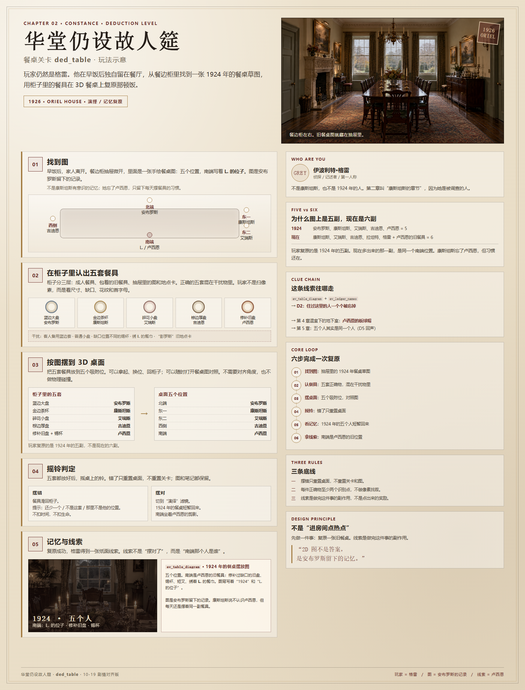
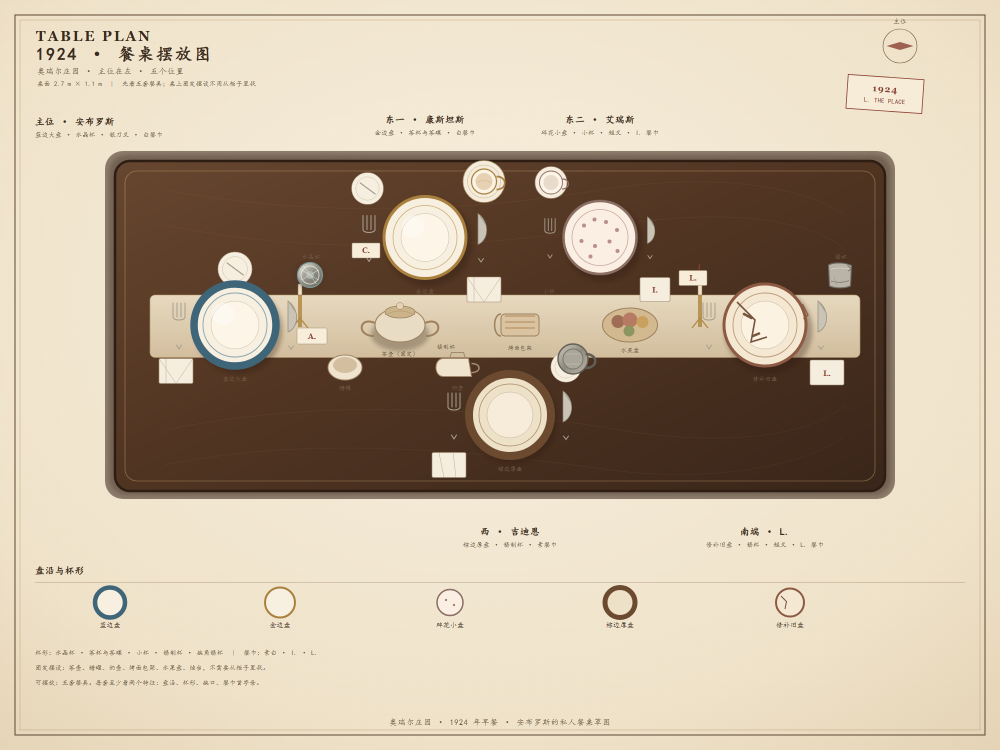
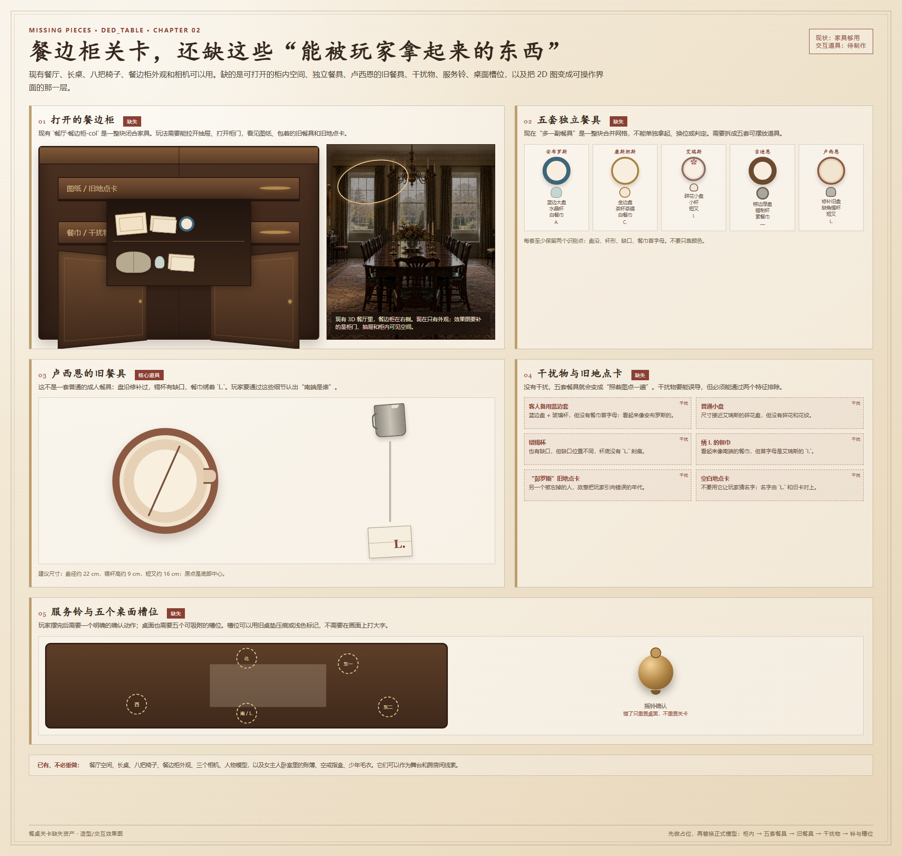
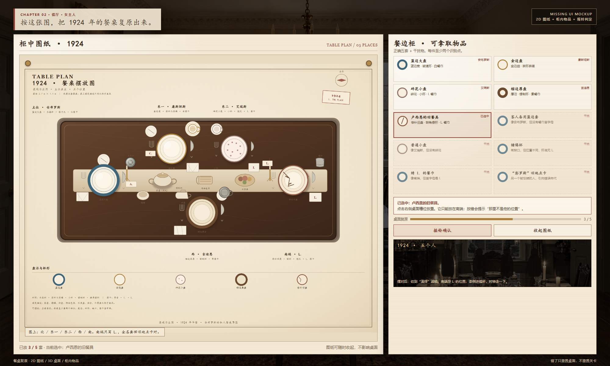
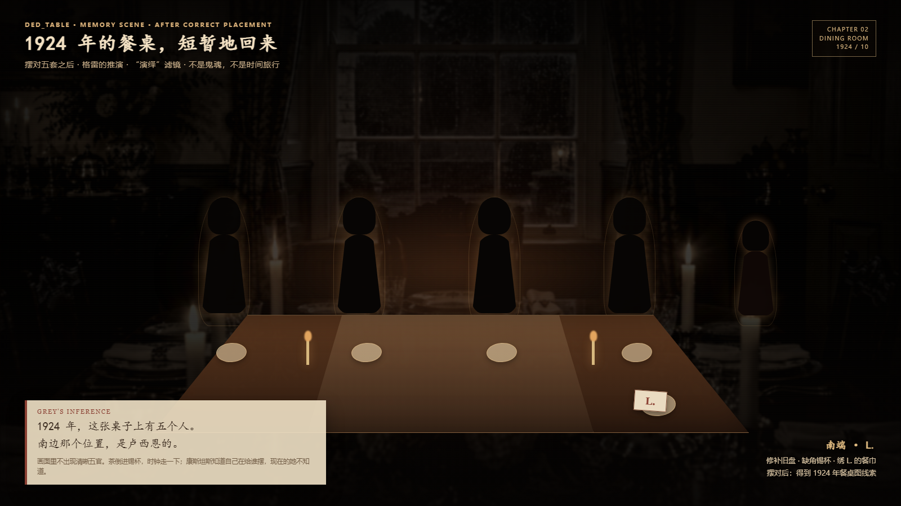

> 10-22 快照可读性修正：图纸已重绘，支持持续阅读、缩放和平移；上部抽屉及柜门转轴已调整。当前行为与验证见 [餐桌可读性记录](../验证/2026-10-22-餐桌可读性/README.md)。

> 10-22 试验状态：本文以下为 PR33 原始设计交付，尚未获本项目人工验收。本分支适配以 [试玩说明](../验证/2026-10-22-PR33试玩/README.md) 为准。常规餐厅继续删除南端空椅和主位椅；两椅仅由本箱式关卡临时加载。基线已有剧情、移动和检视实现优先保留；PR 内的程序化物件及脚本内文字暂保留供体验，不能据此视为架构规范已放宽。

# 关卡：华堂仍设故人筵 `ded_table`

| 项目 | 内容 |
| --- | --- |
| 关卡文件 | `godot/levels/ded_table.tscn`（独立场景，按小关卡叠在餐厅上；场景里自带餐厅、长桌与餐边柜） |
| 类型 | 演绎（记忆复原） |
| 章节 | 第 2 章（C2-01—C2-05） |
| 入口 | 餐厅餐边柜**没关严的抽屉**里的 1924 年餐桌摆放图（关内按 E 拉开抽屉、拿起图，图纸展开后才解锁摆餐具；主线由 `C2-02a` 进入餐厅） |
| 产出 | `ev_table_diagram`（新），作为 S2-03①“多摆的一副餐具”的新候选实现；D2 可选，指向卢西恩 |
| 负责 | 待定 |
| 状态 | 可玩 MVP：第一人称走动、抽屉入口、拿取/摆放 9 件、自动判定、格雷聊天框提示、自动摇铃；记忆演出已接 3D（四大人 + 卢西恩剪影 + 倒茶特写 + 暖褐滤镜 + 座钟/倒茶声，约 12 秒）；素材已登记（第 14 节） |
| 参考 | 《02》第 9.5 节第 2 章；《03》第 2.2 节；`docs/关卡/manor.md` 餐厅；`assets/2d/T-029-餐厅/` |

更新日期：2026-10-20

> 本文只写玩法设定。10-20：`godot/levels/ded_table.tscn`、餐具与柜内物件、摆位判定与成功卡已进工程，入口是镜头表 `C2-02a` 的 `level(ded_table,ev_table_diagram)`。记忆演出（第 8.1 节）还没做，详见第 13 节交付记录。

> **10-19 剧情变更后的对齐**：1924 年餐桌图是**安布罗斯留下的记录**，不是康斯坦斯有意识的记忆。康斯坦斯已经忘了卢西恩，但每天仍摆那副餐具；这是习惯，不是记忆。第 4 章温室下的地下室里，卢西恩的板球帽是这条线索的回声。





## 1. 一句话

玩家仍然是格雷。他在早饭后独自留在餐厅，从餐边柜里找到一张 1924 年的餐桌摆放图，用柜子里的餐具在 3D 餐桌上复原那顿饭。摆对后，他看见 1924 年的南端坐着卢西恩——康斯坦斯至今还在摆的那副餐具，原来不是多出来的，是一个死去儿子的旧位置。

### 核心循环

找到图 → 在餐边柜里认出五套正确餐具和四件公用件 → 摆到对应的九个位置 → 每摆满一次自动判断 → 错了格雷用聊天框指出一件、改完再指下一件 → 九件全对后格雷自动摇铃 → 看记忆演出 → 拿到卢西恩的线索。

## 2. 玩家角色与叙事视角

### 2.1 玩家是谁

玩家扮演的始终是**伊波利特·格雷**，也就是剧情中的侦探、记述者、“解释者”人格。

不是康斯坦斯，不是卢西恩，也不是任何 1924 年的人。

第二章叫“康斯坦斯的章节”，是因为康斯坦斯是这一章的核心人物、嫌疑人和情感中心，不是因为玩家变成了她。第一章叫“死者”，玩家也没有变成安布罗斯；第三章叫“小女孩”，玩家也没有变成艾瑞斯。

### 2.2 关卡是什么性质

这是一个**演绎关卡**，不是回忆关卡，也不是时间旅行。

- 2D 餐桌图是真实物证；
- 3D 餐具是真实物品；
- 玩家摆出来的 1924 年餐桌，是格雷根据图做的**记忆复原**；
- 复原成功后出现的 1924 年一家人，是格雷推演的视觉化，不是鬼魂；
- 线索来自图、餐具、餐巾上的 `L.`，不来自“格雷看见了什么”。

### 2.3 为什么是格雷一个人

早饭后，家人离开餐厅，康斯坦斯去厨房。格雷留在餐厅。

餐边柜的抽屉没有锁，微微开着。格雷以客人的身份在餐厅里走动，发现里面的旧餐桌图。这一段不需要康斯坦斯在场，也不需要她允许；她不在，格雷才有机会翻看。

图不是康斯坦斯有意留给玩家的；它是安布罗斯夹在旧地点卡和餐巾之间的记录。康斯坦斯没有扔掉他的东西，但她说不出这张图是什么。

### 2.4 画面语言

- 进入关卡时是“当下”的自然光，餐厅是 1926 年的餐厅。
- 玩家打开餐桌图、开始复原时，画面逐渐切到“演绎”的红光或银盐颗粒。
- 复原成功后的 1924 年场景沿用“演绎”画面，明确告诉玩家：这是格雷在想，不是他亲眼看见。
- 记忆里的家人用模糊、遮眼、剪影式处理，不出现清晰五官。

### 2.5 叙述约束

- 格雷只省略，不说谎。
- 格雷不能说“我看见 1924 年”“我记得那顿饭”“这是我第一次进餐厅”。
- 格雷能说的是：“如果这张图是真的……”“1924 年，这张桌子上应该有五个人。”
- 记忆演出只呈现格雷从图和物件推出的内容，不新增他不可能知道的事实。

### 2.6 戏剧反讽

玩家以格雷的身份，替一个母亲复原她死去儿子的餐桌。

但格雷本人就是让她失去丈夫的人。玩家现在还不知道；第 6 章知道“凶手是我”之后，再回看这个关卡，它才会变味：他不是在安慰她，他是在她不知情的情况下，从她的悲伤里拿线索。

10-19 新剧情还补了一层：主人自己想被谋杀，并摆好了局。餐桌关卡不涉及这一层，也不提前解释星期四；它只让玩家看见卢西恩。等玩家读完第 4 章地下室和第 6 章残页，再回看这张 1924 年的餐桌，会多一层“主人想保住这个家”的重量。

这一层只作为叙事注记，不在第 2 章说破。

## 3. 核心谜题

### 3.1 图上是五个人，现在桌上是六副

这是本关卡最重要的逻辑，必须在文档和游戏里说清楚。

**1924 年的家庭**：

- 安布罗斯
- 康斯坦斯
- 艾瑞斯
- 吉迪恩
- 卢西恩

一共五个人。所以 1924 年的餐桌图上是**五个位置**，南端是卢西恩的旧餐具。

1924 年也是卢西恩最后一次出现在合影里的年份；这张餐桌图正好是那一年。第二年，合影里没有他，家里也没有他。这和第 4 章地下室记录的“被收进合影以后被所有人忘掉”是同一条规律。

**现在的家庭**：

- 活着的康斯坦斯、艾瑞斯、吉迪恩、拉坦特，加上客人格雷，一共五个人；
- 康斯坦斯仍然在南端多摆一副卢西恩的餐具；
- 所以现在的桌子看起来是**六副**。

她已经忘了卢西恩；但每天摆那副餐具的习惯还在。这正是 10-19 剧情里“女主人忘了卢西恩”的意思：她不是记得，她是身体还在做。

这是早饭时的样子；关卡开始时桌子已经收空，玩家复原的是 **1924 年的五副**，不是现在的六副。

现在桌子的其他座位与 1924 年不一定相同；玩家只对照南端那副餐具的位置。这样不会把“复原 1924 年”和“摆今天的早饭”混在一起。

复原成功后，玩家会意识到：

> 现在南端那副“多出来”的餐具，不是给客人的，也不是新加的。\
> 它在 1924 年就属于卢西恩。\
> 康斯坦斯只是把儿子的位置一直留到了今天。

### 3.2 玩家不是在猜 1924 年怎么坐

2D 图已经把 1924 年的摆放画好了。玩家不是在猜“谁坐哪里”，而是在做两件事：

1. 照着图，把餐具摆对。这是操作。
2. 发现图上为什么是五副、南端为什么是卢西恩的旧餐具，而现在的桌上多出一副。这是推理。

摆对只是让这张图“成立”。发现南端是谁，才是线索。

## 4. 空间与物件

### 4.1 空间

复用餐厅场景，重点是长桌和餐边柜。

餐桌有五个复原位置：

```
                    北端：安布罗斯

      西侧：吉迪恩                东侧：康斯坦斯
                                        艾瑞斯

                    南端：卢西恩
```

说明：

- 这是 1924 年的五位置复原图，不是现在的六副桌面。
- 现在桌子南端多出来的那一副，只在关卡开头和结尾作为对照出现，不作为复原目标。
- 玩家不需要摆格雷现在坐的位置；复原的是 1924 年。
- 桌上五个位置可以用旧桌垫留下的浅痕区分，不用在画面上打大字标签。

### 4.2 餐边柜

餐边柜分三层，打开后物品可见，不做隐藏物品式的像素搜索。

| 层 | 内容 | 作用 |
| --- | --- | --- |
| 上层 | 成人的盘子、杯子、刀叉 | 找出安布罗斯、康斯坦斯、吉迪恩的餐具 |
| 下层 | 一块包着的布，里面是卢西恩的旧餐具和一张写着“卢西恩”的旧地点卡（被划掉） | 找出南端的核心物件，并把 `L.` 和全名对上 |
| 抽屉 | 折起来的 1924 年餐桌图、旧地点卡、餐巾 | 入口线索与干扰项 |

图折在抽屉里，和旧地点卡、餐巾放在一起，和卢西恩的餐具包在一起。图是安布罗斯留下的记录；康斯坦斯没有扔掉他的东西，但她说不出这张图是什么。她每天摆餐具时不会打开它。

它不是第 4 章地下室那种逐年纪录，只是一张当年的餐桌草图；安布罗斯把它和卢西恩的餐具收在一起，作为私人的纪念。

### 4.3 五套正确餐具

| 位置 | 人物 | 餐具组合 | 识别特征 |
| --- | --- | --- | --- |
| 北端 | 安布罗斯 | 深蓝边大盘（盘沿内两道蓝线）、切面水晶玻璃杯、银刀叉、白餐巾、`A.` 卡片 | 蓝边宽、杯身有竖向切面、刀叉最正式 |
| 东一 | 康斯坦斯 | 金边大盘（两道金线）、金边花纹茶杯 + 金边茶碟、银刀叉、白餐巾、`C.` 卡片 | 盘/杯/碟都有金边、杯身有花纹 |
| 东二 | 艾瑞斯 | 碎花小盘（散落粉点 + 两道玫瑰线）、小杯 + 茶碟、短叉、绣 `I.` 的餐巾、`I.` 卡片 | 盘面粉点、尺寸小、有茶碟 |
| 西侧 | 吉迪恩 | 棕边厚盘（两道棕线）、带把手锡制啤酒杯、餐刀、素色餐巾、`G.` 卡片 | 盘沿厚、杯有把手和凹痕 |
| 南端 | 卢西恩 | 棕边旧盘（两道棕线、裂纹 + 金属修补夹）、缺角锡杯、短叉、绣 `L.` 的餐巾、`L.` 卡片 | 裂纹与补钉、锡杯缺口、立体 `L.` |

每件正确物品至少有两个识别特征，例如“比成人盘略小 + 修补痕”“锡杯 + 缺口”“餐巾 + `L.`”，避免只靠颜色或只靠大小。

### 4.4 干扰物品

柜子里除了正确物品，还放几件“很像但不对”的东西：

| 干扰物 | 像什么 | 区别 |
| --- | --- | --- |
| 第六套成人蓝边餐具 | 安布罗斯的蓝边盘 | 没有餐巾首字母，是客人备用套 |
| 一只普通小盘 | 艾瑞斯的小花盘 | 没有碎花，边缘没有花纹 |
| 一只锡杯 | 卢西恩的锡杯 | 缺口位置不同，杯底没有 `L.` 刻痕 |
| 一块绣 `I.` 的餐巾 | 卢西恩的 `L.` 餐巾 | 首字母是 `I.`，属于艾瑞斯 |
| 一张“彭罗斯”旧地点卡 | 卢西恩的地点卡 | 另一个被忘掉的人，故意引偏 |

干扰物不是纯刁难，它们各自指向剧情里的其他人或家庭习惯。玩家认错时，得到的提示也能让玩家学到东西。

“彭罗斯”旧地点卡只作为阅读干扰，不作为可摆放的餐具；玩家不能把它放到桌上。

抽屉里另有一张写着“卢西恩”的旧地点卡，被划掉；它和南端的旧餐具放在一起，是把 `L.` 和全名对上的物件。“彭罗斯”卡是另一张干扰项，不要把两张卡混成一张。

### 4.5 桌面公用件（10-21 新增）

图纸中间还有一组公用件，和五套餐具一起构成“全部摆对”：

| 公用件 | 桌上位置 | 识别特征 |
| --- | --- | --- |
| 烤面包架 | 桌子中线，茶壶南侧第一件 | 银架 + 两片吐司 |
| 水果盘 | 桌子中线，烤面包架南侧 | 金边浅盘 + 五种水果 |
| 糖罐 | 桌子中线，水果盘南侧 | 花带盖碗、双耳、金钮、银勺 |
| 小碗 | 桌子中线，糖罐南侧，铃北侧 | 最小的白碗，蓝口沿 |
四个公用件在桌上**排成一排**（沿桌子长轴），不要摆成两排；茶壶在它们北端，铃在它们南端、略靠东，避免被公用件挡住。

- **茶壶**按图纸标“固定”，开场就在桌上，不用拿。
- 这四件放在柜子**下层**（第二层）；柜顶放五件干扰物，仍可翻看，但只用于排除，不参与判定。
- 五个位置 + 四件公用件，共 **9 件**；全部摆对才算完成。

## 5. 2D 餐桌图

### 5.1 图的内容

一张手绘的俯视餐桌图，画在旧纸上，折成四折。它像是安布罗斯给全家福排位置时画的草图，不像康斯坦斯每天用的家务清单。

- 五个位置：北、东一、东二、西、南。
- 每个位置画着简单的餐具图标：盘子、杯子、刀叉、餐巾。
- 南端的图标比成人盘略小，餐巾角上写着 `L.`。
- 图背面写着年份 `1924`，旁边还有一行小字：`L. 的位子。` 字是安布罗斯的笔迹。
- 餐具包里另有一张写着“卢西恩”的旧地点卡；玩家可以把 `L.` 和全名对上。

### 5.2 图的呈现

- 图是手绘草图，不是照片；用颜色、轮廓和首字母区分物品，不用照片级细节。
- 玩家可以拿起图；按 `P` 在镜头前展开一张 3D 纸片（像端在手里），按 `Esc` 收起，不需要在柜子和桌子之间反复走。
- 图从餐边柜抽屉里拿出来；拿走以后抽屉就空了（没有把图钉在柜门上，避免和第 6 节抽屉入口冲突）。
- 图在关卡结束后收进记事本，成为线索卡。

## 6. 玩法流程

> 10-20 晚改版：这一关是第一人称走动，不再用固定机位 + 屏幕下方的 2D 物品卡。餐具就是场景里的 3D 物件，玩家走到餐边柜前拿、走到桌边放。

### 6.1 进入

早饭后，家人离开餐厅，康斯坦斯去厨房。格雷留在餐厅。

桌上的早饭已经收走，桌面空着；南端那副餐具放在餐边柜上，作为对照。

镜头 `C2-02a` 之后进入关卡：玩家第一人称站在长桌**西北角**，面朝长桌；餐边柜在右手边（西墙），**下层抽屉没有关严**，微微开着。西侧留出一条走到柜前的通路。

**10-21 远端变动**：北端主位椅、南端空椅已从 `room_dining.gltf` 删除，现在餐厅两端没有椅子，玩家可以从北、南两头绕桌走；桌上的五个位置和九件摆位不变。记忆演出的 1924 椅子不在这一层处理。

HUD：

> 餐边柜里有一张旧餐桌图。它记的是哪一年？
> 先走到右手边的餐边柜，拉开抽屉看看里面有什么。

此时右上角的 P 提示是隐藏的；玩家还没有图纸。

### 6.2 找到图

1. 玩家走到餐边柜前，准星对准抽屉面板，按 E → 抽屉滑出来，里面是一张折起来的旧纸。
2. 准星对准纸，按 E → 拿起图纸，**镜头前展开 3D 纸片**。
3. 图纸展开的这一刻关卡才真正开始：左上角目标更新成“按这张图，把 1924 年的餐桌复原出来”，右上角出现“P 查看 1924 年图纸”，餐具的拿取同时解锁。
4. 图纸展开后：**鼠标滚轮**放大 / 缩小（纸片在镜头前 0.38–1.10 米之间移动）；按 `Esc`，或**点击一下**收起图纸，开始摆餐具。纸上能看到五个位置、南端的旧餐具图标、背面的 `1924` 和 `L.`。

抽屉可以再推回去，也可以重新拉开；图拿走以后抽屉就空了。

### 6.3 在柜子里找餐具

玩家站在柜前，准星逐件扫过三层层板；对着某件餐具时，屏幕下方出现一行提示：

> E　拿起：蓝边大盘

- 一次只能拿一件；拿起的物件出现在画面右下角（像端在手里），顶部显示“手上：……”。
- 对着餐具按 E 拿起；按 R 放回柜子，不会丢失。
- 每件正确物品至少有两个识别特征（盘沿、杯口、缺口、餐巾上的 `L.` / `I.`），玩家可以在手里转着看，也可以随时按 `P` 打开图纸对照。
- 旧地点卡只能翻看（提示“E 翻看”），不能摆上桌。

玩家要找出五套正确的餐具和四件公用件，排除干扰物。

### 6.4 在 3D 桌上摆放

玩家端着餐具走到桌边，准星对准桌上的细黄铜嵌线圆环，按 E。**桌上不再显示“E 摆放：北端”这类槽位提示**：位置只由图纸和圆环决定，避免提示把答案直接说出来。

- 圆环是桌面上的**细黄铜嵌线**，不是发光粗环；**只在手里端着餐具时出现**，空手/放好后隐藏，桌子保持干净。
- 圆环就是位置；放上去以后圆环收起，物件留在桌面。
- 对着已经放好的位置按 E，会把那件拿回手里（可以先换位），不再显示物品名。
- 手里有餐具时对着已占的位置按 E，是“换上”：原来的那件自动回到柜子。
- 每个位置只放一套；玩家可以随时打开图对照。
- 只有餐边柜里拿取时保留“E 拿起：……”；桌面摆放/拿起只给中性的“摆好了/拿了回来”。

### 6.5 确认

九件都摆上桌以后，游戏自动检查，不需要玩家再按铃。

- **九件全对**：格雷自动拿起铃，摇一下，停顿约 1 秒，进入记忆演出；
- **有错**：不摇铃，格雷的内心独白以聊天框弹出，一次指出第一个错；玩家按 E 继续，改完再判断；
- **只有八个位置摆满**：不判断；如果就那样发呆 5 秒，HUD 只提示“桌上还空着一个位置”，这是数量提示，不是对错提示。

操作：

| 键 | 作用 |
| --- | --- |
| WASD | 走动 |
| 鼠标 | 看 |
| E / 左键 | 拿起、摆放、翻看、继续聊天框 |
| P | 打开 1924 年图纸 |
| Esc | 收起图纸 |
| R | 把手里这件放回柜子 |

## 7. 判定、重置与提示

### 7.1 正确

九件全部正确，格雷自动摇铃，进入记忆演出，见第 8 节。

### 7.2 错误

不重置桌面，也不摇铃：

- 摆错时，格雷的聊天框指出**第一个**错件；玩家按 E 继续；
- 正确的槽位不动；玩家只需要改被指出的那一两件；
- 改完以后如果还有错，格雷再指出下一个，直到全对；
- 餐桌图、已经看过的物品、记事本里的记录全部保留；
- 不扣时间，不扣生命，不算失败，也不会把餐具全部退回柜子。

铃只在全对时响；错的时候没有铃声、没有红框、没有“失败”字样。

### 7.3 提示

提示全部来自格雷的内心独白，以屏幕下方的纸质聊天框显示，署名“格雷”，一次最多两行，按 E 继续。

| 错误类型 | 格雷会说什么 |
| --- | --- |
| 把康斯坦斯的茶杯摆到北端 | “……北端摆的是康斯坦斯的金边茶杯。那不是安布罗斯的玻璃杯。” |
| 把吉迪恩的锡杯摆到南端 | “……南端摆的是吉迪恩的锡杯。那不是南端那副旧餐具。” |
| 把公用件摆到座位 | “……烤面包架是桌子中间的，不是这个位置。” |
| 把座位餐具摆到桌子中间 | “……吉迪恩的锡杯不该放在桌子中间的糖罐位。先把它放回柜子。” |
| 用了客人备用套 | “……客人备用套不是这九件里的东西。” |

规则：一次只指一个错；改完再指下一个。**记忆之前不出现“卢西恩”这个名字**，只说“南端那副旧餐具”或 `L.`；记忆第二句和线索卡才用全名。

### 7.4 不做的事

- 不做计时；
- 不做“错一次直接失败”；
- 不做随机物品位置；
- 不做像素级找物；
- 不做需要对齐角度或物理碰撞的摆放。

## 8. 记忆演出与线索

### 8.1 演出

九件正确后：

1. 餐厅暗下来，画面切到“演绎”的红光或银盐颗粒。
2. 1924 年的餐桌短暂出现：安布罗斯、康斯坦斯、艾瑞斯、吉迪恩坐在桌边，南端是一把拉开的小椅子。
3. 南端坐着一个模糊的少年剪影。看不清脸，只能看见他面前的旧盘子和锡杯。
4. 康斯坦斯给锡杯倒茶。茶一直是满的。
5. 时钟走了一下。
6. 画面回到现在，桌子恢复原样。

茶满、时钟、剪影都是格雷推演的意象，不作为新证据；它们只帮助玩家感受“这个位置一直有人”。

1924 年的康斯坦斯知道自己在给谁摆；现在的她不知道。这个对比是本关卡的情感落点，也是 10-19 新剧情“女主人忘了卢西恩”的直接体现。

格雷的内心独白：

> 1924 年，这张桌子上有五个人。\
> 南边那个位置，是卢西恩的。

这段是格雷的推演，不是鬼魂事件。画面必须用“演绎”滤镜与当下区分开。

**实现状态（10-21 晚）**：已接 3D 记忆演出。自动摇铃后淡入 1924：西南角宽景，四个大人用原模型 `sit` 末帧、保留原材质（由记忆滤镜统一调色），南端卢西恩用程序化剪影；约 5 秒切到南端特写，倒茶、杯子始终满、热气；暖褐/颗粒滤镜、黑边、座钟声、倒茶声；约 12 秒，E/点击可跳过，结束后恢复现在的餐厅和线索卡。第二句独白和线索卡直接说“卢西恩”；之前的聊天提示仍不提前出现名字。

### 8.2 线索卡

**`ev_table_diagram`：1924 年的餐桌摆放图**

> 一张手绘的餐桌图，五个位置。\
> 南端是卢西恩的旧餐具：修补过缺口的旧盘（比成人盘略小）、锡杯、短叉、绣着卢西恩名字的餐巾。\
> 图背面写着“1924”和“卢西恩的位子”。\
> 图是安布罗斯留下的记录。康斯坦斯说不认识卢西恩，但每天还是摆着同一副餐具。

如果实现时想拆成两张卡，可以拆成：

- `ev_table_diagram`：1924 年的五位置餐桌图；
- `ev_child_plate`：南端的旧餐具。

第一版建议合并为一张，避免证据表膨胀。

### 8.3 连线与后续

新增一条 D2 连线：

> `ev_ledger_names` + `ev_table_diagram`

`ev_table_diagram` 对应 D2 的 S2-03①“多摆的一副餐具”，不新增 D2 槽位；它只是把这个槽位从“桌上的餐具”扩展成“1924 年的餐桌图 + 南端的旧餐具”。

回应：

> 底片簿上，1924 年多了一个“卢西恩”，第二年名字就没有了。\
> 这张 1924 年的餐桌图上，南端是他的旧餐具；现在的桌子上，康斯坦斯还在摆同一副。\
> 他确实在这张桌子上坐过。家里的人忘了他，东西没有。\
> 住过这里的人，一个个被忘掉了。

后续指向：

- 衣柜底层的少年毛衣（`ev_sweater`）；
- 储物间门框上的身高刻痕 `L.`（`ev_doorframe_l`）；
- 1924 年的合影；
- 第 4 章温室下的地下室：卢西恩的板球帽，玩家可以用第 2 章得到的名字去认；
- 第 3 章艾瑞斯的画；
- 第 5 章拉坦特的降灵会；
- 第 5 章“所有人是同一个人”：这张五个人的 1924 年餐桌会成为 D5 的回声；
- 第 5 章康斯坦斯的手与疤。

### 8.4 线索属于谁

这条线索属于**卢西恩**，不是康斯坦斯，也不是安布罗斯。

- 安布罗斯是“记忆的保存者”：图是他留下的记录，只有他记得卢西恩；
- 康斯坦斯是“习惯的保存者”：她忘了卢西恩，但每天还是摆那副餐具；
- 卢西恩是“被忘记的人”：1924 年他还在桌上，后来从合影和家里消失；
- 玩家通过关卡得到的是“这个家曾经有一个儿子，叫卢西恩，他还在被摆一副餐具”。

康斯坦斯的悲伤是这一关的情感层，但可用的证据落点是卢西恩。

## 9. 逻辑自查

| 可能的问题 | 本文的回答 |
| --- | --- |
| 玩家为什么在餐厅？ | 早饭后家人离开，格雷是客人，留在餐厅；康斯坦斯去了厨房 |
| 玩家为什么能翻柜子？ | 餐边柜在餐厅，抽屉没锁、微微开着；格雷是侦探，正在调查 |
| 图为什么在餐边柜？ | 图是安布罗斯留下的记录，夹在旧地点卡和餐巾之间；康斯坦斯没有扔掉他的东西 |
| 为什么图上是五副，现在是六副？ | 1924 年家里五个人；现在活着的五个人，加上康斯坦斯仍为卢西恩摆的一副，所以看起来六副 |
| 女主人不是忘了卢西恩吗？为什么还留着图和餐具？ | 她忘了卢西恩，但习惯还在；图是安布罗斯留下的，她没扔；她每天摆餐具，是身体记得，不是头脑记得 |
| 玩家摆的是哪一年的桌子？ | 1924 年，不是现在；现在南端那副只作对照 |
| 为什么摆对会出现 1924 年的人？ | 那是格雷根据图和物件做的推演，用“演绎”滤镜呈现，不是鬼魂或时间旅行 |
| 为什么摆对就能得到线索？ | 线索不是“摆对了”本身，而是图上的五副、南端的旧餐具和 `L.`；复原让这个异常变得可见 |
| 为什么不能直接问康斯坦斯？ | 她会说“摆错了”；这一关是格雷从物证复原，不依赖她的口供 |
| 康斯坦斯被送去镇上这件事要不要解释？ | 不解释。第 2 章原话“我也不知道为什么”保留，作为第 4 章地下室的伏笔；餐桌关卡不碰星期四 |
| 餐桌关卡要不要解释“她为什么忘了”？ | 不解释。关卡只呈现“她说不认识、但每天还摆”的行为；遗忘的规律留给第 4 章地下室 |
| 会不会提前泄露主人想被谋杀？ | 不会；餐桌关卡只涉及 1924 年的卢西恩，不涉及星期四、第二页、谋杀计划或“只会留下一个” |
| 和第 4 章地下室怎么接？ | 地下室里卢西恩的板球帽，是这条线索的回声；玩家用第 2 章得到的名字去认 |
| 摆错重置会不会太挫败？ | 只重置桌面，保留图和记录；第一次给方向提示，第二次以后给具体提示 |
| 会不会变成像素找茬？ | 柜子分三层，物品可见；每件正确物品至少两个识别特征；不做随机位置 |
| 会不会和 T1—T5 冲突？ | 不冲突；不改变死亡时间、凶手、叠印、身体特征；只补 1924 年家庭餐桌的物证 |
| 格雷会不会知道他不该知道的事？ | 不会；他只知道图和物品上写的东西，记忆演出是他的推演，不新增事实 |
| 玩家会不会误以为自己是康斯坦斯？ | 不会；全程第一人称格雷，文案明确“我”是格雷；康斯坦斯是调查对象 |

## 10. 实现建议

### 10.1 复用

- 餐厅场景、长桌、餐边柜、椅子、餐具基础模型；
- 家人模型或 1924 年剪影；
- 现有“演绎”滤镜与“当下”自然光；
- 证据板、记事本、线索卡 UI。

### 10.2 新增

- [x] 2D 餐桌图（手绘草图）→ `godot/art/footage/ded_table_blueprint.png`
- [x] 五套正确餐具（重点是卢西恩的旧餐具）→ `ded_table_props.gd` 的 `build_item()`
- [x] 四件公用件（烤面包架、水果盘、糖罐、小碗）+ 固定茶壶 → `build_shared()`
- [x] 五件干扰物 → 同上
- [x] 桌上铃铛 → `build_bell()`
- [x] 五个可放置位置与吸附逻辑 → `ded_table.gd` 的 `SLOT_POS` / `_place_item()`
- [ ] 一个“记忆演出”短过场

### 10.2.1 缺失资产与界面效果图







### 10.3 程序接口

- 桌子五个位置：`slot_north`、`slot_east_1`、`slot_east_2`、`slot_west`、`slot_south`；
- 四件公用件位置：`slot_toast`、`slot_fruit`、`slot_sugar`、`slot_small`；
- 五套餐具：`prop_set_ambrose`、`prop_set_constance`、`prop_set_iris`、`prop_set_gideon`、`prop_set_lucien`；
- 四件公用件：`shared_toast_rack`、`shared_fruit_bowl`、`shared_sugar_bowl`、`shared_small_bowl`；茶壶 `shared_teapot` 固定，不拿；
- 干扰物：`prop_decoy_guest`、`prop_decoy_plate`、`prop_decoy_cup`、`prop_decoy_napkin_i`、`prop_decoy_card_penrose`；
- 确认：`hs_bell`；
- 图：`hs_diagram`（实际实现是抽屉上的 `drawer` 与图纸上的 `diagram` 两个热区，见第 13 节）；
- 演出：`memory_table` 状态层或独立过场。

### 10.4 判定

用一张简单的映射表：

```text
slot_north   -> prop_set_ambrose
slot_east_1  -> prop_set_constance
slot_east_2  -> prop_set_iris
slot_west    -> prop_set_gideon
slot_south   -> prop_set_lucien
slot_toast   -> shared_toast_rack
slot_fruit   -> shared_fruit_bowl
slot_sugar   -> shared_sugar_bowl
slot_small   -> shared_small_bowl
```

九个位置全部匹配才算正确；茶壶固定，不参与判定。

### 10.5 内容表改动

- [x] `godot/content/story/evidence.csv` 新增 `ev_table_diagram`；
- [x] `godot/content/story/links.csv` 新增 `d2` 连线：`ev_ledger_names + ev_table_diagram`；
- [x] `docs/关卡/README.md` 登记 `ded_table`；
- [x] `shots.csv` 新增 `C2-02a`，用 `level(ded_table,ev_table_diagram)` 进入小关卡（10-20）；
- [x] 关内入口：餐边柜抽屉 + 折起的图（`drawer` / `diagram` 两个热区）；拉开抽屉、拿起图才解锁摆餐具（10-21）。
- [ ] 主线入口仍然由 `C2-02a` 自动进入餐厅；要升级成 dining 场景的 `hs_diagram` / 桌前线索引擎，玩家在餐厅自己触发进关。

### 10.6 工作量

- 第一版：1—2 天；
- 五个正确套装 + 四件干扰物 + 一张图 + 五个吸附位 + 一段短演出；
- 不做物理、不做自由旋转、不做随机摆放。

## 11. 验收标准

- 玩家不看外部提示，能在餐边柜里找到餐桌图；
- 玩家能通过图上的颜色、轮廓、首字母和缺口，找出五套正确餐具，并从下层找出四件公用件；
- 玩家摆错时能得到具体提示，且不会丢失图和已看过的信息；
- 九件（五套餐具 + 四件公用件）全部摆对后，玩家能看到 1924 年的记忆演出，并拿到 `ev_table_diagram`；
- 玩家能用 `ev_table_diagram` 和 `ev_ledger_names` 在证据板上推出 D2；
- 玩家能说清楚“1924 年五副、现在六副”的原因；
- 关卡不违反 T1—T5，不出现格雷“看见过去”或“第一次来”的说法。

## 12. 待定

- [ ] 是否在卢西恩的旧餐具旁再加一件童年小物，作为第二个识别特征？建议加，但不要让它变成新的推理线索。
- [ ] `ev_table_diagram` 是否拆成“图”和“餐具”两张卡？建议第一版合并。
- [ ] 1924 年记忆演出用现有角色模型、剪影还是 2D 剪纸？
- [ ] 关卡优先级定 P0 还是 P1？建议 P1；本章 P0 仍由合影/相册提供 `ev_ledger_names`。
- [ ] 现在南端那副餐具是否在关卡开头做一次特写？建议做，作为“五副对六副”的视觉锚点。
- [x] 图是康斯坦斯有意识的记忆，还是安布罗斯留下的记录？已按 10-19 剧情定为安布罗斯的记录；康斯坦斯只保留习惯。

## 13. 交付记录

### 2026-10-20：可玩 MVP 接进第 2 章

**做了什么**

- `godot/levels/ded_table.tscn` + `ded_table.gd` + `ded_table_props.gd`：在餐厅模型上补开放餐边柜、五套正确餐具与五件干扰物（车削网格 + 引擎内程序化贴图）、五个桌面槽位与吸附、服务铃、2D 图纸放大、分级的错误提示、只重置桌面、成功卡；另有 `--auto-solve` / `--capture-ded` 两个自查开关。
- 接入主线：镜头表新增 `C2-02a`（餐厅，`level(ded_table,ev_table_diagram)`）。`level` 是 10-20 新增的系统动作：把小关卡叠在当前房间上、隐藏房间与主界面，关卡收起成功卡后发出 `finished`，回到餐厅再收证据；两种讲法的自动通关都通过。
- `ev_table_diagram` 与 d2 连线已进 `evidence.csv` / `links.csv`。
- 素材与登记：餐具、干扰物、铃登记到 `assets/登记表.csv`（`ded_table_*` 行），2D 图纸单独一行；检查截图移到 `assets/3d/ded_table/review/`，说明见 `assets/3d/ded_table/README.md`。

**没做**

- 第 8.1 节的记忆演出（压暗、演绎滤镜、1924 年四人剪影、卢西恩、倒茶、时钟、两行独白）；现在摆对只弹成功卡。
- 进入关卡仍是镜头自动进入（`C2-02a`）；关内已经要玩家自己走到餐边柜按 E。按《03》第 2 节，最终入口应挂在桌前线索引擎上。
- 现在 `C2-02a` 在必经路径上，等于把这一关变成必玩；规划里它是 P1（可选线索）。等桌前线索引擎做好后再改成可选入口。
- 桌面近景的灯光：`_capture_lights()` 的两盏灯只在截图时加，实际游玩比截图暗。
- 近景截图在 `assets/3d/ded_table/review/`；进入 / 返回主线的截图在 `assets/production/2026-10-20-ded_table-entry/`。
- 铃声已补：`sounds.csv` 新增 `table_bell`（银铃，5.8 s，`godot/audio/sfx/table_bell.wav`）；餐具碰撞仍然没有。

### 2026-10-20 晚：改成第一人称

**为什么改**：用户试玩后指出两点——① 预期是像前面章节一样第一人称走动，不是固定机位；② 屏幕下方那排 2D 物品卡把桌面挡住了，五个圆环只露得出三个，剩下两套不知道往哪放。

**做了什么**

- **玩家**：主线里复用 `SceneHost.player`，单独运行时 `ded_table.gd` 自己建一个；出生点从北端正中（被主位椅和墙夹住、走不出去）挪到长桌**西北角**（14.7, −4.15），面朝长桌，西侧有一条直通餐边柜的路。WASD + 鼠标看，操作和前面章节一致。
- **拿取与摆放**：全部用准星射线（`E` / 左键）。对着柜里的 3D 餐具 → `E 拿起`（保留物品名）；对着桌上的细黄铜圆环 → `E 摆放`，**不显示槽位提示**；对着已占的位置 → 拿起/换上，也不报槽位名；`R` 放回柜子；一次只拿一件，拿起的物件端在画面右下角。
- **图纸**：对着抽屉里的纸按 E，拿到后随时按 `P`，在镜头前展开一张 3D 纸片；按 `Esc` 收起。不是全屏 UI，走动时也端着。
- **HUD**：左上目标、画面中心准星、下方一行交互提示、顶部“手上：……”、右下操作提示；没有底部物品栏，桌子不再被挡。
- **碰撞**：给长桌和餐边柜加了实体碰撞；进关时把主房间（餐厅）的碰撞整体静音，否则原先那个闭合餐边柜的碰撞会把关卡里打开的柜子重新堵上；关卡里的旧餐边柜网格隐藏时也一并静音它的 `StaticBody3D`。
- **鼠标**：`player.capture_mouse()` 加 300 ms 的忽略位移窗口，进关卡/关图纸后镜头不再被系统的光标回中甩到桌面或天花板。
- **自查**：`--self-test` 用真实准星射线走完“拿五套 → 摆五处 → 看图 → 摇铃”，PASS；主线里（宿主玩家）也 PASS。`--capture-hud` 截第一人称 HUD；`--capture-ded` 仍出宽景/柜内/近景/微距。

**没做**

- 第 8.1 节的记忆演出（仍然是摆对只弹成功卡）。
- 摇铃与餐具碰撞音效、桌面近景的真实补光。
- 进入关卡仍是 `C2-02a` 自动进入；关内已经要玩家自己走到餐边柜按 E。

### 2026-10-21：按图纸补四件公用件

用户要求“图纸上的全部物品都要摆上桌，摆对才过”；按 B 方案保留五套为整体，另加图纸中间的公用件：

- `ded_table_props.gd` 新增 `build_shared()`：烤面包架、水果盘、糖罐、小碗、茶壶；茶壶按图纸标“固定”，开场就在桌上，不参与拿取。
- 桌上新增四个公用件槽位（`slot_toast` / `slot_fruit` / `slot_sugar` / `slot_small`），围绕服务铃摆；判定从 5 件改为 **9 件**（五套餐具 + 四件公用件），全对才成功。
- 公用件放在柜子**下层**；五件干扰物挪到柜顶，仍可翻看、只用于排除；图纸钉到敞开的左门内侧，给柜顶腾位置。
- `--self-test` 覆盖 9 件拿取/摆放/看图/摇铃，PASS。

**没做**：记忆演出、音效、近景补光。四条公用件已细化（金边、青花花带、水果/吐司/银勺），烤面包架和茶壶还可以在记忆演出那一轮再调。

### 2026-10-21：入口改成餐边柜抽屉

用户要求按文档把入口做回“抽屉里的图”：

- 餐边柜下层加了一个**能拉开的抽屉**（`drawer_root`），初始没关严；里面放一张折起的纸（`drawer_paper`）。
- 准星对着抽屉按 E：抽屉滑出，纸露出来，HUD 仍问“它记的是哪一年？”；对准纸按 E：拿起图，3D 图纸在镜头前展开，左上角目标更新为“按这张图…”，右上角出现 P 提示，同时**解锁餐具拿取**。
- 图拿走前不能拿任何餐具（`_pick_up` / `_ring` 都会提示先找图）；P 也打不开图纸。
- 图纸展开后按 `Esc`，或**点击一下**收起，开始摆餐具；之后按 `P` 可重看。
- 抽屉可以推回去、重新拉开；图拿走后抽屉为空。

`--self-test` 现在会先走“拉抽屉 → 拿图 → 收图纸”，再拿九件、摆九处、摇铃；单场景与主线都 PASS。

### 2026-10-21 晚：按 2D 图纸校正五套餐具 + 图纸滚轮缩放

用户试玩指出第二层有三套和 2D 图纸对不上：

- **少花纹**：艾瑞斯的碎花盘贴图太淡。盘沿加 12 枚小花瓣、盘心加一朵六瓣花，远看也能认出。
- **少金边**：康斯坦斯的盘子金边只有 1.2 mm 高，几乎看不见。金边加厚提亮（3.7 mm），茶杯口也补一圈金边。
- **认不出是谁**：卢西恩的旧盘/锡杯和吉迪恩太像。盘沿裂纹加长、补钉加大，餐巾上用深色线绣出立体的 `L.`，缺角锡杯保留。
- 柜内十套装具斜放 38°，玩家站在柜前能看到盘沿、杯口和餐巾首字母，而不是只看侧面。
- 图纸展开后支持**鼠标滚轮缩放**（纸片在镜头前 0.38–1.10 米之间移动）；`Esc` / 点击收起，`P` 重新打开。

### 2026-10-21 晚：餐桌铃音效
`sounds.csv` 新增 `table_bell`，文件 `godot/audio/sfx/table_bell.wav`（44.1 kHz 立体声 WAV，**5.8 s 银铃**，-6 dB）。合成脚本 `assets/audio/sfx/scripts/synth_table_bell.py`。
三个候选：`table_bell`（银铃，正片，5.8 s）、`table_bell_brass`（黄铜台铃，旧版）、`table_bell_old`（旧铜铃）；试听与说明在 `assets/audio/sfx/preview/README.md`。 用户 2026-10-21 试听后确认用银铃，正片定稿。
餐具碰撞/摆放音效仍然没有。

### 2026-10-21 深夜：逐套对照 2D 图纸再对齐

用户说上次改完辨识度仍不高。把图纸上五个位置逐张放大对照后，补了这些**图纸上有、3D 没有**的东西：

| 位置 | 图纸上有 | 3D 补了什么 |
| --- | --- | --- |
| 五只盘子 | 盘沿内侧两道细色线 | `_plate` 统一加两道同色细环 |
| 安布罗斯 | 切面水晶杯 | 玻璃加 10 条竖棱 + 3 道横刻线，偏蓝 |
| 康斯坦斯 | 茶杯下的金边茶碟 | 加茶碟；杯口金边保留 |
| 艾瑞斯 | 盘面散落的粉点、茶杯下茶碟 | 去掉凸起花瓣，改成 10 个扁平粉点；加茶碟 |
| 吉迪恩 | 棕边厚盘、带把手锡杯 | 补两道棕线；G. 卡片 |
| 卢西恩 | 棕边旧盘、大裂纹、盘沿金属夹 | 加棕边/两道棕线、三段折线裂纹、金属修补夹、L. 卡片 |
| 五个位置 | 白卡片上的 A./C./I./L. | 全部加 `A./C./I./G./L.` 立体卡片（Label3D，始终朝向玩家） |

现在柜前每套至少有三个一眼可辨的特征（盘沿色/线、杯型、卡片首字母）。

### 2026-10-21 晚：判定改成格雷聊天框 + 自动摇铃
用户试玩后定的规则，已实现：
- 九件全部占满才判断；八件摆满、发呆 5 秒，HUD 只提示“桌上还空着一个位置”（数量提示，不判对错）。
- 有错：不摇铃、不重置。格雷的纸质聊天框在屏幕下方弹出，署名“格雷”，一次最多两行；弹出时冻结移动和视角，按 E 继续。一次只指出第一个错；玩家改完，如果还有错，再指下一个，直到全对。
- 全对：格雷自动拿起铃（镜头右下出现铃的复制体，抬起、晃两下），摇铃、停顿约 1 秒，进入记忆转场；桌面的铃暂时隐藏，转场后恢复。
- 聊天框不出现“卢西恩”，只说“南端那副旧餐具”/`L.`。
- 新增自查：`--chat-test`（错位摆满→聊天框→E 继续）、`--idle-test`（八件→5 秒提示）、`--bell-test`（九件→自动摇铃→记忆转场→成功卡）。
截图：`ded_table_hud_chat.png`、`ded_table_hud_bell.png`；记忆宽景/倒茶特写：`ded_table_memory_wide.png`、`ded_table_memory_pour.png`。

### 2026-10-21 晚：公用件排成一排；桌面不再提前出现名字
- 10-21 追加：四个公用件间距从 0.19 m 拉到 **0.26 m**；公用件槽位判定盒从 0.20 缩到 **0.18**；五套餐具/边柜拿取不变。圆环保留细黄铜嵌线（成人 0.146–0.152、公用件 0.070–0.074），只在端着餐具时出现。

- 四个公用件（烤面包架、水果盘、糖罐、小碗）原来在铃周围摆成 2×2，现改成沿桌子长轴**一排**：烤面包架在茶壶南侧，依次向南是水果盘、糖罐、小碗，铃在小碗南侧偏东（避免被公用件挡住）。
- 记忆之前不出现“卢西恩”：`ITEM_LABELS["lucien"]` 改为“南端那副旧餐具”；聊天框、拿取提示都只说“南端那副旧餐具”/`L.`。记忆第二句和线索卡用全名。
- 新增 `ded_table_solved.png`：摆好九件后的宽景，用来核对公用件是一排。

### 2026-10-21 晚：记忆演出接入
- 新增 `godot/levels/ded_table_memory.gd`，由 `ded_table.gd` 的 `_play_memory()` 调用；`_play_memory` 不再只是黑场。
- 宽景 `cam_memory_wide`：西南角；特写 `cam_memory_close`：南端旧盘/锡杯。四个大人加载 `char_ambrose/constance/iris/gideon.glb`，播 `sit` 末帧；模型正面是 +Z，`look_at` 后再 `rotate_y(PI)`，让人正对桌面；卢西恩用程序化坐姿剪影，不出现脸。
- 倒茶特写：茶流、茶面、热气；杯子始终满。
- 滤镜：`content/visual/fx.csv` 新增“餐桌记忆”（暖褐、低饱和、颗粒、暗角、18 fps）。
- 声音：`sounds.csv` 新增 `tea_pour`（`godot/audio/sfx/tea_pour.wav`，脚本 `assets/audio/sfx/scripts/synth_tea_pour.py`）；座钟用现有 `clock_tick`；铃的 5.8 秒尾音继续进入记忆。
- 时间线约 12 秒；E/点击跳过（Timer 可中断）；结束后恢复相机、灯光、桌面铃与现在的餐厅，再出线索卡。
- 自查：`--memory-test`（完整演出并恢复）、`--memory-skip-test`（1.2 秒跳过）、`--memory-close-capture`（暂停截特写）。
截图：`ded_table_memory_wide.png`、`ded_table_memory_pour.png`。

## 14. 素材与登记

餐具、公用件、干扰物、铃都是**程序化生成**：没有 `.blend` / `.glb`，源是 `godot/levels/ded_table_props.gd`（车削网格 + 引擎内材质）；2D 图是 `docs/关卡/图/ded_table-2D摆放图-v3.png` 的直接复制件。完整说明与检查截图见 [`assets/3d/ded_table/README.md`](../../assets/3d/ded_table/README.md)。

| 游戏 id | 内容 | 登记表 asset_id |
| --- | --- | --- |
| `ambrose` | 安布罗斯：深蓝边大盘 / 玻璃杯 / 银刀叉 / 白餐巾 | `ded_table_set_ambrose` |
| `constance` | 康斯坦斯：金边大盘 / 花纹茶杯 / 银刀叉 / 白餐巾 | `ded_table_set_constance` |
| `iris` | 艾瑞斯：碎花小盘 / 小杯 / 短叉 / `I.` 餐巾 | `ded_table_set_iris` |
| `gideon` | 吉迪恩：棕边厚盘 / 锡啤酒杯 / 餐刀 / 素色餐巾 | `ded_table_set_gideon` |
| `lucien` | 卢西恩：修补旧盘 / 缺口锡杯 / 短叉 / `L.` 餐巾 | `ded_table_set_lucien` |
| `decoy_guest` | 客人备用套 | `ded_table_decoy_guest` |
| `decoy_plate` | 普通小盘 | `ded_table_decoy_plate` |
| `decoy_cup` | 错锡杯 | `ded_table_decoy_cup` |
| `decoy_napkin_i` | 绣 `I.` 的餐巾 | `ded_table_decoy_napkin_i` |
| `decoy_card_penrose` | 彭罗斯旧地点卡（只可阅读） | `ded_table_decoy_card_penrose` |
| `toast_rack` | 烤面包架 | `ded_table_shared_toast_rack` |
| `fruit_bowl` | 水果盘 | `ded_table_shared_fruit_bowl` |
| `sugar_bowl` | 糖罐 | `ded_table_shared_sugar_bowl` |
| `small_bowl` | 小碗 | `ded_table_shared_small_bowl` |
| `teapot` | 茶壶（固定，不拿） | `ded_table_shared_teapot` |
| `bell` | 黄铜服务铃 | `ded_table_bell` |
| `blueprint` | 1924 年 2D 餐桌图 | `ded_table_blueprint` |

- 检查截图：[`assets/3d/ded_table/review/`](../../assets/3d/ded_table/review/)（固定机位宽景、柜内、近景、微距、裁切，以及第一人称 HUD、**拉开的抽屉**、拿取提示、手上餐具、镜头前的 3D 图纸）。 另有摆好九件后的宽景 `ded_table_solved.png`（核对公用件是一排），格雷聊天框/自动摇铃：`ded_table_hud_chat.png`、`ded_table_hud_bell.png`，以及摆好九件后的宽景、端着餐具时的细圆环、记忆宽景/倒茶特写/第二句独白：`ded_table_solved.png`、`ded_table_rings.png`、`ded_table_memory_wide.png`、`ded_table_memory_pour.png`、`ded_table_memory_line2.png`。
- 音效：`table_bell`（`godot/audio/sfx/table_bell.wav`，脚本 `assets/audio/sfx/scripts/synth_table_bell.py`）；`tea_pour`（`godot/audio/sfx/tea_pour.wav`，脚本 `assets/audio/sfx/scripts/synth_tea_pour.py`）；座钟用现有 `clock_tick`。
- `content/visual/props.csv` 仍为空表：它只服务场景里的 `prop_<编号>` 占位节点，本关没有占位节点。
- 音效：`sounds.csv` 还没有“摇铃”“餐具碰撞”两条；`seance_bell` 是降灵会的手摇铃，不能替代。目前确认与摆放是无声的。


## 2026-10-22 主目录迁移

从完整玩法快照迁回主目录，入口 C2-02a；保留主目录新版对话、问询与字幕。完成后收集 ev_table_diagram，取消不收集；存档按当前镜头检查点恢复，未保存桌上物品的中途摆放。自动检查不代替人工解谜验收。
