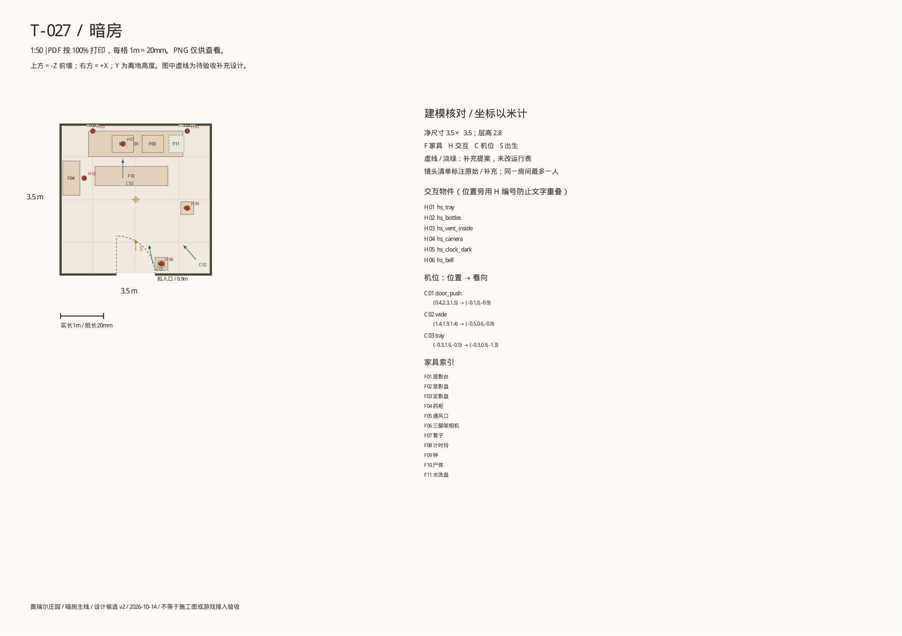
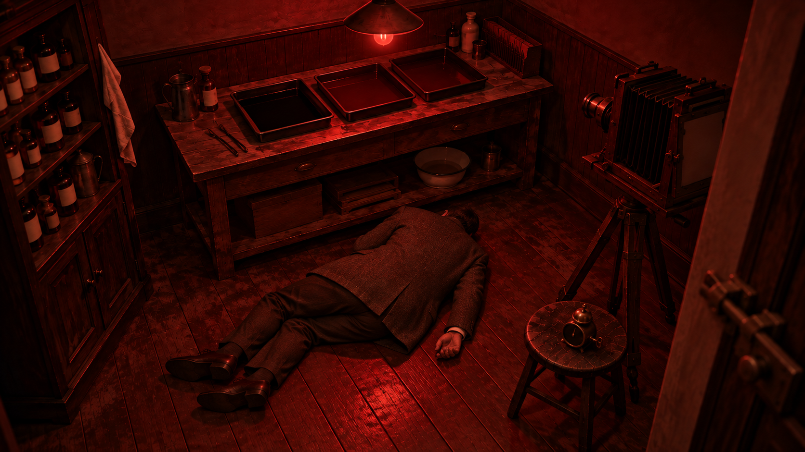
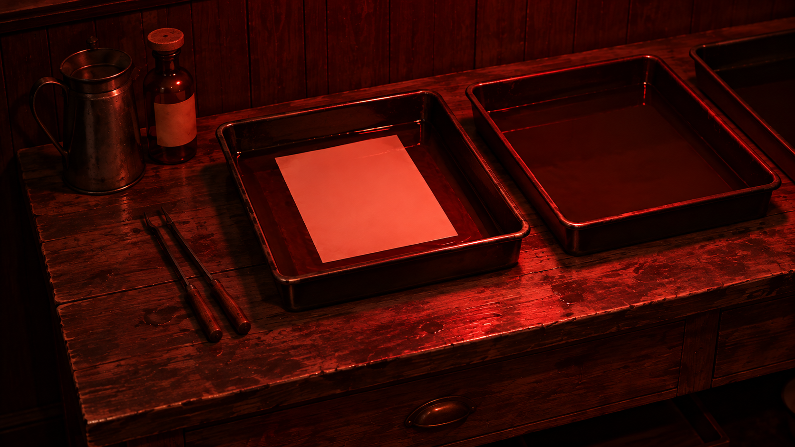
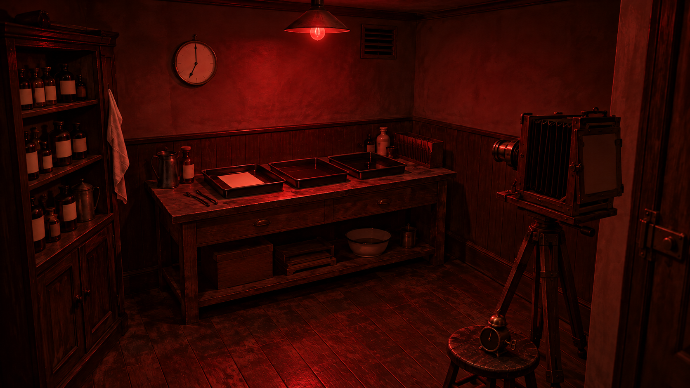

# 效果预览：19:00 `ded_1900`

优先级 P0 · 需求文档：[ded_1900](../ded_1900.md)（还没写的显示为死链）

由 `tools/art/level_previews.py` 生成，不要手改；新增图片后重新运行。每个视角只显示最新版，旧版本在折叠列表里。

## 复用：暗房

来源 `assets/2d/T-027-暗房/` · 还没有演绎版本的预览；空间复用暗房，换成红光

**darkroom_平面图**

**darkroom_透视_door_push**

**darkroom_透视_tray**

**darkroom_透视_wide**

