# 效果预览：合影 `ded_photo`

优先级 P0 · 需求文档：[ded_photo](../ded_photo.md)（还没写的显示为死链）

由 `tools/art/level_previews.py` 生成，不要手改；新增图片后重新运行。每个视角只显示最新版，旧版本在折叠列表里。

## 复用：片头家庭电影的草坪图层

来源 `assets/2d/T-038-片头家庭电影/final/` · 还没有演绎版本的预览；与序章 0A 共用草坪与三脚架相机

**ambrose_scribble**

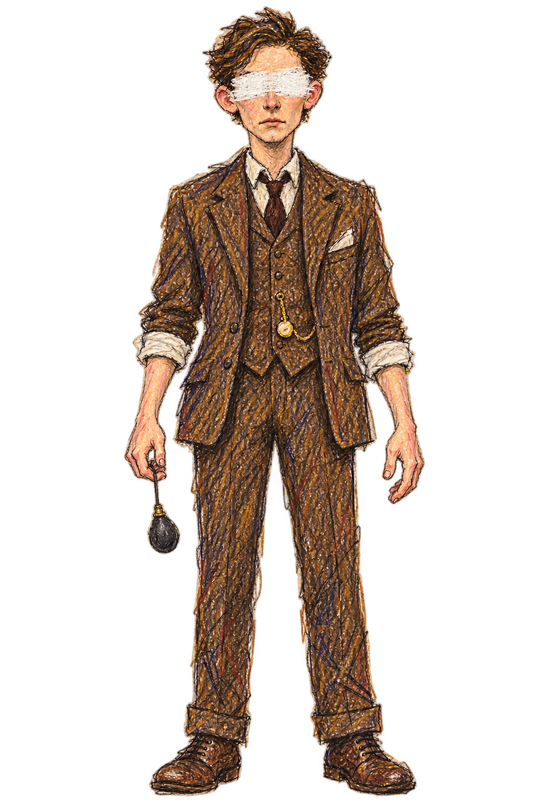

**constance_scribble**

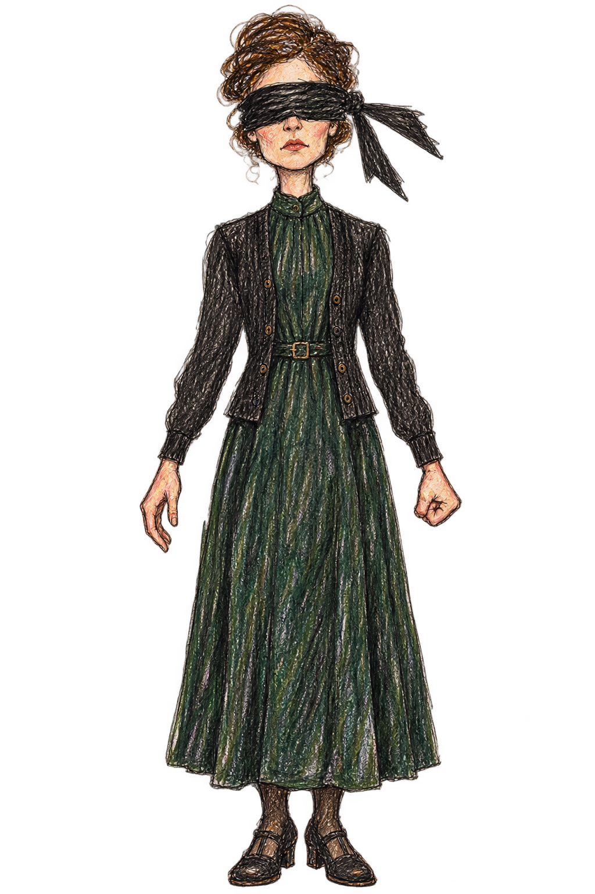

**gideon_scribble**

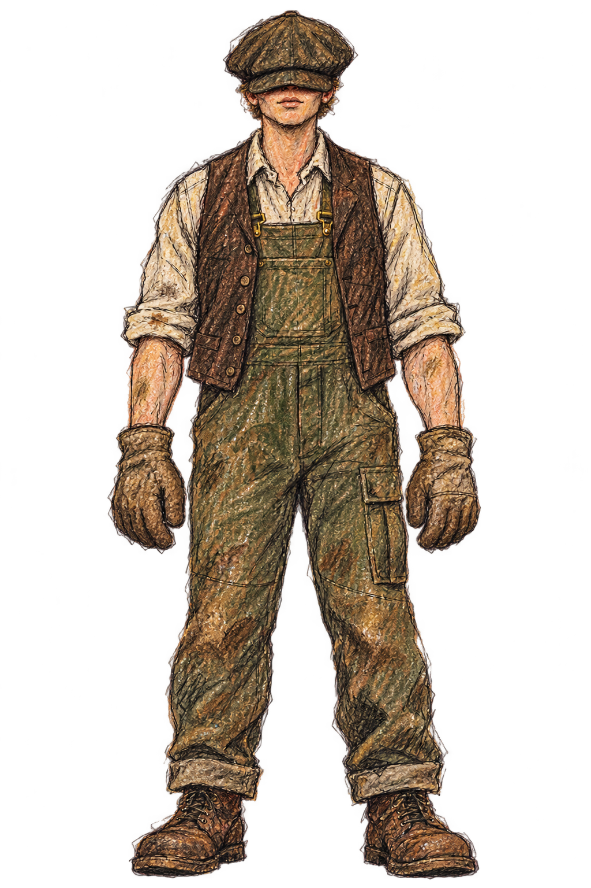

**layer_grass_fore**

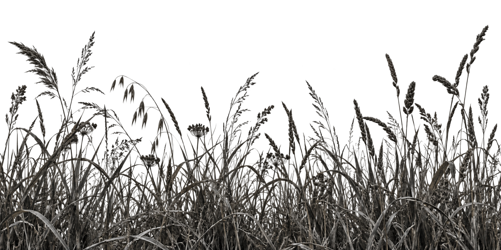

**layer_ground_far**

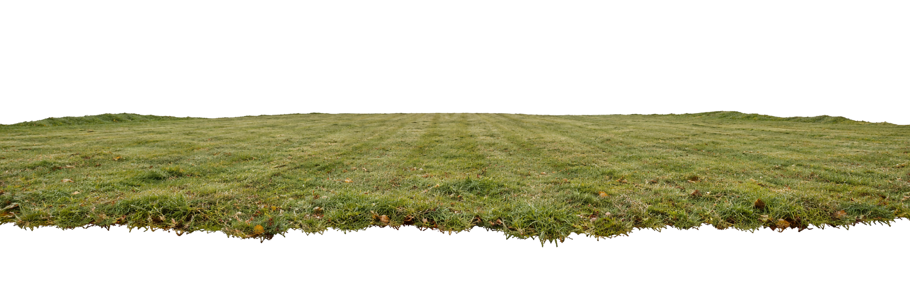

**layer_ground_mid**

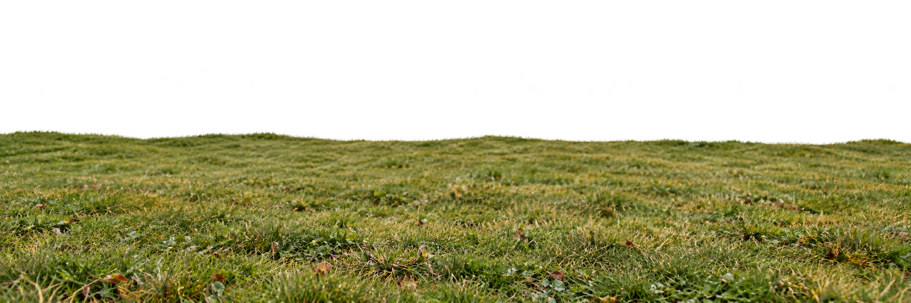

**layer_ground_near**

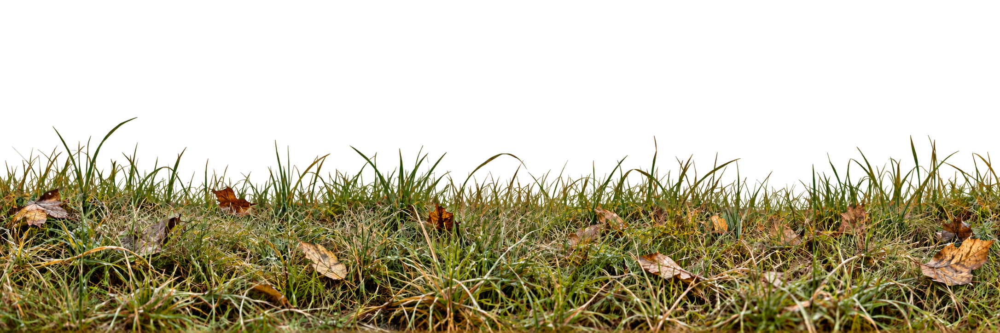

**layer_manor**

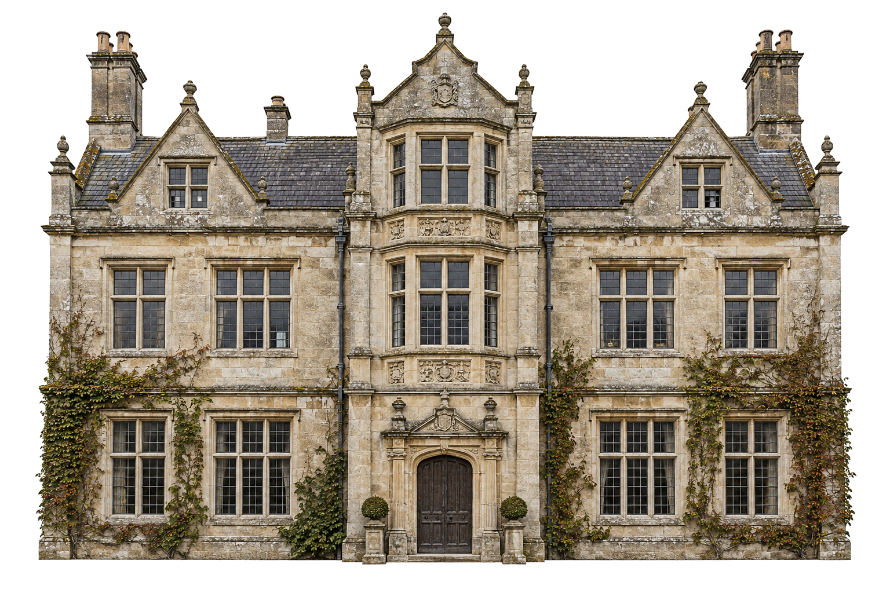

**layer_path**

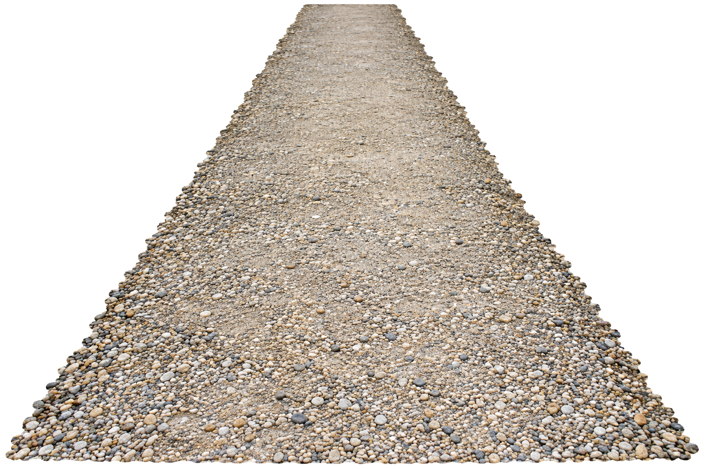

**layer_sky**

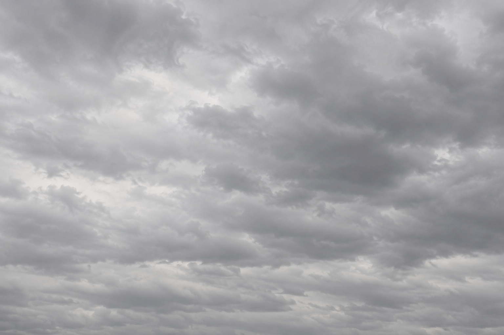

**layer_tree_a**

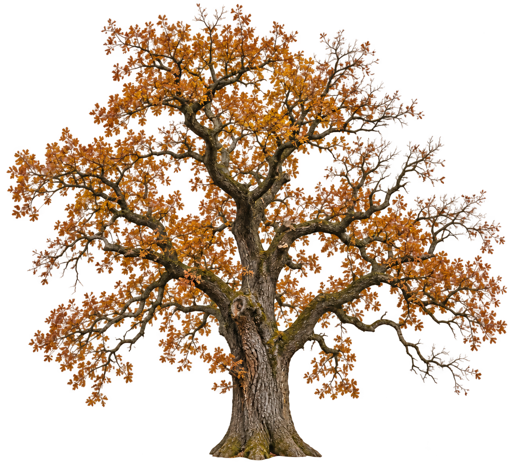

**layer_tree_b**

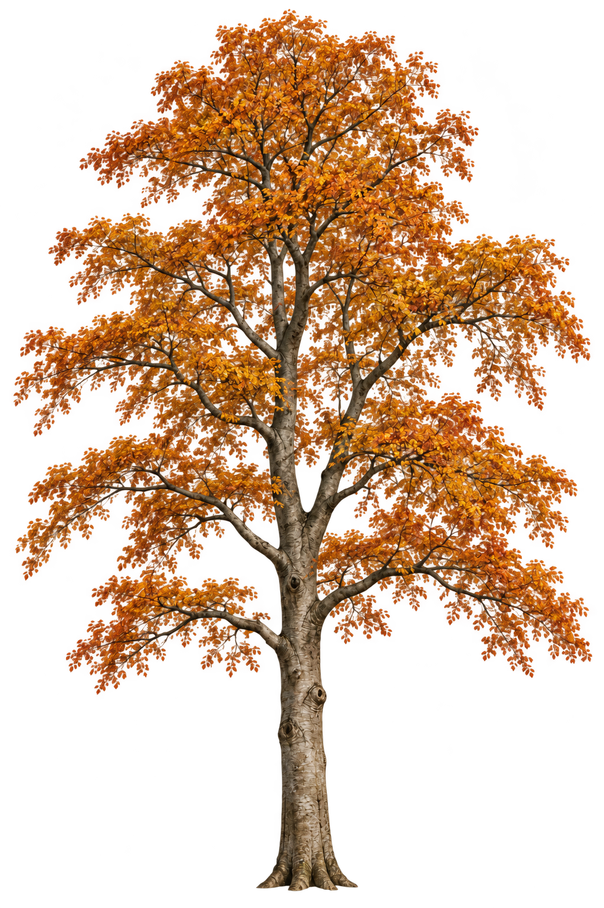

**layer_tripod**

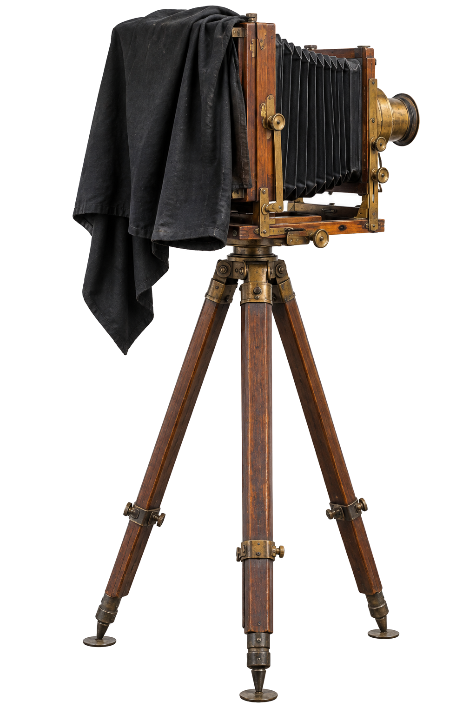

**penrose_scribble**

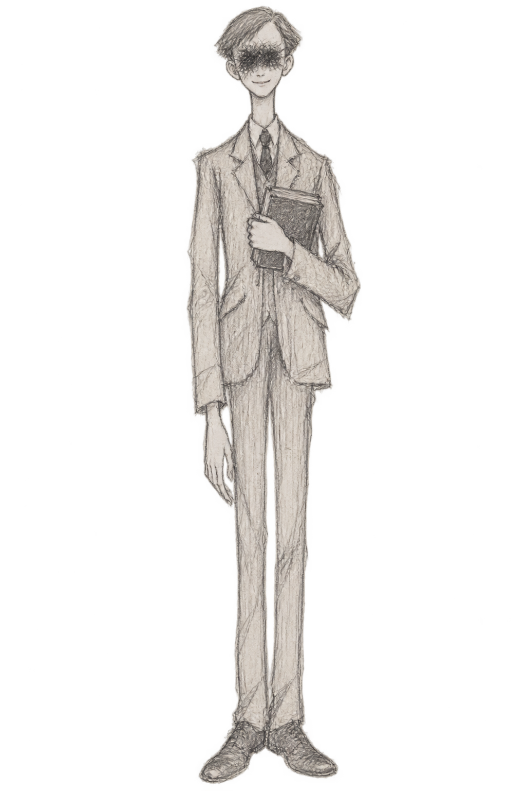
