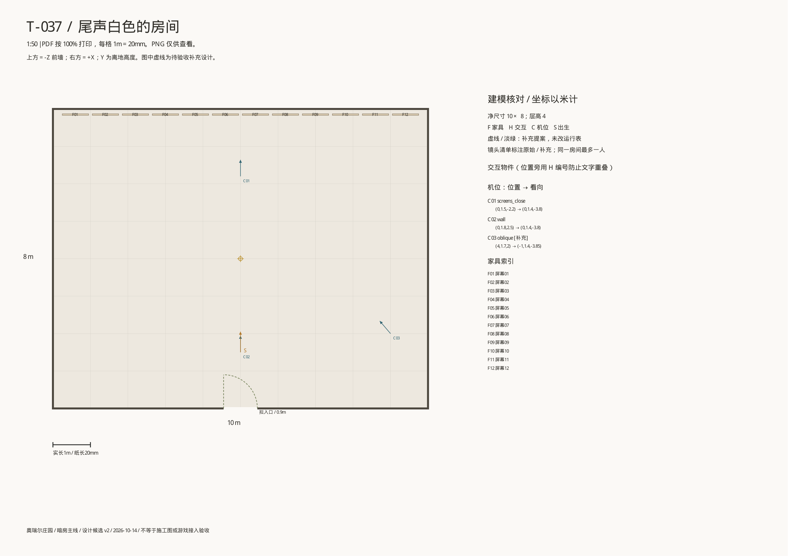
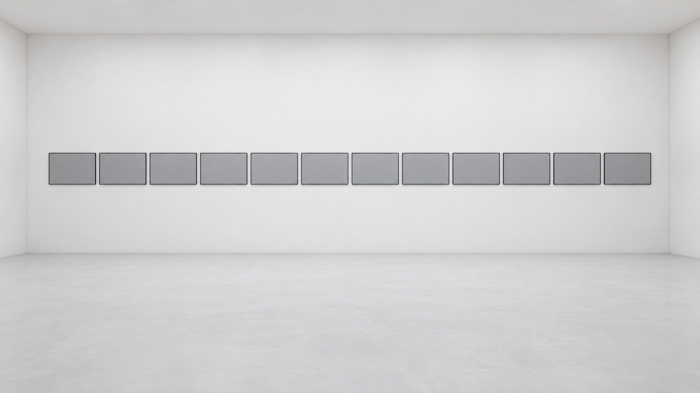

# 效果预览：尾声·白色的房间 `epilogue`

优先级 P0 · 需求文档：[epilogue](../epilogue.md)（还没写的显示为死链）

由 `tools/art/level_previews.py` 生成，不要手改；新增图片后重新运行。每个视角只显示最新版，旧版本在折叠列表里。

## 设计包

来源 `assets/2d/T-037-尾声·白色的房间/` · T-037

**monitor_room_平面图**

**monitor_room_透视_wall**

