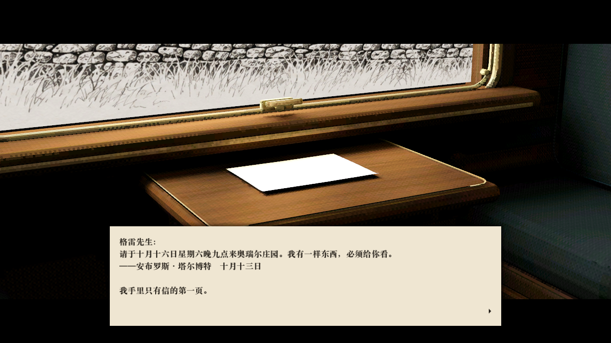
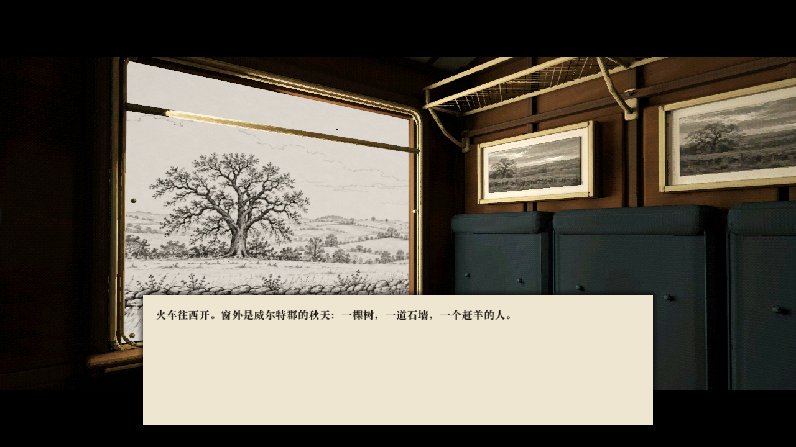
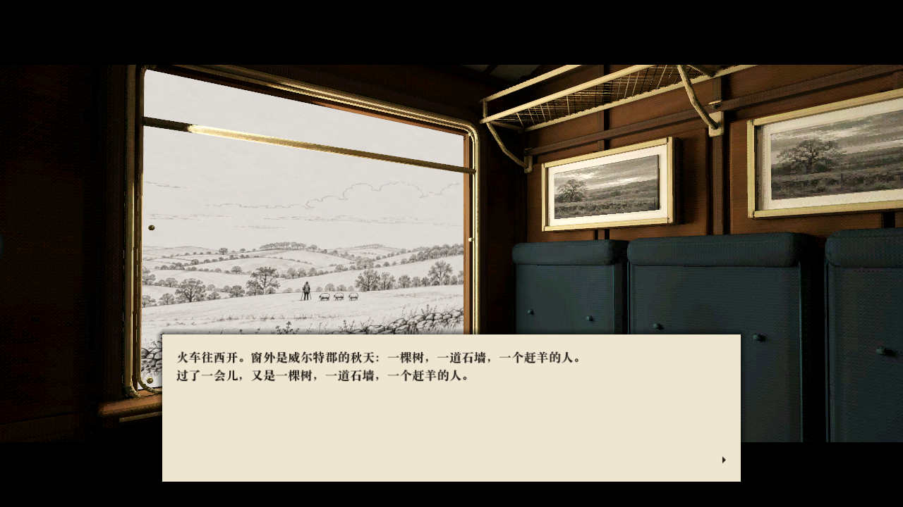
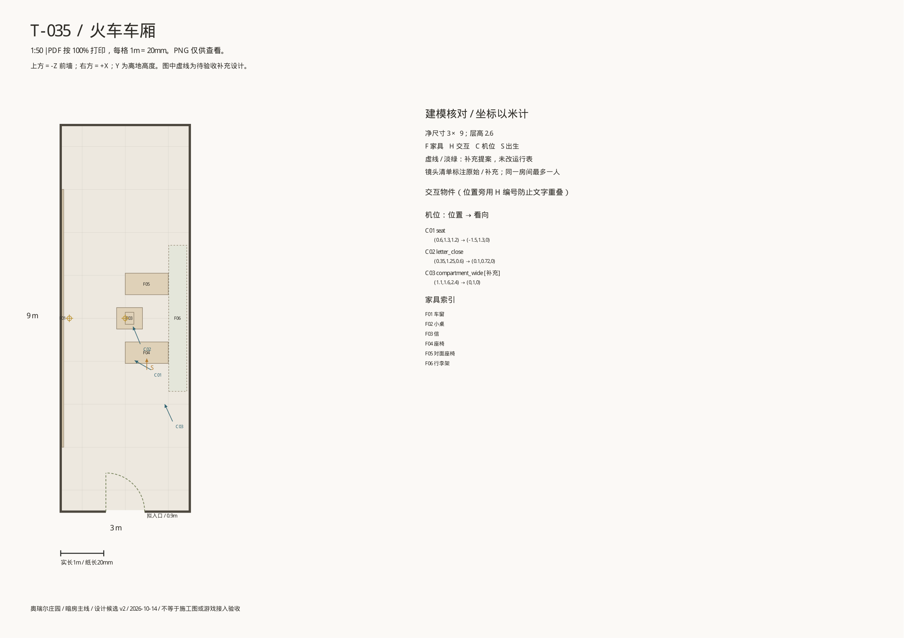
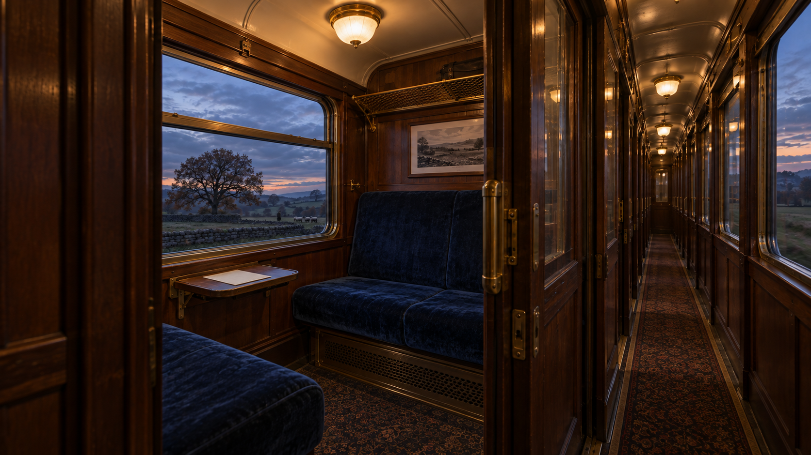
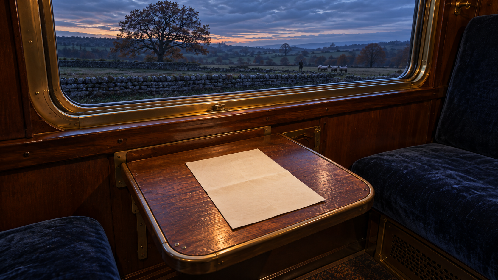
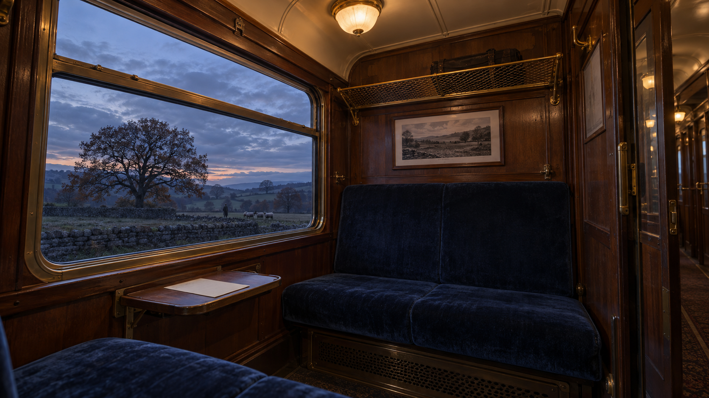

# 效果预览：火车车厢 `train`

优先级 P0 · 需求文档：[train](../train.md)（还没写的显示为死链）

由 `tools/art/level_previews.py` 生成，不要手改；新增图片后重新运行。每个视角只显示最新版，旧版本在折叠列表里。

## 当前游戏画面

来源 `assets/3d/train/review/integration/` · 接进 Godot 后的游戏内截图，代表现在的画面

**letter**

**seat-1s**

**seat-7s**

**seat-clean**

## 设计包

来源 `assets/2d/T-035-火车车厢/` · T-035 平面图与 10-14 的 AI 效果图（previews/）；平面图按完整车厢画，现在定为固定坐姿，只建镜头看得到的部分

**train_平面图**

### previews/2026-10-14/

**train-corridor-lookback**

**train-letter-close**

**train-seat**

