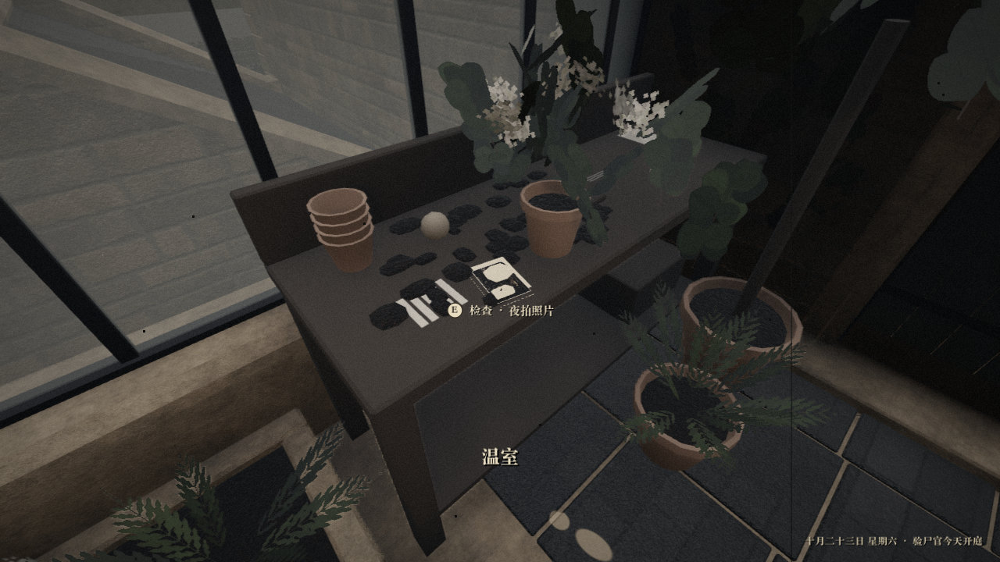

# 温室工作台原位转向 180°

2026-10-22，用户要求。范围仅限工作台朝向，适用于主工程与第四章试验；不合入 PR34、试验入口、相机玩法或本地其他未提交工作。

修改：建模脚本 build 的旋转由 0 改为 180；运行 glTF 中同名工作台节点增加绕竖轴的 180° 四元数 [0,1,0,0]。节点平移、缩放、网格和照片坐标不变；网格自带的工具、台上杂物随工作台转向，独立盆栽维持原位。二进制网格无需重写。

问题：工作台正面原朝南侧玻璃，北侧室内看到的是背板。转向后背板靠玻璃，正面朝室内。

实机对照：试验工作区使用相同室内站位 (21.4,3.63,-9.1) 和相同照片坐标 (20.85,4.539,-8.48)。转向前准星不能选中照片；转向后识别 hs_gh_photos，画面出现 E 检查·夜拍照片。截图为当前本地试验版本，含尚未提交到主线的照片检视资产，不能当成主分支已包含整套照片检视的证据。

人工复测：关闭旧试玩窗口，重新运行试验工作区“试玩第四章.command”；前往温室西南角工作台，检查正面是否朝室内、照片是否易见且 E 键可用。由用户判断最终体验，本记录不代填人工通过。

Q 寻路仍把桌面作为终点，该问题本次没有修改，不能用 Q 是否出现脚印判断转向修复是否成功。

## 基础验证

- 试验工作区从原室内站位发送真实 E 键事件：`selected=true`、`E_opens_inspection=true`，退出检视后 `ev_night_photo` 和已检查记录均存在；检查脚本退出码 0。
- 主分支独立工作区：内容校验与保护/取代两种自动通关均退出码 0，到达终局。
- 自动通关退出日志仍有 ObjectDB/资源释放警告；没有把这些日志描述成完全无错误。
- glTF 结构比较确认唯一语义变化是工作台节点旋转；平移、缩放、其他节点、材质、网格和二进制缓冲不变。
- 最终人工复测尚待用户进行。

- 主分支温室八方向真实玩家碰撞行走检查退出码 0，未掉落；详见 walk.log。
