# 密室 · GH Cellar — 相机双视觉 / 记录本 / 1926 实体底片

在 `D:\千人千面blender\新建游戏项目` 里，把 Blender 的 **10 × 8 × 2.6 m 密室**做成可玩的第一人称空间，并接上相机链路：

**拿相机 → 举镜 → 对焦 → 第一次曝光 → 显影 → 翻记录本第 4 页 → 装回干版 → R 二次曝光 → 再显影 → 空框。**

然后：**举镜看钥匙虚影 → 翻第 7 页拿钥匙 → 开底片盒 → 拿 1926 实体底片 → 放回盒子 / 装片拍两次。**

## 直接运行

用 **Godot 4.7.2** 打开工程，按 **F5**。

`D:\千人千面blender\新建游戏项目`

## 操作

| 键 | 作用 |
|---|---|
| `WASD` | 移动 |
| 鼠标 | 视角 |
| `E` | 检查 / 拿取 / 显影 / 装片 / 开盒 / 翻记录本 |
| `F` | 举起 / 放下相机 |
| 滚轮 | 举镜时对焦；记录本里翻页 |
| 左键 | 举镜时快门 |
| `R` | 装回干版后拨二次曝光 |
| `A / D` | 记录本翻页 |
| `Tab` | 读过一次后，快捷打开 / 合上记录本 |
| `Esc` | 释放鼠标；合上记录本 |

> 第一次翻记录本必须走到桌上按 `E`；之后 `Tab` 只是快捷查看。

## 记录本为什么值得翻

不是“可看可不看”的设定集，而是流程里的实物：

1. **相机压着它**：相机皮腔上挂着纸签“别相信照片。先看本子。”拿相机后，记录本露出来。
2. **片夹会卡住**：第一次显影后，片夹推不动，只说“卡住了。本子上也许有写法。”翻到 **第 4 页**，才解锁装片和 `R`。
3. **钥匙真的在里面**：举镜看到钥匙虚影后，底片柜仍锁着；翻到 **第 7 页**，一把钥匙从夹层里滑出来，才能开柜。

## 1920 完整流程

1. 桌上大画幅相机前按 `E`，拿走相机。
2. `F` 举镜，对 **1920**，滚轮对焦到 100%，左键第一次快门。
3. 放下相机，西侧显影盘按 `E` 显影。
4. 回桌上片夹按 `E`——**卡住**。去记录本翻到 **第 4 页**。
5. 再回片夹按 `E` 装回干版；按 `R` 拨二次曝光。
6. 再举镜拍同一张 1920；放下相机，回显影盘。
7. 1920 相框空出位置，记录本解锁 `1920 · 彭罗斯先生`。

1922 / 1924 用同一套干版流程，可做可不做。1919 / 1921 / 1923 / 1925 没有多出来的人。

## 相机里才看得见的东西

- 西侧旧物旁的人形轮廓
- 木箱上的干版
- 梯口的鞋印
- 显影盘底的白色结晶
- 底片柜上的钥匙虚影

举镜时靠近按 `E`。**钥匙虚影**只在 1920 收完后出现；看到后要回记录本第 7 页拿钥匙。

## 1926 最终选择

打开底片盒后：

1. 举镜看 **1926**，取景框右侧出现“相机后面的主人”；记录本解锁最后一页。
2. 放下相机，到柜前按 `E` 拿 **1926 实体底片**。
3. 两个物理选择：
   - **把底片放回盒子**：回柜前按 `E`，保留这张底片。
   - **装片，拍两次**：回片夹按 `E` 装上 1926 底片，`F` 举镜对 1926，左键两次。
4. 主人挡在镜头前，画面黑掉，进入对应结局。

没有二选一弹窗，选择由玩家拿着底片走过去完成。

## 截图

### 空间

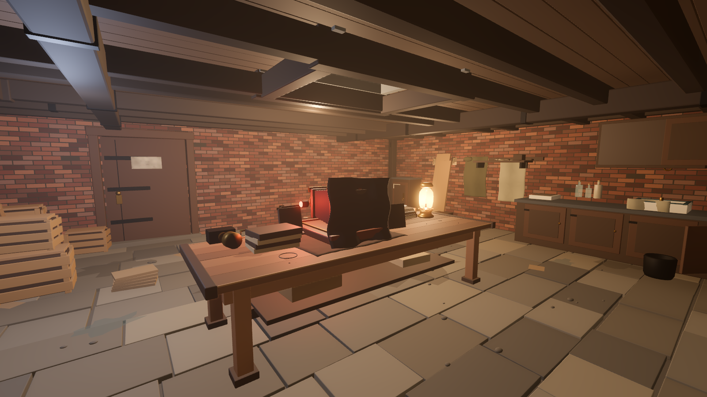

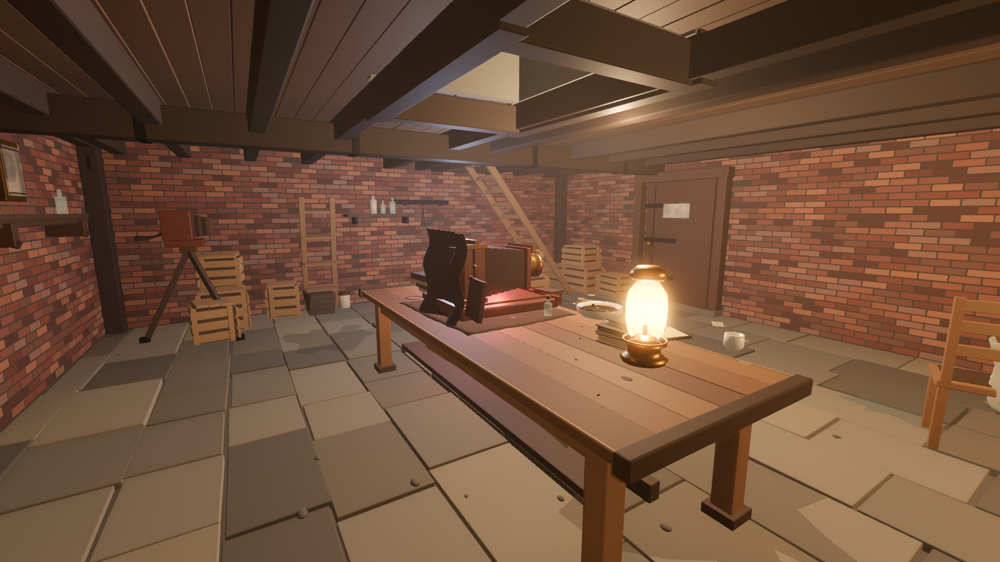

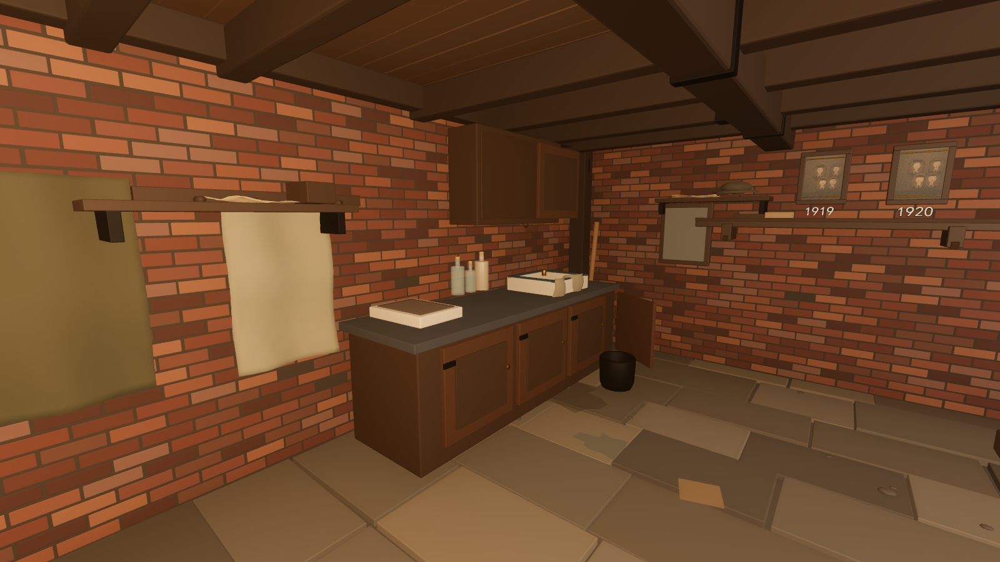

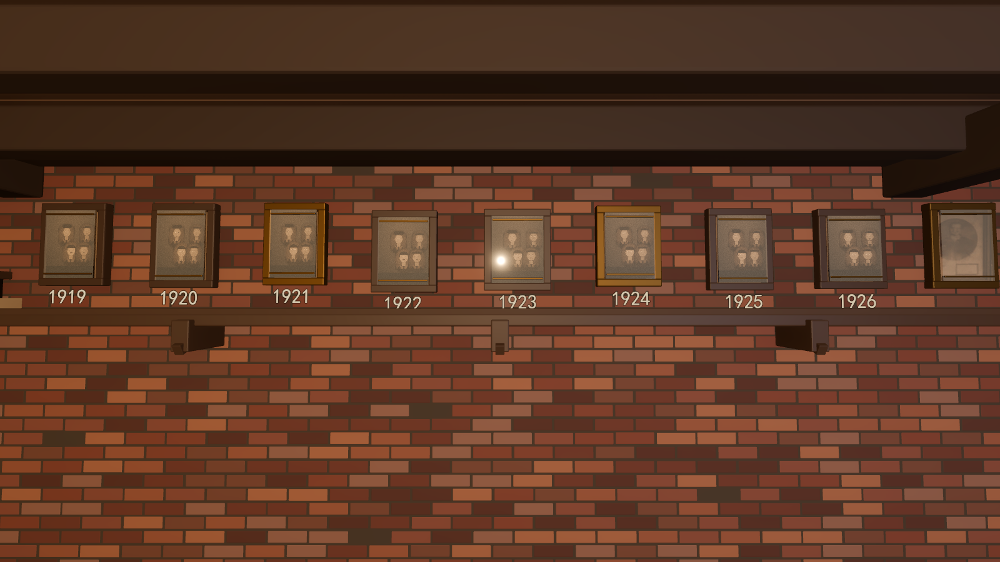

### 相机与记录本

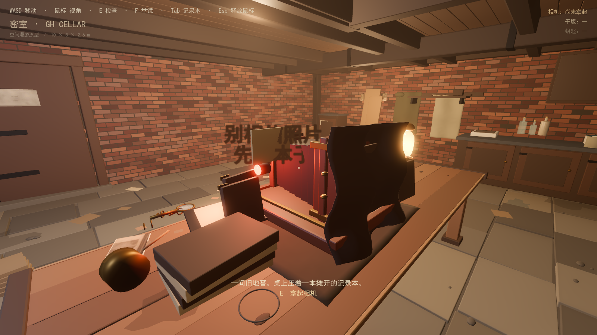

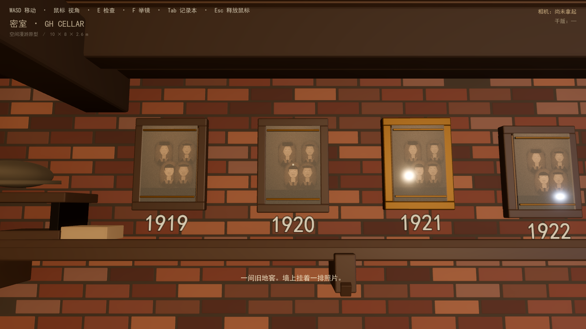

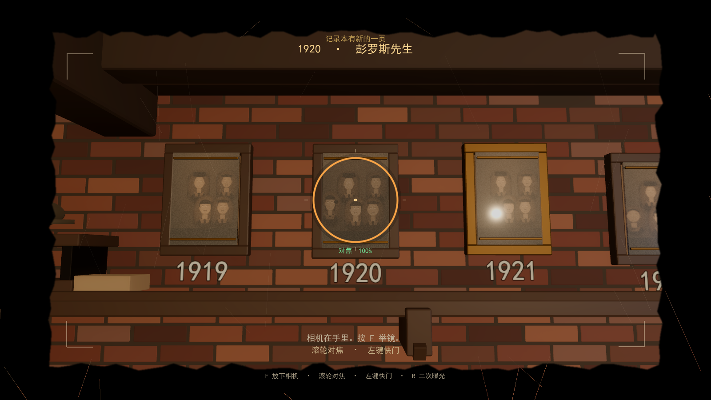

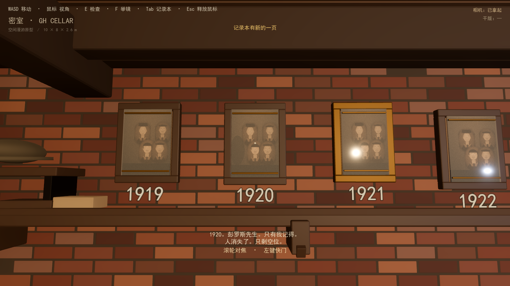

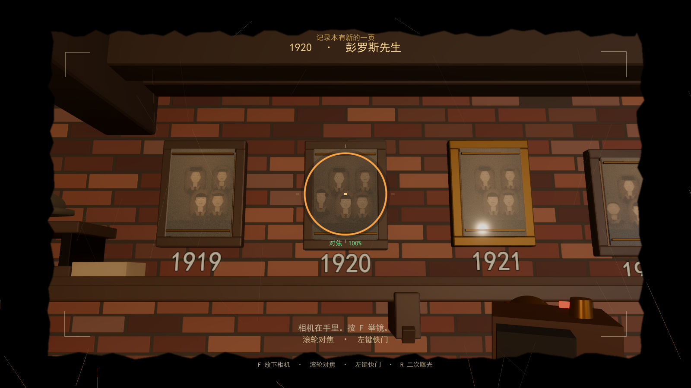

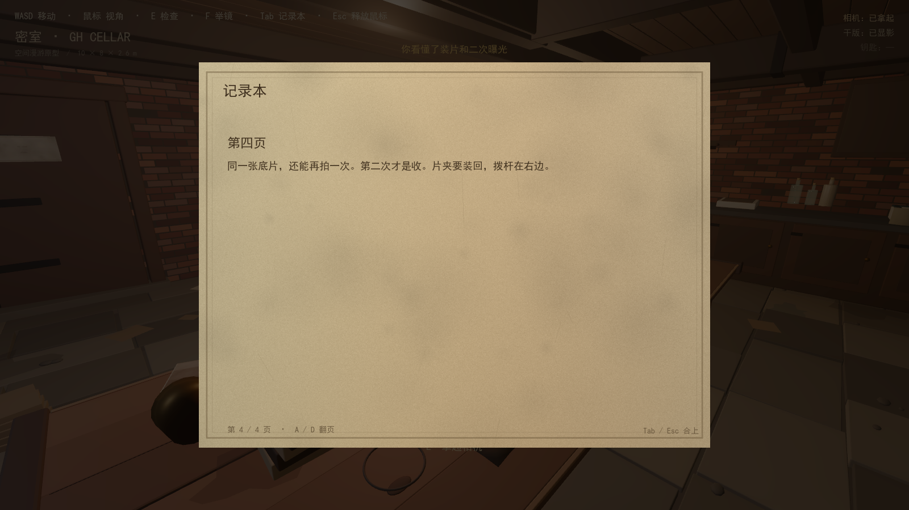

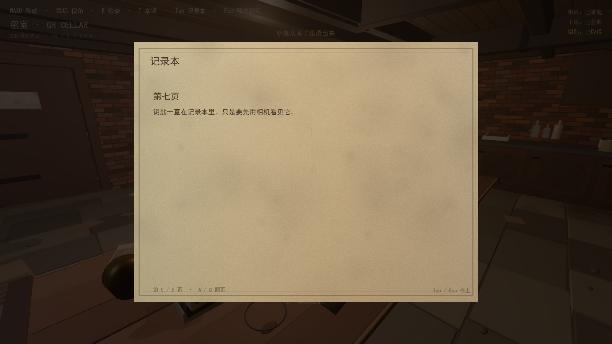

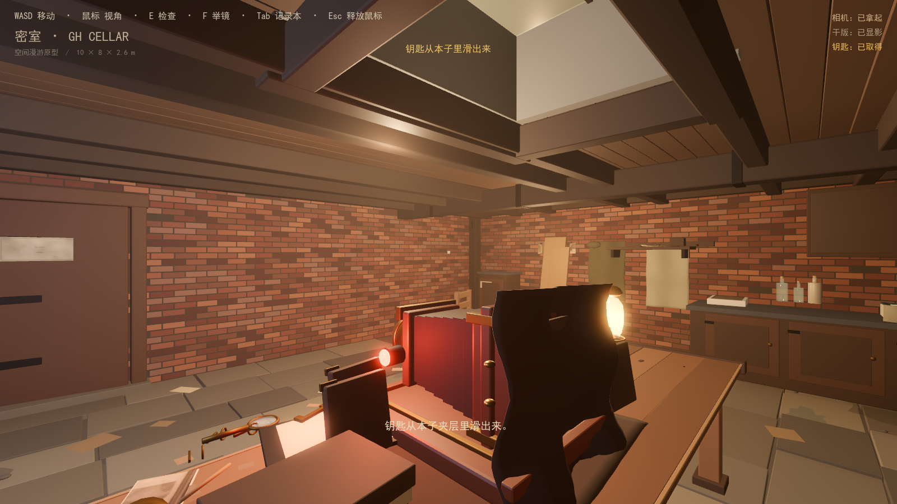

### 1926

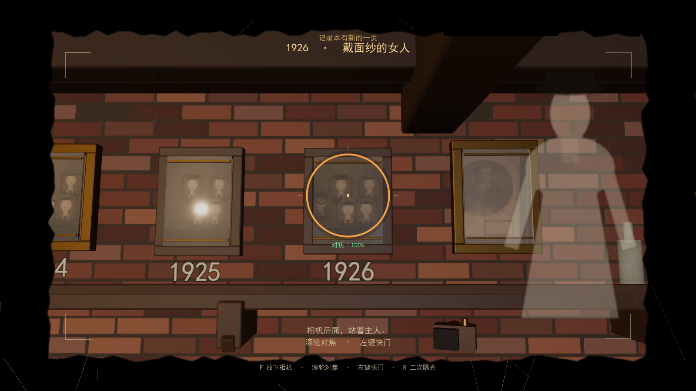

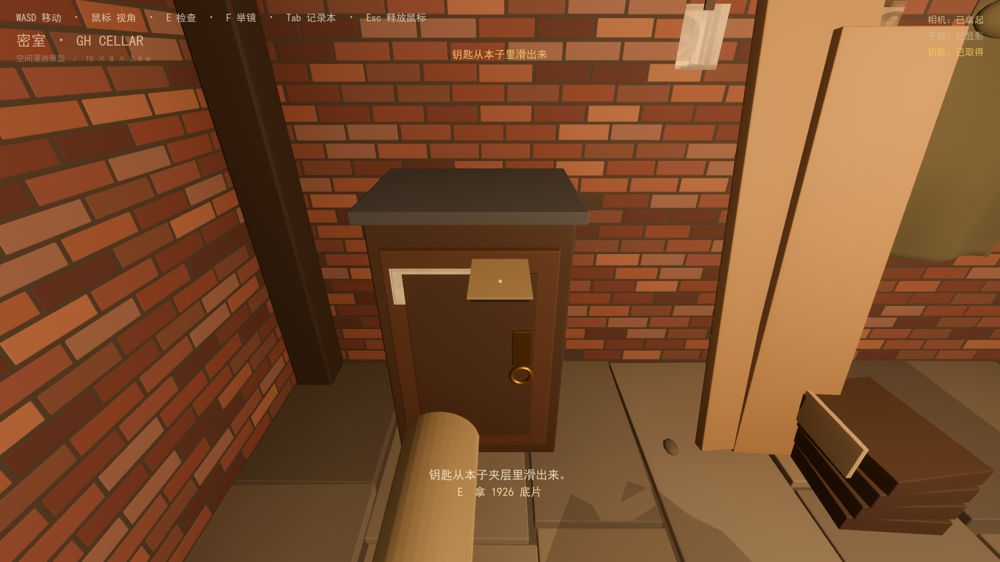

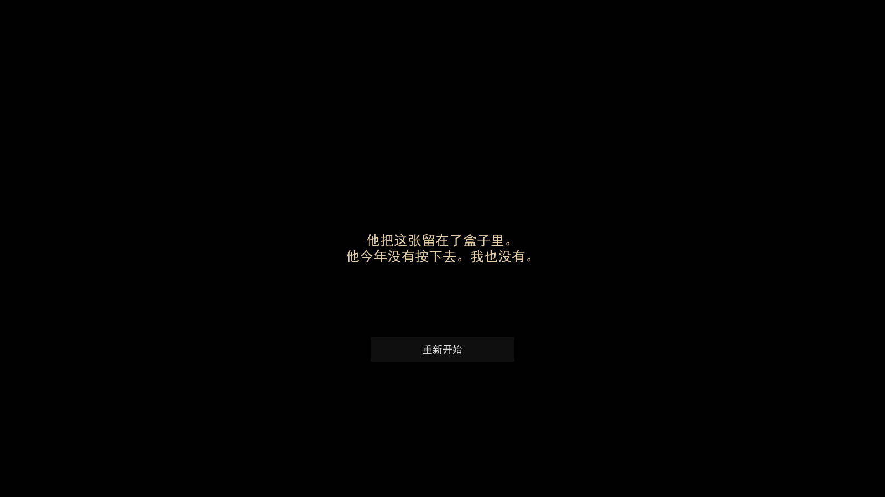

## 代码结构

```text
project.godot                         主场景 levels/gh_cellar.tscn
levels/gh_cellar.tscn                 密室关卡
levels/gh_cellar.gd                   场景装配、纸签/钥匙/1926底片、交互区、相机链路
systems/cellar_state.gd               状态机：干版、第4/7页门槛、钥匙、1926实体底片
player/cellar_player.tscn/.gd         第一人称 + 举镜手感 + 交互射线 + 相机模型
ui/cellar_ui.tscn/.gd                 取景框、对焦环、单页记录本、结局
ui/focus_ring.gd                      对焦环绘制
shaders/frame_view.gdshader           相框双视觉 / 对焦 / 空框混合
data/cellar_content.json              年份、记录本、痕迹、提示、结局文本
data/cellar_anchors.json              相机、记录本、显影盘、片夹、柜子、1926底片、痕迹坐标
art/levels/gh_cellar/gh_cellar.glb    密室模型（不含 Blender 相机/灯光）
art/levels/gh_cellar/textures/frames  8 组 normal / lens / empty
art/ui/                               viewfinder、记录本纸、主人剪影、钥匙、鞋印
audio/                                快门、显影、翻页、布料、房间底噪
tests/test_flow.gd                    纯状态：第4页门槛、第7页钥匙、双结局
tests/test_scene_flow.gd              真实射线：拿相机、翻页、装片、钥匙、放回结局
tests/test_scene_shoot.gd             实体1926底片：装片、举镜、两次快门、shoot结局
tests/test_import.gd                  导入完整性
tests/test_collision.gd               地面射线 + 8 方向行走
tests/test_fps.gd                     帧率 / draw call
tools/capture_room.gd                 四张空间机位
tools/capture_interaction.gd          纸签/第4页/第7页/钥匙/1926底片/结局
tools/capture_player.gd               真实玩家相机 + 取景框 + 相机模型
docs/player_experience.md             玩家如何发现真相
docs/interaction_objects.md           交互物品与流程说明
```

Blender 导出脚本在：

`D:\千人千面blender\新建文件夹\export_gh_cellar.py`

只读取源 `.blend`，不修改原始美术文件。

## 测试

```powershell
$G = 'D:\Godot\Godot_v4.7.2-stable_win64_console.exe'
$P = 'D:\千人千面blender\新建游戏项目'

& $G --headless --path $P --script res://tests/test_import.gd
& $G --headless --path $P --script res://tests/test_collision.gd
& $G --headless --path $P --script res://tests/test_flow.gd
& $G --headless --path $P --script res://tests/test_scene_flow.gd
& $G --headless --path $P --script res://tests/test_scene_shoot.gd
& 'D:\Godot\Godot_v4.7.2-stable_win64.exe' --path $P --resolution 1600x900 --script res://tests/test_fps.gd
```

结果文件在 `tests/*_result.txt`。

当前结果：

- 导入：PASS（1207 网格、12 碰撞、7 灯、8 相框视图）
- 碰撞：PASS（63/63 地面射线；8 方向不掉落、不出墙）
- 纯状态：PASS（第4页门槛、第7页钥匙、1926 两种结局）
- 场景串联：PASS（真实射线：拿相机、翻第4页、装片、第7页钥匙、放回结局）
- 场景 shoot：PASS（实体 1926 底片装片、两次快门、shoot 结局）
- 性能：1600×900 约 **147 FPS / 54 draw calls**（RTX 5070 Laptop）

## 已知取舍

- 砖、木、石仍是近似色简化材质；群像是程序化占位美术。
- 显影仍是即时状态切换 + 音效/闪白，没有 2.5 秒显影动画。
- 1922 / 1924 共用 1920 的干版循环；没有独立结局，只解锁对应记录页。
- 没有存档；结局页“重新开始”会重载场景。
- 空白工程自带的 `garden.tscn` 未使用；主场景已切到 `levels/gh_cellar.tscn`。

## 下一步

- 给显影、装片、二次曝光、放回底片加入 2—3 秒镜头/音效演出。
- 把简化材质换烘焙贴图。
- 加存档与已清理年份持久化。
- 把 `CellarState` 接到主工程 Director / SceneHost。
