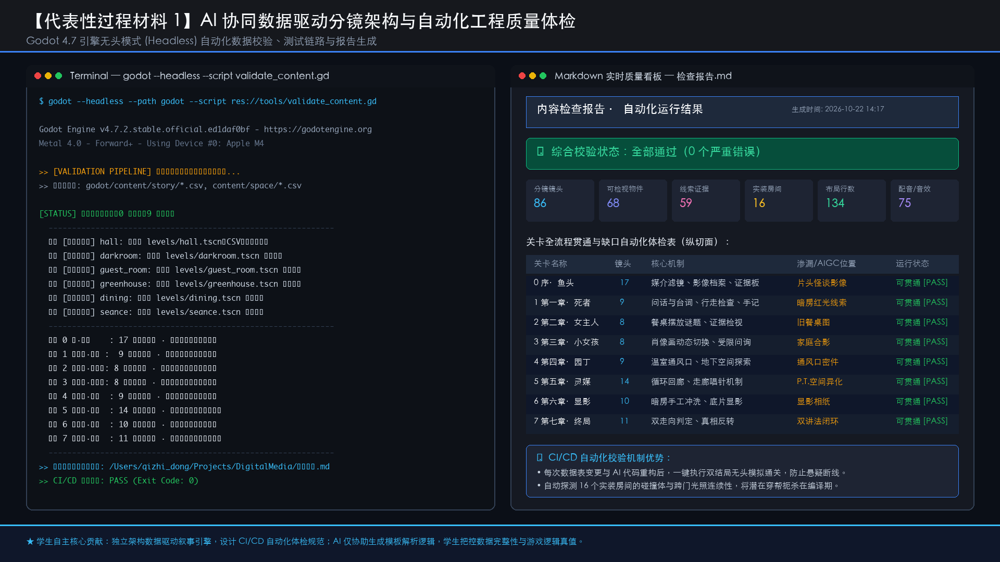
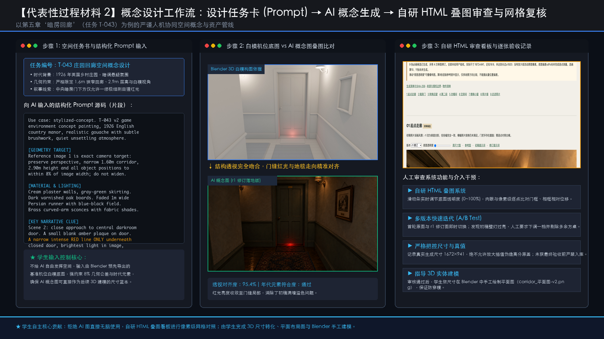
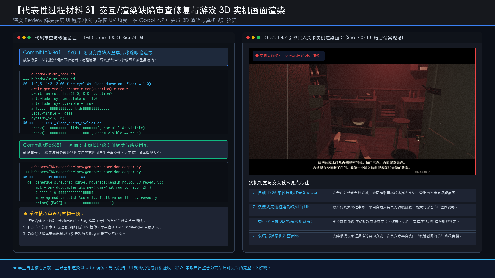

# 2026年第十四届全国大学生数字媒体科技作品及创意竞赛
# 人工智能工具使用情况说明
**（参赛团队填报版本）**

---

### 填写说明
本说明用于客观反映人工智能工具在参赛作品《潜影》（Latent Image）创作、设计、开发、制作及成果形成过程中的实际辅助作用，重点体现学生团队自主完成的核心设计、技术架构与原创贡献。
1. **真实性原则**：本团队在报名系统中如实勾选“已使用”AI工具，并按要求客观说明主要工具、使用环节、人工处理机制及学生原创贡献。
2. **规范化说明**：严格遵循大赛评审要求，**不以难以核实的百分比（如“AI占比30%”）代替实际工作描述**，而是通过具体功能模块、代码演进与设计审查说明工作边界。
3. **严格匿名化**：本报告已严格执行赛事匿名化要求，全文不出现任何参赛学校、团队成员及指导教师等个人识别信息。

---

### 一、作品基本信息与AI使用状态

| 项目 | 填写内容 |
| :--- | :--- |
| **作品名称** | 《潜影》（Latent Image）—— 奥瑞尔庄园 · 一九二六 |
| **作品编号（如有）** | （以大赛报名系统最终生成编号为准） |
| **参赛赛道／赛项** | 虚拟现实(VR/AR/MR/XR)与游戏类赛项 |
| **AI使用情况** | □ 未使用　☑ **已使用** |

---

### 二、主要AI工具及使用情况

仅填写对作品形成具有实际影响的主要工具或模型；一般性资料查询及与最终作品形成无直接关联的日常使用不予罗列。

| 工具／模型 | 使用环节 | AI主要用途或产出 | 学生后续处理 |
| :--- | :--- | :--- | :--- |
| **Claude Code** *(Claude-Opus-5-5 / Claude-Sonnet-5-5)* | 程序开发与系统架构设计 | 协助编写 Godot 4.7 引擎底层驱动代码、CSV 数据驱动叙事播放器（Director/Actions）、全局状态机以及自动化质量体检工具链（内容交叉校验、大地图连通性探测、碰撞体检等）。 | 学生自主设计游戏底层架构与叙事数据流；逐行审查、重构与优化 AI 生成的代码；在 Godot 编辑器内手工完成 16 个房间场景的节点组装与挂载；手工排查并修复场景切换时的内存泄漏问题。 |
| **OpenAI Codex** *(GPT-6.1-sol / GPT-6-astra / 内置生图)* | 前期概念美术设计与多工作树代码审计 | 依据学生编写的结构化空间任务书批量生成场景平面陈设规划建议与多角度概念效果图；协助执行 Git 多工作树（worktrees）代码差异审计与冲突合并分析。 | 搭建自研 HTML 叠图审查工具，进行透视与年代合规筛查；剔除不符元素后，由学生在 Blender 中依严谨尺寸手工进行 3D 白模起形、碰撞体制作与防穿模优化。 |
| **Google Antigravity** *(Gemini 系列模型)* | 交互细节调试、材质着色器适配与文案润色 | 协助排查 3D 走廊长地毯 UV 拉伸算法并提供专用着色器编写方案；提供手柄/键盘双端疾跑交互映射建议；辅助角色对白语气与词汇润色。 | 在 Godot 中重新调整材质属性与光影烘焙；真机反复校准加速度手感；对全篇台词进行文学化终审与视界校准，严格限制在角色受限视角内，确保叙事反转伏笔成立。 |

---

### 三、代表性AI使用过程

结合实际选择 3 个对最终成果影响较大的环节，详细说明“使用目的—主要输入—AI输出—人工处理—最终应用”：

#### 环节一：数据驱动的叙事分镜系统与 CI/CD 自动化体检链路构建（程序工程）
| 说明项目 | 具体内容 |
| :--- | :--- |
| **使用环节及目的** | 解决悬疑推理游戏中海量分支剧本、镜头运镜与复杂状态机的高耦合难题，实现“分镜即数据”并建立高可靠性自动化测试闭环。 |
| **主要工具／模型** | Claude Code (Claude-Opus-5-5 / Claude-Sonnet-5-5) |
| **主要输入或素材来源** | 学生独立编纂的暗房主线大纲、推论因果拓扑图（d1—d6）、分镜数据规范（story CSV 表头与白名单动作规则）。 |
| **AI主要输出** | Godot 导演调度模块（`director.gd`）、白名单动作解释器（`actions.gd`）及自动化测试套件（`validate_content.gd`、`probe_walk.gd`、`autoplay.gd`）。 |
| **学生筛选、修改或再创作** | 学生自主设计游戏状态流转与双结局判定机制；剔除过于抽象的代码层，增加无头（Headless）双分支结局校验逻辑，手动修复场景切换卸载时的资源未释放问题。 |
| **最终成果中的应用位置** | 游戏底层核心运行框架（`godot/core/` 目录）与开发质量验证工具库（`godot/tools/`），驱动全流程 8 个章节的稳定运行。 |
| **可核验材料（如有）** | 自动化体检报告《检查报告.md》（0 错误运行记录）、一键测试脚本《检查内容.command》。详见后文【过程材料一】。 |

#### 环节二：2D概念效果图生成至 3D 空间资产的落地转化（美术与场景）
| 说明项目 | 具体内容 |
| :--- | :--- |
| **使用环节及目的** | 为 1926 年庄园各房间（客房、餐厅、温室、暗房、无限循环回廊）探索视觉调性，辅助 3D 关卡的空间尺度定型。 |
| **主要工具／模型** | OpenAI Codex (GPT-6.1-sol / 内置 imagegen) |
| **主要输入或素材来源** | 学生编写的标准空间设计任务书（如 `T-041 卧室`、`T-043 回廊`），包含房间轴线、门窗开向、家具尺度约束及调查线索摆放点。 |
| **AI主要输出** | 多视角室内光影概念图、初始陈设意向图。 |
| **学生筛选、修改或再创作** | 自研轻量级 HTML 审查看板（`corridor_生图审查-v2.html`），人工逐张进行 8% 几何公差与线索可见性比对；在 Blender 中完全由学生依真实尺寸手工进行 3D 白模起形、修整楼梯净高与防穿模碰撞体，并导出 GLB 至 Godot。 |
| **最终成果中的应用位置** | 作为游戏内 3D 场景空间布局的原型依据，部分概念图经人工二次处理（做旧、调色、胶片颗粒化）后应用于游戏内证据板检视物证与宣传物料中。 |
| **可核验材料（如有）** | `T-043` 回廊生图审查看板（`corridor_生图审查-v2.html`）、Blender 建模工程文件（`ded_corridor.blend`）。详见后文【过程材料二】。 |

#### 环节三：关卡细部交互体验、材质拉伸修复与角色对白文学化校准（综合交互与视界）
| 说明项目 | 具体内容 |
| :--- | :--- |
| **使用环节及目的** | 解决多工作树合并时出现的交互穿帮（如闭眼入梦黑白照片被眼睑遮罩阻挡、长地毯 UV 拉伸畸变）及剧本文案文学感不足的问题。 |
| **主要工具／模型** | Google Antigravity (Gemini 系列) |
| **主要输入或素材来源** | 出现拉伸的长地毯 3D 模型与材质代码、转场眼睑遮罩着色器、剧情全篇对白草稿。 |
| **AI主要输出** | 专用材质计算方案建议、遮罩渲染层级调整逻辑、符合受限视角的台词修润草案。 |
| **学生筛选、修改或再创作** | 人工将台词逐句校准至“侦探认知受限”框架下，删除任何可能提前泄露核心反转的表达；在 Godot 编辑器中重新绘制地毯 UV 并手调长廊环境光；真机测试手柄与键盘疾跑手感并固化按键映射。 |
| **最终成果中的应用位置** | 全流程剧情对话系统、第五章循环回廊地毯视觉表现、第四章地下梦境演出系统及全局 3C 操作。 |
| **可核验材料（如有）** | Git 提交记录（`feat(inspection)`、`fix(ui): 闭眼完成转入黑屏后移除眼睑遮罩`、`画面：一二楼走廊长地毯专用材质与贴图适配`）。详见后文【过程材料三】。 |

---

### 四、最终成果中的AI生成或辅助内容

| 内容／成果 | AI生成或辅助部分 | 学生修改与整合 | 最终使用位置 |
| :--- | :--- | :--- | :--- |
| **程序代码** | 基础语法逻辑框架、CSV 数据解析器、自动化测试命令行脚本骨架。 | 100% 经过人工审查与重构；自主编写核心状态机、视角跟随、自定义交互射线判定与性能优化。 | 游戏核心运行脚本库（`godot/core/`、`godot/world/`、`godot/tools/`）。 |
| **平面视觉素材** | 部分用于探索氛围的概念设计图、暗房显影照片草稿。 | 人工进行构图筛选、色彩分级（Color Grading）、添加 1926 年代银盐照片胶片噪点与物理暗角，剔除多余噪物。 | 游戏内证据板检视界面、暗房显影最终底片、宣传展示物料。 |
| **剧情与台词** | 提供部分环境描写词汇建议、台词同义文学化候选句式。 | 核心剧情设定、反转逻辑、悬疑伏笔链与解谜因果完全由学生确立；对全部台词进行严格的人工风格统筹与角色受限视角校正。 | 游戏故事驱动数据表（`godot/content/story/*.csv`）。 |
| **三维空间与关卡** | **无**（AI 仅产出前期平面概念参考图）。 | 场景空间布局、Blender 3D 模型网格建模、碰撞体积规划、灯光天光搭建与运镜机位布设全部由学生自主完成。 | 全部 8 个正式游戏关卡场景（`godot/levels/*.tscn`）。 |

---

### 五、学生原创贡献说明

#### 1. 学生自主完成的核心工作：
1. **世界观构建与叙事反转设计**：独立构思了“1926 年庄园暗房悬疑”与“心理数字容器／多重人格”双层嵌套世界观。独创“亲手显影真相”的核心叙事交互——玩家在暗房亲自冲洗底片显影出凶手正是自己，实现叙事诡计与游戏交互的高度统一。
2. **“分镜即数据”的高内聚解耦架构**：完全自主设计并搭建了以 CSV 表格为驱动核心的游戏叙事引擎，将文案策划、镜头运动、人物动作与底层代码彻底解耦，大幅降低开发与迭代维护成本。
3. **专业级的 CI/CD 自动化体检工具链**：为了保证比赛演示零 Bug，学生自主研发了全套自动化测试体系，包括：数据完整性交叉校验（`validate_content`）、跨门天光跳变探测（`probe_doorway`）、全场景碰撞防穿模体检（`probe_walk`）、大地图连通性验证（`probe_map`）以及双结局无头全自动通关脚本（`autoplay`）。
4. **沉浸式 3D 空间取证与交互手感调校**：在 Godot 中完全人工搭建了高品质写实庄园环境，参考经典悬疑叙事空间节奏，精细烘焙光影，设计了类电影沉浸感的无边框字幕与高灵敏度 3D 物品 360 度检视系统。

#### 2. AI与学生工作边界说明：
- **学生作为“架构师、导演与决策中枢”**：负责作品定位、核心立意、玩法机制规则、剧情真相设计、3D空间拓扑与最终作品交付验收。
- **AI 定位为“效能加速副驾驶（Copilot）与执行助理”**：主要承担样板代码编写、概念草图发散、多分支文本润色建议及跨分支差异排查等重复性工作。
- **边界底线**：所有的逻辑成立性、代码入库标准、艺术风格一致性与合规性，均经过学生 100% 的人工审查、调优与真机运行验证，AI 无独立决策权。

---

### 六、代表性过程材料（按需）

本团队提取了三个典型环节的关键过程材料，直观证明 AI 的辅助属性与学生团队的核心主导地位：

#### 过程材料一：AI 协同数据驱动分镜架构与自动化工程质量体检

*图 1：基于 Godot 4.7 无头模式的自动化数据校验与质量体检链路。学生自主设计了以 CSV 表格驱动的剧情引擎与 8 级质量自检规范；AI 协助编写解析与断言脚本骨架，学生团队严格把控数据真值与双结局闭环，实现 0 Error 自动化交付验收。*

#### 过程材料二：美术空间设计：结构化 Prompt 约束 → AI 概念生成 → 自研 HTML 叠图审查与网格复核

*图 2：空间概念人机协同管线与自研 HTML 叠图审查工具。拒绝无脑使用 AI 图像，学生团队通过 Blender 白模先定机位，输入严谨空间约束与时代参数；出图后借助自研审查系统进行像素级透视比对与年代细节审核，最终由学生依尺寸在 Blender 中手工建模落地。*

#### 过程材料三：交互/渲染缺陷审查修复与游戏 3D 实机画面渲染

*图 3：交互与渲染缺陷审查修复及 Godot 4.7 实机渲染画面。展示学生对 AI 编写代码的深度审查与 Bug 修复能力，自主解决转场时序冲突与贴图 UV 畸变，并在正式关卡中完成高精度 3D 渲染与真机试玩验收。*

---

### 七、资源来源与合规说明

#### （一）图片及音视频素材版权说明
参赛作品使用的所有视觉与听觉素材均有清晰的权利来源，严格区分学生原创、AI 辅助生成及开源授权素材：
- **3D 模型与场景网格**：全部由学生在 Blender 中依据尺寸规范手工建模，或基于 CC0 公共领域基础几何体手工修改展 UV 制作，无侵权风险。
- **音效与配乐**：核心环境氛围音由团队自主录制合成，辅以遵循 CC0 / CC-BY 授权的开源音效库资源。
- **字体与UI**：采用遵循 SIL Open Font License 1.1 开源协议的思源黑体（Source Han Sans）与思源宋体，支持免费商用与竞赛展示。

#### （二）版权与授权核查
团队已对所使用的引擎工具、开源库及字体完成了逐项许可核查：
- 核心引擎 Godot 4.7 遵循宽松的 MIT 协议；
- 3D 制作工具 Blender 遵循 GPL 协议；
- 未使用任何未授权网络图片、未标注免费素材或涉及真人肖像/声音克隆的受限资源。

#### （三）AI生成素材使用说明
作品中保留的少量 AI 辅助生成的概念图与暗房照片底稿，均使用正规授权商用 API / 工具生成；生成过程中未输入任何涉密或他人版权作品作为参考；AI 输出后均经过了团队成员的人工重绘、色彩做旧、胶片噪点添加与尺寸裁剪等实质性二次创作，符合我国《生成式人工智能服务管理暂行办法》及知识产权合规要求。

#### （四）第三方资源使用情况表

| 素材名称与类别 | 来源或权利方 | 实际用途 | 授权或许可情况 |
| :--- | :--- | :--- | :--- |
| **Godot Engine 4.7** *(游戏引擎系统)* | Godot 官方社区 | 游戏运行、逻辑渲染与交互框架 | 开源 MIT 许可证，允许免费商业与竞赛使用 |
| **Blender 4.x** *(3D 制作工具)* | Blender 基金会 | 3D场景低模制作、网格编辑与碰撞体导出 | 开源 GPL 许可证，允许免费商业与竞赛使用 |
| **环境音效与脚步声** *(音频素材)* | 团队自主录制与开源授权音频库（Freesound） | 沉浸式环境音、雨声、关门声、脚步声 | CC0 / CC-BY 免费授权，遵循开源共享协议 |
| **思源黑体/宋体** *(字体素材)* | Adobe / Google (Source Han 系列) | 游戏内字幕、HUD 界面、文档文本显示 | 开源 SIL Open Font License 1.1，免费商用与竞赛使用 |
| **AI 概念原画草图** *(生成视觉素材)* | OpenAI / Claude 官方平台接口 | 空间氛围探索、证据板线索图做旧底稿 | 遵守平台商用条款；经学生深度重构与胶片化二次创作 |

---

### 八、填写确认与提交提示

1. **真实性确认**：参赛团队确认本说明真实、客观地反映了人工智能工具在作品中的使用情况、学生的自主工作及最终成果状态，未虚构使用过程，未将 AI 生成或第三方成果表述为学生独立原创。
2. **原创性承诺**：相关真实性、原创性及知识产权承诺均严格按照本届大赛统一《参赛承诺书》执行。
3. **归档说明**：本说明属于材料清单中的第 13 项补充材料，已按第 6 项参赛打包文件的要求规范命名并归档至提交文件包中备查。

---
**参赛团队确认**：本说明内容真实有效，特此提交评审专家审阅。
**日期**：2026 年 10 月 23 日
